# Primer Developer Docs

## Overview

This doc set is the consolidated, current-state developer reference for the Primer
codebase. It is sourced from the design specs under `docs/superpowers/specs/`, but
it reflects what the code does now rather than what any one spec proposed: where
the implementation diverged from a spec, this set describes the implementation and
records the divergence in a per-doc "Historical decisions" callout. It is not a
changelog, not the spec archive, and not user-facing documentation. The changelog
lives in git history, the spec archive stays under `docs/superpowers/specs/`, the
agent-facing docs live under `docs/wiki/` (the single platform wiki source), and the operator-facing docs live in
a separate external repo (the `primerhq.github.io` Pages site). Read this set when
you need to understand or extend a subsystem; read the specs only when you need the
original rationale behind a decision this set summarises.

## Subsystem dependency graph

There are two graphs a reader can want, and this page now shows the one the
code actually has: the **import graph** between the top-level `primer/`
subpackages. It was computed read-only from the module-scope `import` /
`from ... import` statements in the tree (the 2026-11-23 review, finding 7.6,
did the same scan and measured its cost). The other graph - which
architecture *pattern* each subsystem builds on - is the point of the
individual `architecture/` docs, and it is not an import order: the
import graph below shows the layers the pattern docs imply do not exist.

Arrows point from the importing package to the imported one.

```mermaid
flowchart TD
    base["base component - common, int, model, llm, observability<br/>one cycle, not a layer (common -&gt; llm -&gt; common)"]

    media[media]
    search[search]
    secret[secret]
    speech[speech]
    embedder[embedder]
    xenc[cross_encoder]
    wfetch[web_fetch]
    wsearch[web_search]

    runtime["runtime component - 23 subpackages, one strongly connected<br/>import cycle: access, agent, artifact, bootstrap, bus, canvas,<br/>channel, claim, coordinator, events, graph, harness, knowledge,<br/>memory, model_profile, service, session, storage, tap, toolset,<br/>trigger, worker, workspace"]

    sched[scheduler]
    vec[vector]

    subgraph entry["entry surface"]
        api[api]
        authpkg[auth]
        mcp[mcp]
    end

    media --> base
    search --> base
    secret --> base
    speech --> base
    embedder --> base
    xenc --> base
    wfetch --> base
    wsearch --> wfetch
    wsearch --> base

    runtime --> base
    runtime --> media
    runtime --> wfetch
    runtime --> wsearch

    sched --> base
    sched --> runtime
    vec --> base
    vec --> runtime

    api --> runtime
    api --> base
    api --> search
    api --> speech
    api --> wfetch
    api --> wsearch
    api -.-> sched
    api -.-> vec
    authpkg --> api
    mcp --> api
```

Three components, plus leaves:

- **Entry surface: `api`, `auth`, `mcp`.** `api` imports almost every other
  subpackage at module scope (the lifespan wiring is eager); `auth` and `mcp`
  import `api` directly. `api` also carries function-scope (lazy) imports of
  `scheduler`, `vector`, `secret`, `coordinator`, `embedder`, `cross_encoder`
  and `graph` - the dotted arrows - so a config change only touches them at
  startup, not at import.
- **Runtime component: 23 subpackages in one strongly connected import
  cycle**, including `storage` and `claim` (the "foundation" rows the old
  version of this page drew below `worker` and `sessions`) and `bootstrap`.
  There is no layering inside it: because the cycle closes, importing *any*
  member pulls in the whole component (finding 7.6 measured importing
  `primer.storage.migrations` loading 275 `primer` modules in 2.8 s; the
  paths include `storage -&gt; bootstrap -&gt; toolset` and
  `claim -&gt; session` / `claim -&gt; worker`).
- **Base component: `common`, `int`, `model`, `llm`, `observability`.** Even
  this is a cycle, not a layer: `common/transport_text.py` imports
  `primer.llm._failure` at module scope, and `llm` imports `common` back, so
  importing any web adapter executes `primer/llm/__init__.py` (and its SDK
  imports).
- **Leaves.** `media`, `search`, `secret`, `speech`, `embedder`,
  `cross_encoder` and `web_fetch` rest on the base component only; `web_search`
  rests on `web_fetch`; `scheduler` and `vector` rest on the base component
  plus the runtime component (via `storage` and `bus`).

Two structural facts to keep in mind when moving code (description, not a
refactor plan - breaking the cycle is real work and is not recorded here):

- **Tool doors are lazy on purpose.** `toolset` modules import `api`
  registry and router internals inside functions (e.g.
  `toolset/workspaces.py` pulls a private helper from
  `api.routers.sessions`), so a router refactor breaks the tools only when
  they are called, with no import-time failure.
- **The pattern docs are not an import order.** If a future change wants the
  layered picture the pattern docs suggest, it has to break the runtime
  cycle and the `common` / `llm` cycle first; until then, treat any
  `primer.*` import as "pulls in the runtime component".

## Table of contents

### Architecture

- [storage](architecture/storage.md) - the backend-agnostic interface (Postgres or
  SQLite) behind every persisted entity, with the predicate language, the `Q`
  builder, and the lazy per-model table rule.
- [rest-api](architecture/rest-api.md) - the single FastAPI HTTP surface: the
  `create_app` factory, middleware order, the RFC 7807 error envelope,
  `make_crud_router`, cookie-plus-bearer auth, and the lifespan wiring seam.
- [claim-machine](architecture/claim-machine.md) - the one polymorphic lease engine
  that decides which worker runs the next unit of work for a session, harness,
  or trigger, and for how long.
- [worker-system](architecture/worker-system.md) - how Primer runs agent and graph
  work off the request path: the three coordination ABCs and the worker pool that
  drives them in both single-process and distributed mode.
- [provider-pattern](architecture/provider-pattern.md) - the uniform ABC-plus-adapter
  shape every external model family and tool source is reached through, with its
  config, registry, and lifecycle contract.
- [observability](architecture/observability.md) - the cross-cutting telemetry
  surface: OTEL traces, Prometheus metrics, trace-correlated JSON logs, and per-turn
  turn logs, all zero-overhead when off.
- [auto-bootstrap](architecture/auto-bootstrap.md) - the first-run provisioning seam
  that makes a fresh install immediately usable by idempotently creating a fixed set
  of reserved-id rows.
- [access-control](architecture/access-control.md) - who may read, change, share or delete an entity: the
  per-row `access` block, the three levels, the person behind a request, tool or MCP call, and the indexed list
  filter every owned kind uses.

### Subsystems

- [workspaces](subsystems/workspaces.md) - the materialised sandbox an agent lives
  in: filesystem, shell, git-backed state repo, the seven workspace tools, and a
  registry of session handles, across local, container, and Kubernetes backends.
- [sessions](subsystems/sessions.md) - one execution of one agent or graph on one
  workspace: the seam where the claim machine, the executor, the workspace, and the
  REST surface and the workspace tap meet to run one turn at a time.
- [agents](subsystems/agents.md) - the runtime that drives one LLM turn end to end:
  prompt assembly, model streaming, tool dispatch, compaction, the approval gate, and
  turn persistence.
- [memory](subsystems/memory.md) - what an agent learns between turns: the owner-set
  settings row, the `mem-<agent id>` entry collection, the `memory` claim kind that runs
  the reflection and curation jobs, and the turn-input seam the notes ride.
- [graphs](subsystems/graphs.md) - the Pregel-style executor for declarative directed
  graphs of agent nodes, with templated inputs, conditional routing, map-reduce
  fan-out/fan-in, and a tool-approval checkpoint protocol.
- [canvas](subsystems/canvas.md) - the panel above the session the agent draws on: Canvas Lang,
  the element table, the atomic batch, the user's clicks delivered by the session's state,
  and the sandboxed frame that renders it.
- [bootstrap-operator](subsystems/bootstrap-operator.md) - first-run setup and the
  marker-independent ensure pass that seeds the default workspace, the operator and
  builder agents, and the system collection at every startup.
- [channels](subsystems/channels.md) - the event-to-action bridge for Slack, Telegram, and
  Discord: inbound provider events are normalized and matched against `channel`-trigger
  bindings to drive actions, while outbound session traffic (gates, lifecycle, final result)
  follows a unified reply binding back to the room.
- [knowledge](subsystems/knowledge.md) - how documents and the platform's own entities
  become searchable: the load-split-embed-store ingestion pipeline and the per-entity
  `/search` routes (the internal-collections bootstrap was removed by D18; its reserved
  ids and deactivation route remain).
- [semantic-search](subsystems/semantic-search.md) - the vector-retrieval half of the
  platform: the search-provider entity and registry, the vector-store backends, and
  the cross-encoder-rerank retrieval pipeline.
- [web-search](subsystems/web-search.md) - live web retrieval for agents: the search
  provider entity and registry, the active-config singleton with its fallback chain,
  and the `web` MCP toolset agents call.
- [artifact-storage](subsystems/artifact-storage.md) - where message media and service bundle
  files are kept: the database, filesystem and S3 backends, the active store new files go
  to, and the per-artifact record that keeps older files readable after a switch.
- [triggers](subsystems/triggers.md) - "do something later, or on a schedule" as a
  first-class primitive: a fire source plus delivery subscriptions, riding the claim
  engine for timing and the park machinery for `subscribe_to_trigger`.
- [harness](subsystems/harness.md) - "Helm for Primer": git-backed, Jinja2-templated
  bundles of Primer entities installed and uninstalled with one click, with inbound
  install/sync and outbound build/push directions.
- [model-providers](subsystems/model-providers.md) - the adapter layer that converts
  Primer's universal model interfaces into concrete vendor SDK wire shapes for LLMs,
  embedders, and cross-encoder rerankers.
- [mcp-oauth](subsystems/mcp-oauth.md) - the shared, admin-owned OAuth sign-in for
  outbound MCP toolsets, including encrypted persistence, cross-pod refresh, REST
  routes, and agent-visible status.
- [services](subsystems/services.md) - versioned web apps: immutable bundles published
  through REST and served at /svc/{name}/ by any API replica, with bundle python executing
  per-request in the python-runner sandbox.
- [external-tools](subsystems/external-tools.md) - invoker-supplied tool calls: an
  API caller attaches tool definitions to an invocation, the model calls them, the
  turn parks, and the caller resumes it with the result through the same
  invocation API.
- [ui-foundation](subsystems/ui-foundation.md) - the shared browser substrate every
  console surface builds on: the HTTP client, the polled-read and optimistic-write
  hooks, the router shim over overlay state, and the shared primitives.
- [ui-pages](subsystems/ui-pages.md) - the fresh shell: one workspace-scoped surface
  whose navigation is a verb registry, whose documents are deep-linkable tabs, and
  whose management surfaces are overlays re-hosting the page components.
- [modularity](subsystems/modularity.md) - the modular-monolith contract: one wheel with
  a lean core, optional subsystems behind packaging extras, capability discovery, and the
  two boundary rules enforced by the core-install lane and the import-linter contracts.

### Vision and motivation

- [vision/](vision/README.md) - the origin story and design philosophy: why Primer
  exists, the hypothesis that context quality can substitute for model scale, and a
  chapter-by-chapter walk from a 16 GB VRAM constraint to a microagents platform, with
  worked examples. Read this for the "why" behind the subsystems.

### Contributing and deferred work

- [CONTRIBUTING.md](CONTRIBUTING.md) - the required reading order and the five-track
  completeness checklist every feature-bearing change must satisfy; read this first if
  you are adding a feature.

## How to read this

Humans: start here, skim the dependency graph above, then jump straight to the
subsystem doc nearest your task. When you hit a cross-cutting pattern a subsystem
leans on (leasing, storage, the provider shape, telemetry), follow the link to the
architecture doc it cites and read that for the underlying mechanism.

AI agents: read [CONTRIBUTING.md](CONTRIBUTING.md) first for the completeness
checklist, then read the relevant subsystem doc before touching code.

Both: the architecture docs explain the cross-cutting patterns that recur across
the codebase; the subsystem docs explain individual features. A subsystem doc names
the architecture docs it depends on and cross-links them rather than restating them.

## Conventions

The whole doc set follows one fixed style:

- File paths are cited without line numbers, so a citation stays valid as code
  moves; find the symbol by name, not by position.
- Visual content is mermaid. Diagrams are embedded as fenced `mermaid` blocks rather
  than linked images.
- No em dash characters appear anywhere. Use hyphens, semicolons, or sentence breaks
  instead.
- Prose is present tense for current behaviour. Past tense is confined to the per-doc
  "Historical decisions" callouts that record why the code diverged from a spec.
- Every doc follows a fixed heading template. Architecture docs have 8 sections;
  subsystem docs have 11. The shared section-1 "Purpose" is the source of the
  one-line descriptions in the table of contents above.
