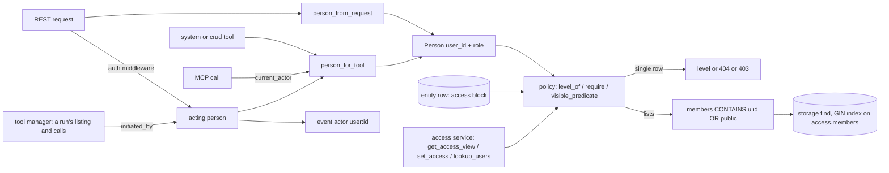

# Access Control

## 1. Purpose

Access control decides which user may read, change, share or delete an entity. Every user-created entity of an owned
kind carries an `access` block on its own row: its owners, the users it is shared with at a level, and whether it is
public. One package, `primer/access/`, turns a caller into a person and decides levels; every REST route, system tool
and MCP call that touches an owned entity goes through it, so the doors cannot disagree.

There are three levels, the same for every owned kind: `read`, `full` and `owner`. Public always means `read` for every
full user. Admins (and the system principal of an auth-disabled install) hold `owner` on everything; a `restricted`
account (the onboarding gate) holds nothing. An agent or graph never brings access of its own: what a run may reach is
decided by the person behind it.

The owned kinds are agents, graphs, toolsets, workspace templates and channels. Workspaces, sessions, collections,
triggers, harnesses and the grantable infrastructure (providers and model profiles) follow the same model in later
phases.

## 2. Visual overview



## 3. Public surface

- `primer/model/access.py`: `AccessLevel` (`read`, `full`, `owner`) and `LEVEL_RANK`; `Access` (`owners`, `grants`,
  `public`, `public_tools`, the derived `members` tokens and the `rev` counter) with `Access.owned_by(user_id)`; the
  `Owned` mixin that adds `access` to a model.
- `primer/access/person.py`: `Person` (`user_id`, `role`, `is_admin`, `is_full_user`); `person_from_request` (an API
  token acts as its owner user), `person_from_ref` (a persisted `PrincipalRef`) and `person_for_tool` (the run's
  initiator when a tool has a `ToolContext`, else the acting person, else the MCP endpoint's `current_actor`).
- `primer/access/acting.py` (a leaf module: it imports nothing from primer at runtime): `acting_as(person)` (a context
  manager over one ContextVar, reset on exit), `acting_person()` and `actor_label(person)` (`user:<id>`, else
  `system`).
- `primer/access/tools.py`: `toolset_use` (which tools of which toolsets a person may use) and `may_use_toolset` (at
  least one tool: who may sign in to an MCP toolset and read its status).
- `primer/access/policy.py`: `level_of`, `require` (no level raises `NotFoundError`, too low a level raises
  `AccessDeniedError`, rendered as 403 with code `access_denied`), `visible_predicate` (the list filter; `None` for
  admins), `readable_ids` (the ids of the rows a person holds a level on, for an inherited kind's `<parent>_id IN`
  filter; `None` for admins) and `tool_is_public`.
- `primer/access/service.py`: `get_access_view`, `set_access` (owners only; the whole desired state; refuses an empty
  owner list, unknown, disabled or restricted users, and per-tool flags on kinds without tools; writes the `access`
  block alone with `patch_if` guarded on `access.rev`) and `lookup_users` (username prefix, id and username only).
- REST: `make_crud_router(..., owned=True)` (`primer/api/routers/_crud.py`), or `row_guard` plus `list_filter` for a
  kind that inherits its parent's access (documents from their collection), and `make_access_router(...)`
  (`primer/api/routers/access.py`): `GET` and `PUT /v1/{plural}/{id}/access`, plus `GET /v1/users/lookup`.
- Tools: `system__get_entity_access`, `system__set_entity_access`, `system__lookup_users`
  (`primer/toolset/_system_access.py`); the generated CRUD tools enforce the same levels.

## 4. How to add a new implementation

To make another entity kind owned:

1. Mix `Owned` into its model (`class Thing(Owned, Identifiable)`).
2. Add `("access_members", False, "USING GIN ((data->'access'->'members'))")` for its table to `_HOT_FIELD_INDEXES` in
   `primer/storage/postgres.py`.
3. Pass `owned=True` to its `make_crud_router` and include `make_access_router(...)` for it BEFORE the CRUD router (the
   route-order rule of `_crud.py`). Every other route that reads the row calls `require(person_from_request(request),
   row.access, <level>, what=...)`.
4. Give its tools the same rules: `_crud_tools_for(..., owned=True)` for generated CRUD tools, `person_for_tool(ctx)`
   plus `require` / `visible_predicate` for hand-written ones, and add the kind to `_KINDS` in
   `primer/toolset/_system_access.py`.
5. Add a forward-only migration that gives existing rows an owner, the way migration 21 does.

## 5. Existing implementations

| Kind | Router | Tools | Notes |
|---|---|---|---|
| Agent | `primer/api/routers/compute.py` | system CRUD, `crud` toolset | seeded agents are public with no owner |
| Graph | `primer/api/routers/compute.py` | system CRUD, `crud` toolset | |
| Toolset | `primer/api/routers/providers.py` | system CRUD, `crud` toolset | the only kind with `public_tools` |
| Workspace template | `primer/api/routers/workspaces.py` | `workspaces` toolset | `local-default` is public with no owner |
| Channel | `primer/api/routers/channels.py` | system CRUD | |
| MCP OAuth sign-in | `primer/api/routers/mcp_oauth.py` | `system__get_toolset_auth_status` | not an owned kind: a browser sign-in is keyed by (toolset, user) and is its person's own; client credentials stay one shared row per toolset (see [mcp-oauth](../subsystems/mcp-oauth.md)) |
| MCP server catalogue | `primer/mcp/dispatch.py` | the exposed built-in tools | only reserved built-in toolsets are exposable (`is_exposable`, `not_system_toolset`), so no owned toolset reaches an MCP client; the built-in tools check the caller's access |
| Event log actor | `primer/storage/{postgres,sqlite}.py`, `primer/events/recorder.py` | every tool that writes | `user:<id>` of the acting person, else `system` |

## 6. Wiring

The auth middleware sets `user_id` on every `Principal` (the user on the cookie path, the token's owner on the bearer
path, `None` for the system principal); `PrincipalRef.from_principal` keeps it on persisted refs. Routers read the
person per request; tools read it from the `ToolContext` or, over MCP, from `primer.mcp.server.current_actor`. The list
filter compiles to `data->'access'->'members' ? $n` on Postgres, served by the GIN index; SQLite installs scan.
Migration 21 (`primer/storage/migrations/m021_entity_ownership.py`) stamps the first admin as owner of rows created
before access control, and makes the seeded agents and template public.

### The acting person

`primer/access/acting.py` holds who the current code acts for. The auth middleware sets it for every authenticated
request, REST, WebSocket and MCP alike: the user, the owner of a bearer token (never the token), and the system person
when auth is disabled; an unauthenticated request sets nothing, and the person is reset when the request ends. The tool
manager runs every listing and every call of a run under `acting_as(person_from_ref(initiated_by))`, so a run whose
task was spawned from another user's request acts for its own person; `dispatch_inner_tool` does the same from its
context (an approved re-run), and the MCP task bridge polls a parked task call as its session's `turn_person`, else
its `initiated_by`. Two things read it: `person_for_tool` with no `ToolContext` (so an MCP OAuth listing sends the
acting person's token) and the event writers. Worker internals, trigger dispatch and the dispatcher act for nobody.

### MCP OAuth per person

A browser (authorization-code) MCP sign-in belongs to one person: its token row is keyed by
`token_key(toolset_id, user_id)` and names both, and a call or listing sends only the token of
`person_for_tool(ctx)`. Nobody to act for (an unattributed run) means no browser token, never another row. A
client-credentials sign-in is one shared row per toolset (the bare toolset id), and so is any sign-in of the system
person. Any full user who may use at least one tool of the toolset (`may_use_toolset`: a level on it, or a public tool)
starts, reads and ends their own browser sign-in; client credentials need FULL to connect or disconnect and use to
read. A toolset the caller may not use answers like a missing one on every route and in the status tool. The callback
writes the starter's row only if that user still exists, is enabled and full, may still use the toolset, and no other
person is signed in on the callback request. Changing the toolset's OAuth settings or deleting it forgets every
person's sign-in; `forget_user_sign_ins(storage_provider, user_id)` removes one person's on every toolset (Phase 6
calls it when a user is removed). The per-user OAuth migration hands each existing browser sign-in to the user who
connected it (`connected_by`), else the first admin; never the toolset's owner, who may never have held that upstream
account. Details: [mcp-oauth](../subsystems/mcp-oauth.md).

### The MCP server catalogue

What an MCP client may list and call is the exposure allowlist AND `is_exposable`, which refuses every tool whose
toolset is not a reserved built-in (`not_system_toolset`; stored toolset rows cannot take a built-in id). So no owned
toolset, and no person's MCP OAuth sign-in, is ever reachable over `/v1/mcp`, whatever the allowlist says; this is
pinned by `tests/mcp/test_safety.py`. The exposed built-in tools run as the MCP caller's person (`current_actor`, and
the acting person the middleware set) and check access like any other door.

### Event attribution

Every CRUD and action event names the person behind it. Both storages' CRUD writers (`_append_crud_event`) and
`EventRecorder.emit(actor=None)` record `actor_label(acting_person())`: `user:<user id>` for a person (a bearer call is
its token's owner), `system` for the system person or when nobody acts. An explicit `actor=` still wins, and
`actor_of(ref)` renders `user:<user_id>` whenever the ref carries a user id, so `mcp.tool_called` names the user. The
acting agent is not part of the label (approvals carry the full identity). The console's Activity view shows a
`user:<id>` actor as the username.

### Run identity

Every run carries a composite identity: the person behind it plus the entity acting. The person is
`ToolContext.initiated_by` (the turn person of a steered turn, a token's owner for an API-token run); the actor is
`ToolContext.actor`, an `ActorRef` (`primer/model/principal.py`, `kind` one of `agent`, `graph`, `user`, `system`, plus
`id`). The actor is the innermost acting entity: the session's agent, a graph agent node's agent, a sub-agent, a ToolCall
node's graph or a child graph. A direct MCP call acts as the user (`system` on an auth-disabled install). The builders
set it on the `ToolExecutionManager` (`actor=`; default: the bound session's agent), which stamps it on every context.
The actor never adds access: every decision is still the person's.

`identity_doc(ref, actor, username=None)` (`primer/access/person.py`) renders it; `gate_identity` reads an API token
owner's username from the `User` row when a gate fires, and `tool_identity(ctx, storage_provider)` reads it the way
`person_for_tool` reads the person. Every gate that builds an approval input passes it as `ApprovalContext.identity`
(the tool manager's gate, `system__call_tool` with and without a context, the MCP endpoint), so the input always has an
`identity` key:

```json
{"user": {"id": "u-7", "name": "bob", "role": "user"}, "actor": {"kind": "agent", "id": "agent-builder"}}
```

## 7. Testing patterns

- `tests/access/`: `Person` derivations and the policy, including a matrix that pins list visibility to `level_of` for
  every row and person (`test_list_and_get_agree_on_every_row_and_person`).
- `tests/api/test_crud_owned.py` and `tests/api/test_access_routes.py`: a minimal app with a test-only middleware that
  turns an `X-Test-User: <id>:<role>` header into `request.state.actor`, on a real SQLite provider.
- `tests/toolset/test_system_access_tools.py`: tool refusals and the MCP path (set and reset `current_actor`).
- `tests/storage/test_access_index.py`: the GIN index and its use by the list query (Postgres lane).
- `tests/storage/test_m021_entity_ownership.py`: the migration rules and the public seeded rows.
- `tests/access/test_acting_person.py` and `tests/events/test_event_attribution.py`: the acting person (middleware,
  bearer owner, auth disabled, reset after the request, `person_for_tool` order) and the event actor (REST, bearer, a
  run's tool write, a run overriding an inherited request person, MCP, worker internals, an explicit actor); the
  Postgres twin is `tests/storage/test_crud_event_actor_live.py`.
- `tests/toolset/oauth/test_per_user_tokens.py`, `tests/api/test_mcp_oauth_per_user_routes.py` and
  `tests/storage/test_m027_mcp_oauth_per_user.py`: MCP OAuth per person, its routes and its migration;
  `tests/e2e/test_access_p5_journey.py` drives the whole flow against the mock OAuth MCP server.

## 8. Historical decisions

- Access lives on the row rather than in a side table: one write changes it atomically, the CRUD event carries it, and
  the list filter is a single indexed predicate with no join.
- `public_tools` alone does not make a toolset listable: listing and reading must agree, and single public tools are
  reached through the tool catalogue, not the toolset row.
- The sessions-are-a-shared-read decision (G7-02) is reversed by this model; sessions follow their workspace once
  workspaces are owned.
