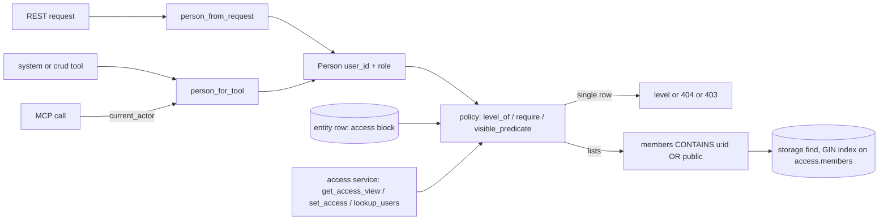

# Access Control

## 1. Purpose

Access control decides which user may read, change, share or delete an entity. Every user-created entity of an owned
kind carries an `access` block on its own row: its owners, the users it is shared with at a level, and whether it is
public. One package, `primer/access/`, turns a caller into a person and decides levels; every REST route, system tool
and MCP call that touches an owned entity goes through it, so the doors cannot disagree.

There are three levels, the same for every owned kind: `read`, `full` and `owner`. Public always means `read` for every
full user. Admins (and the system principal of an auth-disabled install) hold `owner` on everything; a `restricted`
account (the onboarding gate) holds nothing. An agent or graph never brings access of its own: what a run may reach is
decided by the person behind it.

The owned kinds are agents, graphs, toolsets, workspace templates, channels, collections, triggers and harnesses.
Three kinds have no access of their own and inherit a parent's: a document inherits its collection's and a trigger
subscription its trigger's (both by CHECKING the parent on every door), and an agent, graph, toolset or collection a
harness installed carries a COPY of the harness's access, rewritten whenever the harness is shared (6.12). The grantable
infrastructure (providers and model profiles) follows the same model in a later phase.

## 2. Visual overview

## 3. Public surface

- `primer/model/access.py`: `AccessLevel` (`read`, `full`, `owner`) and `LEVEL_RANK`; `Access` (`owners`, `grants`,
  `public`, `public_tools`, the derived `members` tokens and the `rev` counter) with `Access.owned_by(user_id)`; the
  `Owned` mixin that adds `access` to a model.
- `primer/access/person.py`: `Person` (`user_id`, `role`, `is_admin`, `is_full_user`); `person_from_request` (an API
  token acts as its owner user), `person_from_ref` (a persisted `PrincipalRef`) and `person_for_tool` (the run's
  initiator when a tool has a `ToolContext`, else the MCP endpoint's `current_actor`).
- `primer/access/policy.py`: `level_of`, `require` (no level raises `NotFoundError`, too low a level raises
  `AccessDeniedError`, rendered as 403 with code `access_denied`), `visible_predicate` (the list filter; `None` for
  admins), `readable_ids` (the ids of the rows a person holds a level on, for an inherited kind's `<parent>_id IN`
  filter; `None` for admins) and `tool_is_public`.
- `primer/access/service.py`: `get_access_view`, `set_access` (owners only; the whole desired state; refuses an empty
  owner list, unknown, disabled or restricted users, per-tool flags on kinds without tools, and a row a harness
  installed with 409 `harness_managed`; writes the `access` block alone with `patch_if` guarded on `access.rev`, then
  runs an optional `after_write` hook), `lookup_users` (username prefix, id and username only), and the two writers
  that keep the sharing out of a whole-row write: `update_keeping_access` (every other field, fenced on the rev the
  caller read: a sharing change in between answers 409) and `rewrite_keeping_access` (every other field, fenced on the
  rev read fresh and retried, for long operations such as a harness sync whose snapshot may be stale).
- Field-scoped platform writers: `primer/knowledge/row_writes.py` `write_collection_fields` and
  `primer/trigger/row_writes.py` `write_trigger_fields` (one `patch_if` of the named fields only).
- Inherited kinds: `primer/toolset/_collection_access.py` (`collection_for`: the tool twin of the REST
  `_require_collection`; `readable_documents`: the document-list filter), the trigger service gate
  `primer/trigger/service.py` `_require_trigger` (every function that takes `person`), `primer/harness/access.py`
  `apply_harness_access` (the fan-out of a harness's access to what it installed) and
  `primer/trigger/channel_access.py` `require_channel_trigger_access` (a channel trigger needs read on its channel).
- REST: `make_crud_router(..., owned=True)` (`primer/api/routers/_crud.py`), or `row_guard` plus `list_filter` for a
  kind that inherits its parent's access (documents from their collection), and `make_access_router(...)`
  (`primer/api/routers/access.py`): `GET` and `PUT /v1/{plural}/{id}/access`, plus `GET /v1/users/lookup`.
- Tools: `system__get_entity_access`, `system__set_entity_access`, `system__lookup_users`
  (`primer/toolset/_system_access.py`); the generated CRUD tools enforce the same levels.

## 4. How to add a new implementation

To make another entity kind owned:

1. Mix `Owned` into its model (`class Thing(Owned, Identifiable)`).
2. Add `("access_members", False, "USING GIN ((data->'access'->'members'))")` for its table to `_HOT_FIELD_INDEXES` in
   `primer/storage/postgres.py`.
3. Pass `owned=True` to its `make_crud_router` and include `make_access_router(...)` for it BEFORE the CRUD router (the
   route-order rule of `_crud.py`). Every other route that reads the row calls `require(person_from_request(request),
   row.access, <level>, what=...)`.
4. Give its tools the same rules: `_crud_tools_for(..., owned=True)` for generated CRUD tools, `person_for_tool(ctx)`
   plus `require` / `visible_predicate` for hand-written ones, and add the kind to `_KINDS` in
   `primer/toolset/_system_access.py`.
5. Add a forward-only migration that gives existing rows an owner, the way migration 21 does.

A kind that inherits instead checks its parent on every door (documents: `row_guard` / `list_filter` and
`collection_for`; subscriptions: the `person` argument of every trigger service function) or carries a copy that the
parent's `set_access` rewrites (harness contents: `after_write=apply_harness_access`). Never widen a child beyond its
parent.

## 5. Existing implementations

| Kind | Router | Tools | Notes |
|---|---|---|---|
| Agent | `primer/api/routers/compute.py` | system CRUD, `crud` toolset | seeded agents are public with no owner |
| Graph | `primer/api/routers/compute.py` | system CRUD, `crud` toolset | |
| Toolset | `primer/api/routers/providers.py` | system CRUD, `crud` toolset | the only kind with `public_tools` |
| Workspace template | `primer/api/routers/workspaces.py` | `workspaces` toolset | `local-default` is public with no owner |
| Channel | `primer/api/routers/channels.py` | system CRUD | |
| Collection | `primer/api/routers/knowledge.py` | `collections` toolset, system CRUD and collection extras, the wiki tools | `system` is public and write-protected; `_internal_*` are admin-only; the search block changes only through `/search` (6.8, 6.9) |
| Document (inherited) | `knowledge.py` (`/collections/{id}/...` and the flat `/v1/documents`) | `collections` toolset, system document tools, generic `get_document` / `find_documents` | inherits its collection by check (6.8) |
| Trigger | `primer/api/routers/triggers.py` | `trigger` toolset (re-exported by `crud`), system channel-binding tools | run-as unchanged; the gate is `_require_trigger` (6.10) |
| Subscription (inherited) | `triggers.py` (`/triggers/{id}/subscriptions...`) | `trigger` toolset, `create/list/delete_channel_binding`, `subscribe_to_trigger`, `subscribe_to_channel_event` | inherits its trigger by check (6.10) |
| Harness | `primer/api/routers/harness.py` | `harness` toolset | writes stay admin-only; list, get and bundle need read (6.12) |
| Harness-installed rows (inherited) | the owning kinds' routers | the owning kinds' tools | carry a copy of the harness's access; direct sharing answers 409 `harness_managed` (6.12) |

## 6. Wiring

The auth middleware sets `user_id` on every `Principal` (the user on the cookie path, the token's owner on the bearer
path, `None` for the system principal); `PrincipalRef.from_principal` keeps it on persisted refs. Routers read the
person per request; tools read it from the `ToolContext` or, over MCP, from `primer.mcp.server.current_actor`. The list
filter compiles to `data->'access'->'members' ? $n` on Postgres, served by the GIN index; SQLite installs scan.
Migration 21 (`primer/storage/migrations/m021_entity_ownership.py`) stamps the first admin as owner of rows created
before access control, and makes the seeded agents and template public.

The subsections below describe Phase 3 (collections, triggers, channel triggers and harnesses). They are numbered
from 6.8 so they follow the Phase 2 subsections (workspaces and what inherits from them, the turn person, events, the
per-user default workspace) of the same section.

### 6.8 Collections and what documents inherit

A collection is owned; a document has no access of its own and is checked against its collection on every door (by
check, not by copy). The REST helper is `_require_collection` (`primer/api/routers/knowledge.py`), the tool helper
`collection_for` (`primer/toolset/_collection_access.py`); both answer a collection the person cannot read exactly like
a missing one (REST 404 with the missing-row text, tool `type=not-found`), too low a level with REST 403
`access_denied` / tool `type=forbidden`, and refuse any write to a `system` collection whoever asks.

| Level | REST | Tools |
|---|---|---|
| read | `GET /collections/{id}`, the list and find (filtered in storage), `/access`, `/docs` (read and tree), `/grep`, `/documents` (list and read), `POST /search`, `GET /search` (status), `/indexed_documents`; the flat `/v1/documents` list and find (`collection_id IN` the readable collections, from `readable_ids`) and get | `collections_list` (filtered), `collection_tree`, `read_document`, `search`; system `list/get/find_collections`, `list_collection_documents`, `find_collection_documents_by_meta`, `search_collection`, `get_document_content`, `list_documents`, the generic `get_document` and `find_documents` (same filter), `get_entity_access`; `wiki_read` and `wiki_search` act as the caller on `system` |
| full | `PUT /collections/{id}` (keeps the stored access and the stored search block), `POST/PATCH/DELETE /docs`, `/docs/move`, `PUT/DELETE /documents`, `/documents/move`, `POST /import`; the flat `/v1/documents` create (full on its collection), update and delete (a move into another collection needs full there too) | `create/update/move/delete_document` (collections toolset), system `update_collection`, `put_document`, `move_document`, `create/update/delete_document` |
| owner | `DELETE /collections/{id}`, `PUT /{id}/access`, `PUT` and `DELETE /{id}/search` | system `delete_collection`, `set_entity_access`, `refresh_collection` (re-indexing is search management) |

The search block is owner-only: a whole-row update (`PUT /collections/{id}`, `update_collection`) whose search
configuration differs from the stored one is refused for everyone, owner included (403
`collection_search_protected`, tool `type=forbidden`), and points to `PUT` / `DELETE /collections/{id}/search`, which
validate the providers and backfill or drop the index. A body that sends the stored configuration back passes, and the
stored block (with its lifecycle `state` and `error`) is what is written (`check_collection_search_unchanged` in
`primer/knowledge/checks.py`, called from both update hooks).

### 6.9 Special collections

- `system` (the platform wiki) is created `Access(public=True)` and every regeneration turns `public` back on (a
  rev-guarded patch that keeps any other sharing), so every full user reads it and the wiki tools work for everyone.
  Its `system` flag keeps it read-only: every write is refused, an admin's included.
- `_internal_*` collections carry `Access()`: no owners, not public, so only admins reach them.
- The `this-install/` live map lists only public entities: a private agent, graph, collection or workspace has no page
  and no index entry, and a page whose entity goes private is dropped (by `converge_entity` and by the boot prune).
  Provider pages are still listed: providers have no `access` yet.

### 6.10 Triggers and subscriptions

A trigger is owned; a subscription has no access of its own and is checked against its trigger. Every function of
`primer/trigger/service.py` that takes `person` enforces the level through `_require_trigger`; `person=None` is an
internal (platform) call that is not gated, so every REST route and tool must pass the caller:
`tests/trigger/test_service_calls_name_the_person.py` parses `primer/api` and `primer/toolset` and fails on a call
that omits `person=`.

| Level | What it allows |
|---|---|
| read | get, list (filtered in storage), `/access`, the subscription list and get, `list_channel_bindings`, parking on the trigger (`subscribe_to_trigger`, `subscribe_to_channel_event`) |
| full | `PUT` (update), `fire_now`, subscription create, update and delete, `create_channel_binding`, `delete_channel_binding` |
| owner | `DELETE`, `rotate_token`, `PUT /access` |

No level answers `trigger_not_found` (REST 404, as an unknown id); too low a level REST 403 `access_denied`, tool
`type=forbidden`. These levels replace the rank rules of tickets 01a16e65-12d1 and 01a16ee4 (`refuse_fire_now`,
`refuse_trigger_change`) and the webhook manage rule on update and rotate.

Who a fire runs as is unchanged: the trigger's `owner` (its last saver) and each subscription's `owner`, ranked by
the lower of their current roles (`principal_for_fire`, `primer/trigger/owner.py`). A full grantee who saves becomes the
run-as owner and acts as themselves; a save that changes the run-as owner of a webhook trigger mints a new token.
`view_for` still masks the webhook token and reduces the owner to `display` and `role` for anyone but the run-as owner
or an admin. A subscription with no owner is refused at fire time (`refuse_fire_out_of_reach`, error code
`target_out_of_reach`; fail closed: the migration gave every legacy row an owner and disabled it until that owner
re-enables it), and an admin or system owner passes that check without a workspace lookup.

### 6.11 Channel triggers

A channel trigger's events are channel content, so whoever saves one, or binds a subscription onto one, needs read on
the channel it fires from (`require_channel_trigger_access`): the REST create and update, the trigger tools and
`create_channel_binding`. A channel the person cannot read answers like a missing one; a provider-wide trigger
(`channel_id` null, listening to every channel of the provider) is admin-only (403 `access_denied`). The check at save
time is the gate: `primer/channel/event_dispatch.py` does not check access when it dispatches an event.

### 6.12 Harnesses

A harness is owned. What it installs (agents, graphs, toolsets, collections; documents follow their collection) carries
a COPY of the harness's access: an install or sync creates a row with `access = harness.access`, and a sync updates the
other fields with `rewrite_keeping_access`, never the access. Sharing the harness (`PUT /v1/harnesses/{id}/access`,
`set_entity_access` kind `harness`) runs `apply_harness_access` after the write: one field-scoped patch of `access` per
installed row, ordered by `access.rev` (a row already at a higher rev is left alone, and each write is fenced on the rev
it read, so two racing fan-outs cannot resurrect a revoked grant) and only while the row still belongs to the harness.
Sharing an installed row directly answers 409 `harness_managed`. Harness writes (create, update, install, sync, build,
push, uninstall) stay admin-only in this phase; list, get and the bundle need read, and list filters in storage. The
outbound export strips `access` from the templates it writes.

### 6.13 Whole-row writers

Every writer that changes some fields of an owned row writes those fields only, or writes every field but `access`, so
an owner's sharing change made in between is never undone:

| Writer | How |
|---|---|
| Owned CRUD `PUT` and the generated update tools; trigger update and rotate | `update_keeping_access` (409 on a sharing change in between) |
| Harness syncs, the harness routes and tools that rewrite the row | `rewrite_keeping_access` (fenced on a fresh rev, retried) |
| The search lifecycle (`_write_search`), internal-collection materialisation, the system wiki's title | `write_collection_fields` |
| The system wiki's `public` | a rev-guarded `patch_if` of `access` |
| A fire's bookkeeping (`last_fired_*`), the trigger claim release (`enabled`, `next_fire_at`) | `write_trigger_fields` |

### 6.14 Phase 3 migrations

- `m023_collection_ownership`: an unset collection is owned by the first enabled admin, `system` becomes public,
  `_internal_*` stays unset (admin-only).
- `m024_trigger_ownership`: an unset trigger is owned by the user behind its run-as owner (a token resolves to its user),
  else the first enabled admin. An ownerless subscription gets its trigger's run-as owner (the first admin when the
  trigger has none) so that owner can see it, and is DISABLED: nobody recorded who saved it, and any adopted identity
  would give a possibly planted row the owner's role and reach (their private workspaces and sessions). The trigger's
  owner re-enables it with an ordinary update, which needs full and makes the re-enabler its owner.
- `m025_harness_ownership`: an unset harness is owned by the first enabled admin; every installed row takes a copy of
  its harness's access.

## 7. Testing patterns

- `tests/access/`: `Person` derivations and the policy, including a matrix that pins list visibility to `level_of` for
  every row and person (`test_list_and_get_agree_on_every_row_and_person`).
- `tests/api/test_crud_owned.py` and `tests/api/test_access_routes.py`: a minimal app with a test-only middleware that
  turns an `X-Test-User: <id>:<role>` header into `request.state.actor`, on a real SQLite provider.
- `tests/toolset/test_system_access_tools.py`: tool refusals and the MCP path (set and reset `current_actor`).
- `tests/storage/test_access_index.py`: the GIN index and its use by the list query (Postgres lane).
- `tests/storage/test_m021_entity_ownership.py`: the migration rules and the public seeded rows.
- Phase 3: `tests/api/test_collection_access.py` (every collection and document door by level),
  `tests/toolset/test_collection_tools_access.py`, `tests/knowledge/test_collection_access_special.py` (special
  collections, the live map, revokes racing the platform writers), `tests/trigger/test_trigger_access.py`,
  `tests/toolset/test_trigger_tools_access.py` (including the channel-binding tools),
  `tests/trigger/test_service_calls_name_the_person.py` (the static guard), `tests/trigger/test_channel_trigger_access.py`,
  `tests/harness/test_harness_access.py`, and `tests/storage/test_m023_collection_ownership.py`,
  `test_m024_trigger_ownership.py`, `test_m025_harness_ownership.py`. The two-user journey is
  `tests/e2e/test_access_p3_journey.py`.

## 8. Historical decisions

- Access lives on the row rather than in a side table: one write changes it atomically, the CRUD event carries it, and
  the list filter is a single indexed predicate with no join.
- `public_tools` alone does not make a toolset listable: listing and reading must agree, and single public tools are
  reached through the tool catalogue, not the toolset row.
- The sessions-are-a-shared-read decision (G7-02) is reversed by this model; sessions follow their workspace once
  workspaces are owned.
- Inheritance is by check where the parent is always at hand (documents, subscriptions) and by copy where the child is
  an independent owned row that other code lists and reads on its own (harness contents): a copy keeps every list a
  single indexed predicate. Either way a child is never wider than its parent.
- The trigger rank rules were replaced by the access levels: a rank says who may drive whose automation, a level says
  who was given what, and the owner of a trigger now decides who may fire or edit it.
