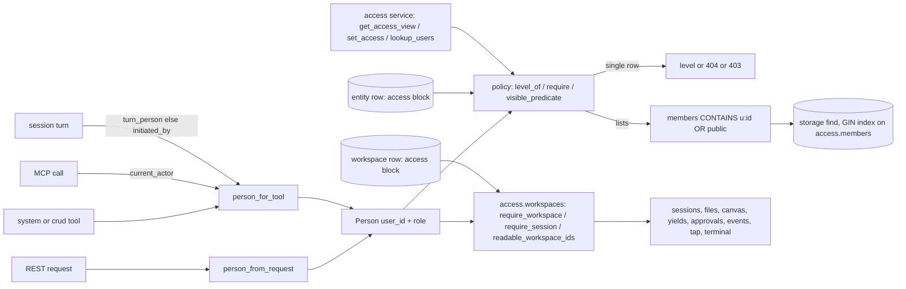

# Access Control

## 1. Purpose

Access control decides which user may read, change, share or delete an entity. Every user-created entity of an owned
kind carries an `access` block on its own row: its owners, the users it is shared with at a level, and whether it is
public. One package, `primer/access/`, turns a caller into a person and decides levels; every REST route, system tool
and MCP call that touches an owned entity goes through it, so the doors cannot disagree.

There are three levels, the same for every owned kind: `read`, `full` and `owner`. Public always means `read` for every
full user. Admins (and the system principal of an auth-disabled install) hold `owner` on everything; a `restricted`
account (the onboarding gate) holds nothing. An agent or graph never brings access of its own: what a run may reach is
decided by the person behind it.

The owned kinds are agents, graphs, toolsets, workspace templates, channels and workspaces. Everything that lives in a
workspace has no access of its own and inherits the workspace's: sessions and their transcripts, files, the state log,
the tap, workspace events, the canvas, yields and approvals, external tool calls, the terminal and graph-run logs. Each
turn of a session runs as the person whose input started it, and every full user has a private default workspace.
Collections, triggers, harnesses and the grantable infrastructure (providers and model profiles) follow the same model
in later phases.

## 2. Visual overview

## 3. Public surface

- `primer/model/access.py`: `AccessLevel` (`read`, `full`, `owner`) and `LEVEL_RANK`; `Access` (`owners`, `grants`,
  `public`, `public_tools`, the derived `members` tokens and the `rev` counter) with `Access.owned_by(user_id)`; the
  `Owned` mixin that adds `access` to a model.
- `primer/access/person.py`: `Person` (`user_id`, `role`, `is_admin`, `is_full_user`); `person_from_request` (an API
  token acts as its owner user), `person_from_ref` (a persisted `PrincipalRef`) and `person_for_tool` (the run's
  principal when a tool has a `ToolContext`, which is the turn's person, else the MCP endpoint's `current_actor`).
- `primer/access/policy.py`: `level_of`, `require` (no level raises `NotFoundError`, too low a level raises
  `AccessDeniedError`, rendered as 403 with code `access_denied`), `visible_predicate` (the list filter; `None` for
  admins) and `tool_is_public`.
- `primer/access/service.py`: `get_access_view`, `set_access` (owners only; the whole desired state; refuses an empty
  owner list, unknown, disabled or restricted users, and per-tool flags on kinds without tools; writes the `access`
  block alone with `patch_if` guarded on `access.rev`), `update_keeping_access` (an edit writes every field but
  `access`, fenced on `access.rev`) and `lookup_users` (username prefix, id and username only).
- `primer/access/workspaces.py`: `workspace_level(sp, person, workspace_id)` (`None` for a missing row or no level),
  `require_workspace(sp, person, workspace_id, need)` (returns the row), `require_session(sp, person, session_id, need)`
  (the session's level is its workspace's; a stranger, and a session whose workspace row is gone, answer the session's
  own missing-row text; admins pass even for a lost workspace) and `readable_workspace_ids(sp, person, need=READ)`
  (`None` for admins, otherwise the ids a list query filters on).
- The turn person: `WorkspaceSession.turn_person`, `primer.model.principal.person_ref` (a ref that names a person, or
  `None`), `BY_ATTRIBUTION_KEY` on a queued message, the `by` argument of `wake_session`, `deliver_steer`,
  `store_pending_steer`, `restart_session`, `resume_session` and `deliver_canvas_event`, and
  `primer.worker.executor_builders.session_run_principal` / `resolve_run_principal`, and the build-time re-check
  `refuse_run_without_workspace_access` with its refusal `primer.authz.WorkspaceAccessRevoked`.
- The default workspace: `User.default_workspace_id`; `primer/bootstrap/prime.py` `ensure_user_default_workspace`,
  `user_default_workspace_id` (`ws-<user id>`), `is_user_default_workspace` and `resolve_default_workspace_id(sp,
  person=None)`; `primer/api/user_default.py` `ensure_default_for_request`; `default_workspace_id` on `GET
  /v1/auth/status`.
- REST: `make_crud_router(..., owned=True)` (`primer/api/routers/_crud.py`) and `make_access_router(...)`
  (`primer/api/routers/access.py`): `GET` and `PUT /v1/{plural}/{id}/access` (workspaces included), plus `GET
  /v1/users/lookup`.
- Tools: `system__get_entity_access`, `system__set_entity_access`, `system__lookup_users`
  (`primer/toolset/_system_access.py`; the kinds are agent, graph, toolset, workspace template, channel and workspace); the
  generated CRUD tools enforce the same levels; the `workspaces` toolset asks `require_workspace` per tool.
- Console: `SHR_ShareDialog` (`ui/components/shared/share-dialog.jsx`) for every owned kind, workspaces included.

## 4. How to add a new implementation

To make another entity kind owned:

1. Mix `Owned` into its model (`class Thing(Owned, Identifiable)`).
2. Add `("access_members", False, "USING GIN ((data->'access'->'members'))")` for its table to `_HOT_FIELD_INDEXES` in
   `primer/storage/postgres.py`.
3. Pass `owned=True` to its `make_crud_router` and include `make_access_router(...)` for it BEFORE the CRUD router (the
   route-order rule of `_crud.py`). Every other route that reads the row calls `require(person_from_request(request),
   row.access, <level>, what=...)`.
4. Give its tools the same rules: `_crud_tools_for(..., owned=True)` for generated CRUD tools, `person_for_tool(ctx)`
   plus `require` / `visible_predicate` for hand-written ones, and add the kind to `_KINDS` in
   `primer/toolset/_system_access.py`.
5. Add a forward-only migration that gives existing rows an owner, the way migrations 21 and 22 do.

To add a route or tool that acts on something inside a workspace, give it no access of its own: call
`require_session(sp, person, session_id, level)` or `require_workspace(sp, person, workspace_id, level)` before
anything is read, written or announced (read for a view, full for an act, owner for delete and sharing), and never admit
the session's creator on their own say-so. A cross-workspace list ANDs `where_in("workspace_id", ids)` with
`ids = readable_workspace_ids(...)` into its storage query (`None` means no filter; an empty list answers an empty page
built by hand, since `IN ()` is not SQL). A tool answers a stranger `not-found` in the words of a missing id and a low
level `forbidden`.

## 5. Existing implementations

| Kind | Router | Tools | Notes |
|---|---|---|---|
| Agent | `primer/api/routers/compute.py` | system CRUD, `crud` toolset | seeded agents are public with no owner; a run's person needs read, re-checked every turn |
| Graph | `primer/api/routers/compute.py` | system CRUD, `crud` toolset | as agents |
| Toolset | `primer/api/routers/providers.py` | system CRUD, `crud` toolset | the only kind with `public_tools` |
| Workspace template | `primer/api/routers/workspaces.py` | `workspaces` toolset | `local-default` is public with no owner; creating a workspace from it needs read |
| Channel | `primer/api/routers/channels.py` | system CRUD | |
| Workspace | `primer/api/routers/workspaces.py`, `tap.py`, `terminal.py` | `workspaces` toolset, the system reply-binding tools, `reset_prime_instructions`, the sharing tools (`kind` `workspace`) | no `public_tools` |
| Inherited from a workspace | `sessions.py`, `workspaces.py`, `canvas.py`, `yields.py`, `tool_approval.py`, `external_tools.py`, `compute.py` (graph-run logs), `events.py` | `workspaces` toolset (session, file and log tools), `message_session`, `wait_for_event`, trigger subscription targets (`primer/trigger/reach.py`) | the table in section 6.2 |

## 6. Wiring

### 6.1 Owned rows

The auth middleware sets `user_id` on every `Principal` (the user on the cookie path, the token's owner on the bearer
path, `None` for the system principal); `PrincipalRef.from_principal` keeps it on persisted refs. Routers read the
person per request; tools read it from the `ToolContext` or, over MCP, from `primer.mcp.server.current_actor`. The list
filter compiles to `data->'access'->'members' ? $n` on Postgres, served by the GIN index; SQLite installs scan. A
workspace create (REST and the `create_workspace` tool, through `WorkspaceRegistry.create`) stamps
`Access.owned_by(<creator>)`; an id-less admin or system caller writes an unowned row. Access in a create or update body
is ignored.

### 6.2 Workspaces and what inherits from them

A stranger to the workspace gets the missing-row answer of what they asked for (404; a session route answers in the
session's words), a person below the needed level gets 403 `access_denied`, and admins pass every gate. There is no
own-session admission: a creator whose grant is revoked loses their sessions with it.

| Kind | read | full | owner |
|---|---|---|---|
| Workspace | get, list (filtered), state log and commits, the tap, `GET .../events`, `GET /v1/events?workspace_id=` | rename, events toggle, reply binding, diagnostic exec, attach and detach, the caller's main session | delete, sharing (`/access`), the `terminal_user_access` toggle |
| Files | tree, list, info, read, download | write, mkdir, move, delete | |
| Sessions | get (both paths), the workspace's session list, turn log, messages, timeline | create, steer, restart, resume, pause, cancel, interrupt, delete, rename, compact, rewind, binding switch, response format, dismiss a queued message | |
| Canvas | get | operator ops, clear, click events | |
| Yields and `ask_user` | pending | respond, cancel (the approver spec still applies on top) | |
| Tool approvals | a session's pending | respond (the approver spec still applies on top); policies stay admin | |
| External tool calls | a session's pending | results go through steer (full) | |
| Graph runs | node states and turn log (read on the run session's workspace and on the graph) | | |
| Terminal (`WS .../terminal`) | | connect, plus `terminal_user_access` for a non-admin (close 4404 for a stranger, 4403 below full) | |

The tools take the same levels: the `workspaces` toolset guards each tool with `require_workspace` for the turn's person
(`_access_guard`), `list_workspaces` lists the readable workspaces and `find_sessions` filters on
`readable_workspace_ids`; `message_session` and the steer and restart tools called from a session need full on the
target's workspace (`primer/session/peer_messages.py`); the reply-binding tools need full; `reset_prime_instructions`
needs full on the default workspace; a trigger subscription's owner needs full on its target workspace, checked on save
and again on every fire (`target_out_of_reach`). A run in prime no longer reaches every workspace: wherever a run lives,
it reaches what its person can.

### 6.3 The turn person

A session carries identity per turn (spec 13 Q1). `WorkspaceSession.turn_person` is written by the wake that arms a turn,
in the same `patch_if` (`_write_the_wake` in `primer/session/enqueue.py`), and by `resume_session` when the row has never
run a turn. A turn runs as `turn_person`, else `initiated_by`, else the unattributed stand-in (`session_run_principal`),
re-ranked by the person's current role and refused when the account is deleted or disabled (`resolve_run_principal`).
That principal becomes the tools' `ctx.initiated_by`, so `person_for_tool` and every check above see the turn's person;
the bound agent or graph is re-read every turn and needs read for that person, and the person must still hold full on the
session's workspace (`refuse_run_without_workspace_access` in `primer/worker/executor_builders.py`, asked when the worker
builds a turn or a resume; admins pass, and a pool without storage or a workspace row that is gone asks nothing). A revoked
grant therefore stops the next turn and every resume, however it was queued or parked: the build raises
`WorkspaceAccessRevoked` (a `RunRefused`), the transcript gets an ERROR record with the fixed words of
`WORKSPACE_ACCESS_REVOKED_MESSAGE` and `last_turn_error.code` `workspace_access_revoked`, and the session ends failed.

| Input | The turn runs as |
|---|---|
| REST steer, restart, resume | the request's actor |
| Canvas click that wakes the agent | the clicker |
| A message queued behind an open turn (a REST steer, `deliver_steer`, a canvas click, a wake that defers) | its sender, kept as `attribution["by"]` and passed on when the drain realizes it |
| `message_session`, steer and restart tools from a session | the sending run's person |
| Trigger `session_append` fire | the fire's owner (`principal_for_fire`); a fire with no person leaves the session's person |
| Channel-thread reply | the session's creator (`initiated_by`): channel senders are not primer users |
| Approval or `ask_user` answer, any park resume | unchanged: the parked turn keeps its person (`by=None`) |

Why: a full-access peer who steers someone else's session must never borrow the creator's private toolsets, collections
or OAuth tokens. The trigger fire rank floor (`refuse_steer_above_fire`, `may_drive`) is the one rank rule left on a
session; the steer, approval and canvas routes no longer rank the caller against the creator.

### 6.4 Events and waits

`GET /v1/events` from a non-admin must name a `workspace_id` the caller can read (`require_workspace`, 404 otherwise),
and returns only the user-safe kinds with canvas input removed; `session.wake` is never user-safe (`UNSAFE_TYPES` in
`primer/events/visibility.py`). A non-admin `wait_for_event` is pinned to a workspace: an `eq` matcher on `workspace_id`
must name one the turn's person can read (`forbidden` otherwise, in the same words for a missing workspace), and a wait
without one is pinned to the run's own workspace (a run with no workspace is refused). Workspace-less events, the wake
envelope among them, never match a pinned subscription. At delivery the event dispatcher re-judges the parked session's
run principal on the event's workspace with one `workspace_level` call (`_read_blocked`): a revoked grant consumes the
event without waking the park, and a storage error holds the cursor and retries. Admins read and wait on everything.
The `events.workspace_id` btree index and the `sessions.workspace_id` expression index serve these filters.

### 6.5 The per-user default workspace

Every full user (role `user` or `admin`, not disabled) has a private default workspace, recorded on
`User.default_workspace_id`. `ensure_user_default_workspace` creates it the first time they sign in as a full user:
`POST /v1/auth/login`, the SSO callback, and `GET /v1/auth/status` for an existing cookie (a user promoted since their
last sign-in), all through `ensure_default_for_request`, which never fails a sign-in and makes the status probe wait 60 s
after a failure. The workspace is `ws-<user id>`, materialised from the configured default template (else
`local-default`), owned by the user and private, with the user's own operator `main` session; the work is idempotent
under a per-user lock, and a lost create race reads as success. The first admin with no default adopts the install-wide
default (`prime`, or the legacy `primer`) instead, when it has no owner and is not public (`patch_if` on `access.rev`
0 to 1). A restricted user gets none until promoted.

`resolve_default_workspace_id(sp, person)` answers the person's own default (an id-less person gets the install-wide
one), so `is_default` on REST rows and tool rows is per caller; the console picks its default workspace by that flag
(`NV_defaultWid`), and `GET /v1/auth/status` also carries `default_workspace_id`. `WorkspaceRegistry.delete` refuses the install default and every workspace a user records as their
default (`ReservedWorkspaceError`). A default workspace can be shared or made public like any other. Deleting a user
leaves their default workspace in place, reachable only by admins.

### 6.6 Migrations

- Migration 21 (`m021_entity_ownership.py`) stamps the first admin as owner of agents, graphs, toolsets, templates and
  channels created before access control, and makes the seeded agents and template public.
- Migration 22 (`m022_workspace_ownership.py`) gives every workspace with no owners, grants or `public` the first admin
  as sole owner, private, the prime or legacy default included; with no admin the rows stay as they are.
- Migration 23 (`m023_admin_default_workspace.py`) records the install-wide default workspace as the first admin's
  `default_workspace_id`, unless that admin already has one or another user owns or records it.

### 6.7 Not yet scoped

The cross-workspace lists (`GET /v1/sessions`, `POST /v1/sessions/find`, `GET /v1/sessions/recent`, `GET
/v1/yields/pending`, `GET /v1/external_tool_calls`, `GET /v1/tool_approval/records`) are scoped: for a non-admin,
`scope_to_readable_workspaces` (`primer/access/workspaces.py`) ANDs `workspace_id IN <readable workspaces>` into the query,
so pages, totals and the recent window count only what the caller reads; external tool calls and approval records carry
`workspace_id` (migration 24 backfills it from their session; a row whose session was gone stays `None`, visible to admins
only). A live tap or terminal connection is checked when it opens,
not again after a revoke (a Phase 6 ticket). A turn already running when a grant is revoked runs to its end, its
in-session file tools included; the next turn or resume is refused (6.3).

## 7. Testing patterns

- `tests/access/`: `Person` derivations and the policy, including a matrix that pins list visibility to `level_of` for
  every row and person (`test_list_and_get_agree_on_every_row_and_person`); `test_workspace_access.py` for the workspace
  levels, `require_session` and `readable_workspace_ids`.
- `tests/api/test_crud_owned.py` and `tests/api/test_access_routes.py`: a minimal app with a test-only middleware that
  turns an `X-Test-User: <id>:<role>` header into `request.state.actor`, on a real SQLite provider. The workspace and
  session routes use the same harness: `test_workspace_access_routes.py`, `test_session_access_routes.py` (including
  `test_creator_loses_access_with_the_grant`) and `test_user_default_workspace_routes.py`.
- `tests/session/test_turn_person.py`: who each turn runs as (`test_steered_turn_runs_as_the_peer`, queued steers,
  resumes, channel input); `tests/api/test_queued_steer_keeps_its_sender.py` for a REST steer queued behind an open turn;
  `tests/worker/test_turn_needs_workspace_access.py` for the build-time re-check after a revoke.
- `tests/toolset/test_system_access_tools.py` and `tests/toolset/test_workspace_tools_access.py`: tool refusals and the
  MCP path (set and reset `current_actor`), including `test_default_workspace_no_longer_reaches_everything`.
- `tests/events/test_event_access.py`: the event feed and `test_wait_for_event_is_scoped_to_readable_workspaces`.
- `tests/bootstrap/test_user_default_workspace.py`: the default workspace lifecycle and migration 23.
- `tests/storage/test_access_index.py`, `tests/storage/test_m021_entity_ownership.py` and
  `tests/storage/test_m022_workspace_ownership.py`: the GIN index (Postgres lane) and the migration rules.
- `tests/ui/test_share_dialog.py` and `tests/ui/test_workspace_sharing_ui.py`: the share dialog, the rail's Mine /
  Shared with me / Public groups and the read-only affordances; `tests/ui/test_decide_ui_controls.py`: the decide
  controls follow the workspace level (`SH_mayDecideFor`, `SH_workspaceLevel`).
- `tests/e2e/test_access_p1_journey.py` and `tests/e2e/test_access_p2_journey.py`: two-user journeys over the live API
  (CI only).

## 8. Historical decisions

- Access lives on the row rather than in a side table: one write changes it atomically, the CRUD event carries it, and
  the list filter is a single indexed predicate with no join.
- `public_tools` alone does not make a toolset listable: listing and reading must agree, and single public tools are
  reached through the tool catalogue, not the toolset row.
- The sessions-are-a-shared-read decision (G7-02) is reversed: a session, its transcript, canvas and pending gates are
  read through the workspace's access, and an out-of-access session answers like a missing one.
- The session rank rule (`may_drive` with the `own_session` admission, `refuse_outranked`, 403 `forbidden_rank` on the
  session routes) is replaced by full access on the workspace; rank still decides role floors and trigger fires.
- Prime's reach over every workspace (and a session's reach of only its own workspace) is replaced by the person's
  access wherever the run lives.
- A turn runs as the person whose input started it rather than the session's creator (spec 13 Q1), so access is decided
  per turn, not once per session.
