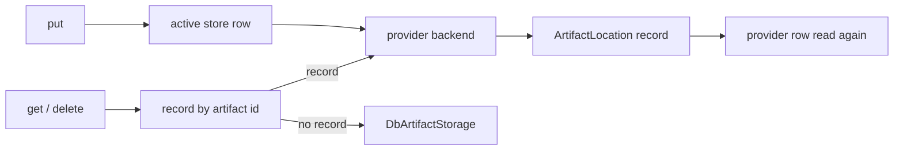

# Artifact Storage

This is a stub, written ahead of plan 09 task 12: it records how artifacts are routed between stores (the location record, the active
store, the delete and move refusals) and how the filesystem store keeps its files, as the code does it today. The S3 backend (plan 09
task 9) is not built yet.

## 1. Purpose

Artifacts are the binary files the platform keeps for people and agents: images and files attached to messages (a session's or a channel's), the files an agent sends with
`inform_user`, the files a person sends back through an `ask_user` form, and the files of published service bundles. The subsystem decides
where each file is written, finds it again by its id, and keeps a store from being deleted or moved while it still holds files.

## 2. Conceptual model

- An **artifact storage provider** (`ArtifactStorageProvider`) is a row naming a backend kind (`db`, `filesystem`, `s3`) and its config.
  The reserved row `artifact-storage-default` is the database store and must stay `db`.
- The **active store** (`ActiveArtifactStorageConfig`, one row at id `_active_artifact_storage_config`) names the provider NEW artifacts
  are written to. With no row, it is the reserved default. It is read on every put and never cached, so a switch is seen by every
  process at once.
- A **location record** (`ArtifactLocation`, row id = artifact id) says which provider holds one artifact. It is written only for a
  backend whose ids the database cannot serve (`ArtifactStorage.needs_location_record`: filesystem, S3). Every `db` provider stores in the
  same `Artifact` table, so a `db` provider writes no record and always counts zero artifacts.
- The **database fallback**: an artifact id with no record is a database artifact, read and deleted through a direct
  `DbArtifactStorage`, never through a registry lookup, so a broken provider row cannot make the old artifacts unreadable.
- A **filesystem root** is ONE folder that every server pod (the API and every worker) mounts at the same path. A prepared root holds a
  `.primer-artifact-root` marker; a process that finds no folder, or a folder without the marker, is a pod without the shared volume and
  refuses to use the store.

## 3. Architecture patterns implemented

The provider pattern ([provider-pattern](../architecture/provider-pattern.md)): a discriminated config, a factory
(`build_artifact_storage`) and a registry that caches one live store per row (`ArtifactStorageRegistry`). The registry's
`invalidate` publishes on the `artifact_storage_provider` invalidation topic once the lifespan binds the bus, and every process evicts its
own copy. The REST routes follow [rest-api](../architecture/rest-api.md) (`make_crud_router`, RFC 7807 errors), and the pre-write checks
are shared by the routes and the system tools (the D3/D5 shared-validator pattern).

## 4. Code layout

- `primer/model/providers/artifact.py`: the provider row, its three config classes, the active-store row and the two reserved ids.
- `primer/model/artifact.py`: `Artifact` (the database rows) and `ArtifactLocation`.
- `primer/int/artifact_storage.py`: the `ArtifactStorage` ABC (`put`, `get`, `delete`, `needs_location_record`).
- `primer/artifact/db.py`, `primer/artifact/factory.py` (`BUILDABLE_KINDS`: `db` and `filesystem`), `primer/artifact/probe.py` (the live
  round trip), `primer/artifact/routing.py` (`RoutingArtifactStorage`, `count_artifacts_held`), `primer/artifact/active.py` (read and
  select the active store), `primer/artifact/checks.py` (the write, delete and move checks, and `prepare_artifact_provider`).
- `primer/artifact/filesystem.py` (`FilesystemArtifactStorage`, `prepare_root`, `check_root`, `ROOT_MARKER`) and `primer/artifact/ids.py`
  (`BACKEND_ARTIFACT_ID_RE`, `new_backend_artifact_id`: the `artifact-<32 hex>` ids a non-database backend mints; database ids stay
  `artifact-<12 hex>`).
- `check_filesystem_artifact_stores` in `primer/api/_app_lifespan_phases.py`, the boot check.
- `primer/api/registries/artifact_storage_registry.py`, `primer/api/routers/artifact_storage.py`, `primer/toolset/_system_artifact.py`.

## 5. Data model

`ArtifactStorageProvider` carries `provider` and `config` (`DbArtifactConfig`, `FilesystemArtifactConfig` with `root`,
`S3ArtifactConfig` with `bucket`, `prefix`, `endpoint_url` and keys). `ActiveArtifactStorageConfig` carries `provider_id`.
`ArtifactLocation` carries `provider_id`, and both storage backends index that hot field (the SQLite and Postgres hot-field lists), so
counting what a provider holds is an index read.

**On disk** (the filesystem store), each artifact is two files under `<root>/<hex[0:2]>/<hex[2:4]>/`, where `hex` is the 32 hex digits
of the id: the bytes at `<id>` and a UTF-8 JSON sidecar at `<id>.json` holding `{"mime_type", "filename", "size"}` (the filename kept
as written, any characters). The root also holds the `.primer-artifact-root` marker. Shard folders are created on demand and left in
place when they empty.

## 6. Lifecycle

**Put** (`RoutingArtifactStorage.put`): read the active store, write the bytes to its backend, then, for a backend that needs one, write
the location record and read the provider row again. A failure from the record write on (a cancel included) removes the record, best
effort, and the bytes. A provider row that is gone at the re-read (the store was switched away and deleted while the upload was in
flight) removes the record and the bytes and fails with a 409; retried, the put goes to the store that is active now. So does a row
that was moved meanwhile: the cached store was built from the old row, and when `store.serves(row)` answers False (a filesystem root that
changed while the store held no record, so the move check let it through) the put removes its record and bytes and fails with a 409.

**Get and delete** follow the record, even when the recorded provider is not the active one. A delete removes the bytes first and the
record second, so a delete that fails in the store keeps the record and can be retried.

**Filesystem put, get and delete.** A put writes the bytes, then the sidecar, each to a temporary file that is synced and renamed into
place; a sidecar that fails removes the bytes again, so a sidecar is never seen without its bytes. A get reads the sidecar, then the
bytes, and answers `None` when either is missing. A delete removes the sidecar, then the bytes; missing files are fine. Every file
operation runs in a worker thread (`asyncio.to_thread`), so a slow or hung volume never blocks the event loop. A put cancelled while its
thread is writing (a client that went away) cannot stop the thread and never hands out its id, so the write is shielded and, once the thread
finishes, a cleanup task removes both files (the module holds the task until it is done).

**Preparing a filesystem root** (`prepare_artifact_provider`, run LAST by the REST create and update hooks and the system tool pre-create
and pre-update, and by the draft `_test` as its `prepare` step): create the folder when missing, check that it takes a write, and write
the marker when it has none. A root that is not absolute, is a file, or cannot be written is a 422 (`validation-error` from a tool)
`artifact_root_unusable` naming `config.root`, and nothing is stored. The saved-row `_test` and the active-store selection do not prepare:
they check what every process will find.

**Using a filesystem root** (`initialize`, through `check_root`, in every process that resolves the store): the root must be absolute,
exist, be a folder, hold the marker and take a write. It creates nothing. A missing root or a missing marker is refused with a message that
names the root and says to mount the shared artifact volume in every server pod. A failed `initialize` is not cached by the registry, so
every later use checks again.

**Boot check.** `check_filesystem_artifact_stores` resolves every filesystem provider row (up to 200) through the registry and logs, at
ERROR, `artifact store <id> (filesystem, root <root>) is not usable in this process: <reason>` for each one that fails, giving each 30
seconds. It never raises. The lifespan starts it as a background task after the invalidation bus is bound (a store it caches is evicted by
a later edit in any process) and cancels it at shutdown, so it never holds the boot.

**Select** (`set_active_artifact_store`): read the provider, probe it, read it again, and write the selection with a compare-and-set
against the selection read before the probe (`patch_if_checked`; a create for the first selection). A provider deleted during the probe,
or a selection of another provider someone else wrote meanwhile, is a 409 and leaves the selection unchanged; a selection of the same
provider written meanwhile is the answer (a 200).

What is left of the put and select races is a window two statements wide: a delete whose check ran before the record (or the selection)
was written and whose row delete lands after the re-read.

## 7. Persistence

The provider rows, the active-store row, the location records and the database artifacts are storage rows; the live stores are cached in
memory by the registry and rebuilt from the rows. The reserved default row is seeded at boot.

## 8. Public surfaces

- REST: the CRUD routes under `/v1/artifact_storage_providers`, `POST /v1/artifact_storage_providers/_test` (a draft),
  `POST /v1/artifact_storage_providers/{id}/_test` (a saved row), `GET /v1/artifact_storage_providers/_types`, and
  `GET` / `PUT /v1/artifact_storage_active_config` (the PUT answers 409 for a lost race).
- System tools, all admin-only: the generic `create_`, `update_` and `delete_artifact_storage_provider`, and
  `system::test_artifact_storage_provider`, `system::get_active_artifact_store`, `system::set_active_artifact_store` (agent doc:
  `docs/agents/artifact-storage.md`).

## 9. Internal contracts

- The reserved default stays `db` (`check_artifact_provider_write`): every artifact without a record is read from the database.
- **Delete refusal** (`check_artifact_provider_delete`): the active store cannot be deleted (409 `cascade_blocked`), nor can a store
  that still holds records (409 `artifact_provider_holds_artifacts`, with the count).
- **Move refusal** (`check_artifact_provider_update`): changing `provider`, a filesystem `root`, or an S3 `bucket` or `prefix` of a
  store that holds records is a 409 naming the field: the records would point at a location that no longer has the files.
- Consumers call `ArtifactStorageRegistry.get_default()` and nothing else; `primer.artifact` must not import `primer.api`.
- **Filesystem paths never leave the root.** An id must match `BACKEND_ARTIFACT_ID_RE` (anchored with `\A` and `\Z`: `$` would accept a
  trailing newline) before it becomes a path; a get or a delete of any other id logs a warning and does nothing. Below the root each shard
  folder must be a real folder, never a link, and resolve inside the resolved root, and the files are opened with `O_NOFOLLOW`; a delete
  unlinks a link itself, never what it points at. The root itself may be a link (a mount reached through one).
- **Deployment.** On Kubernetes a filesystem store needs one shared volume (ReadWriteMany) mounted at `root` in the API pod and every
  worker pod. Do not select a filesystem store on a deployment that lacks it: the selection probe runs in one pod only, and every other
  pod would refuse the store (the boot check names them).

## 10. Testing patterns

`tests/artifact/` runs the routing store, the active store and the checks on a real SQLite storage with an in-memory store that needs a
record (`tests/artifact/_stores.py`); the race tests hold a put inside the store, or run the concurrent delete inside an injected probe.
`tests/artifact/test_filesystem_store.py` pins the filesystem store (the marker, the traversal ids and planted links, the thread rule),
and `tests/artifact/test_backend_contract.py` runs one contract (bytes, MIME type and any filename round-trip) against every backend that
builds. `tests/api/test_artifact_storage_*.py` cover the routes and the registry, `tests/api/test_artifact_store_switch.py` the switch to
a filesystem store and the boot check, and `tests/toolset/test_system_artifact_tools.py` the tools. Every filesystem test works inside its
own `tmp_path`. `tests/e2e/test_artifact_store_switch_journey.py` runs the switch against a live server.

## 11. Historical decisions

The routing store replaced the single fixed-id store (plan 09, design section 15.2): consumers kept `get_default()`, and the fallback to a
direct database store keeps every artifact written before the location records readable. The re-read after the record and the
compare-and-set selection came from the G5 audit (G5-03, G5-05, G5-06).
