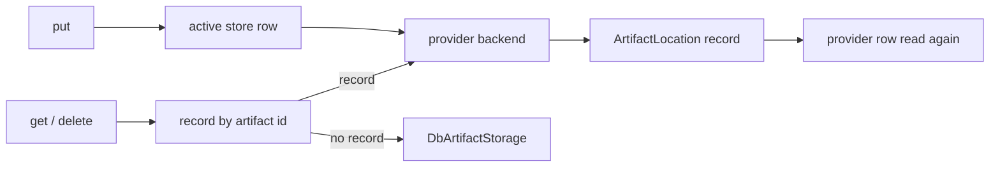
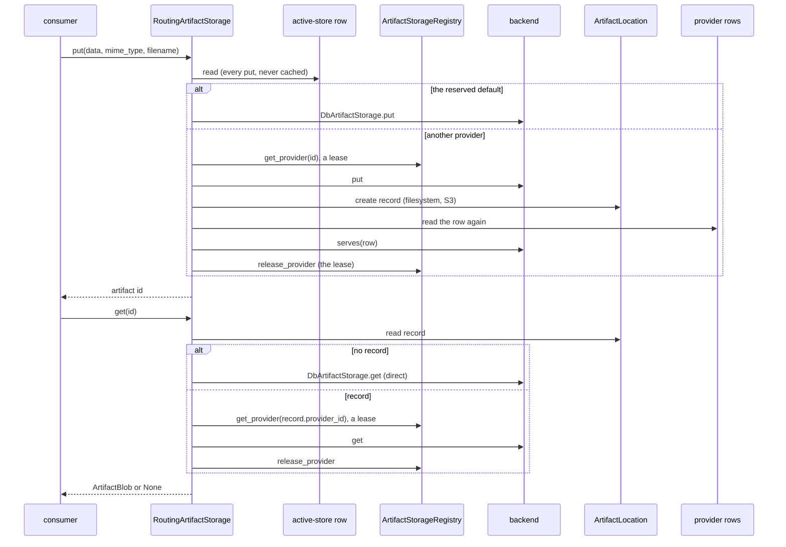

# Artifact Storage

## 1. Purpose

Where message media and service bundle files are kept: the database, filesystem and S3 backends, the active store new files go to, and the
per-artifact record that keeps older files readable after a switch.

Artifacts are the binary files the platform keeps for people and agents: media that arrives on a channel (Slack, Telegram and Discord
adapters, `store_inbound_media` in `primer/channel/media.py`), the workspace files a person attaches to a message sent to a session (the
`attachments` of a session message, `primer/api/routers/workspaces.py`), the workspace files an agent attaches to an `inform_user` or
`ask_user` prompt (`primer/agent/inform.py`, `primer/worker/yield_runtime.py`), and the files of published service bundles
(`primer/service/publish.py`, served by `primer/api/routers/svc_serve.py`). A message part carries an `artifact_id`, never the bytes; the
agent loop reads the bytes back at turn time (`hydrate_prompt_parts` in `primer/media/hydrate.py`, called by `primer/agent/loop.py`) and a
channel adapter at send time (`hydrate_media_dicts` in `primer/channel/media.py`). The subsystem decides where each file is written, finds it again by its id, and keeps a store from being deleted or moved while it still holds
files.

## 2. Conceptual model

- An **artifact** is one stored file: bytes, a MIME type and an optional filename, under an id the backend mints.
- An **artifact storage provider** (`ArtifactStorageProvider`) is a row naming a backend kind (`db`, `filesystem`, `s3`) and its config.
  The reserved row `artifact-storage-default` is the database store and must stay `db`.
- The **active store** (`ActiveArtifactStorageConfig`, one row at id `_active_artifact_storage_config`) names the provider NEW artifacts
  are written to. With no row, it is the reserved default. It is read on every put and never cached, so a switch is seen by every
  process at once.
- A **location record** (`ArtifactLocation`, row id = artifact id) says which provider holds one artifact. It is written only for a
  backend whose ids the database cannot serve (`ArtifactStorage.needs_location_record`: filesystem, S3). Every `db` provider stores in the
  same `Artifact` table, so a `db` provider writes no record and always counts zero artifacts.
- The **database fallback**: an artifact id with no record is a database artifact, read and deleted through a direct
  `DbArtifactStorage`, never through a registry lookup, so a broken provider row cannot make the old artifacts unreadable.
- A **filesystem root** is ONE folder that every server pod (the API and every worker) mounts at the same path. A prepared root holds a
  `.primer-artifact-root` marker; a process that finds no folder, or a folder without the marker, is a pod without the shared volume and
  refuses to use the store.
- An **S3 store** keeps each artifact as one object in a bucket of AWS S3 or an S3-compatible server (MinIO), under the row's key prefix.
  It needs the `s3` extra (aiobotocore). Its two keys go together: both, or neither to use the server's own credentials.



## 3. Architecture patterns implemented

- **Provider pattern** ([provider-pattern](../architecture/provider-pattern.md)): a discriminated config on the row
  (`primer/model/providers/artifact.py`), a factory (`build_artifact_storage`, `primer/artifact/factory.py`) and a registry that caches one
  live store per row (`ArtifactStorageRegistry`). The class serves the `_types` form metadata and a draft and a saved-row `_test`.
- **Storage** ([storage](../architecture/storage.md)): every row is a `Storage[T]` row in a lazy per-model table named after its class:
  `artifactstorageprovider`, `activeartifactstorageconfig`, `artifactlocation` and `artifact`. `artifactlocation.provider_id` is a hot
  field indexed by both backends (`_HOT_FIELD_INDEXES` in `primer/storage/postgres.py`, `_SQLITE_HOT_FIELD_INDEXES` in `primer/storage/sqlite.py`), so
  counting what a provider holds (`count_artifacts_held`) is one index read. The selection is a compare-and-set
  (`patch_if_checked`, `primer/storage/cas.py`).
- **Invalidation bus**: the registry's `invalidate` publishes on the `artifact_storage_provider` topic
  (`InvalidationTopic.ARTIFACT_STORAGE_PROVIDER`, `primer/int/coordinator.py`) once the lifespan binds the bus, and every process (the
  publisher included) evicts its own copy from its subscription; a reconnect of the subscription flushes the whole cache. The active-store
  row is not cached anywhere, so the topic carries provider-row evictions only.
- **REST** ([rest-api](../architecture/rest-api.md)): `make_crud_router` with pre-write hooks, RFC 7807 errors whose `extensions` carry
  `{"error", "kind", "field", "message", ...}` (`kind` is `artifact_storage_provider` or `artifact_storage_active_config`).
- **Shared validators** (the D3/D5 pattern): the write, delete and move checks live in `primer/artifact/checks.py` and raise
  `EntityCheckError`; the REST hooks turn it into a 403, 409 or 422 and the system tools into `forbidden`, `conflict` or
  `validation-error`. `primer.artifact` imports nothing from `primer.api`.
- **Auto-bootstrap** ([auto-bootstrap](../architecture/auto-bootstrap.md)): every process seeds the reserved default row at startup
  (`seed_default_artifact_provider`, `primer/api/_app_lifespan_phases.py`), idempotently.
- **Modularity** ([modularity](modularity.md)): the S3 backend sits behind the `s3` extra (`EXTRA_MODULES` in `primer/common/optional.py`,
  `require_extra` in the factory); the slim and full images install it.

## 4. Code layout

| File | What it holds |
|------|---------------|
| `primer/model/providers/artifact.py` | `ArtifactStorageProvider`, its three config classes, `ActiveArtifactStorageConfig`, the two reserved ids, `S3_KEYS_INCOMPLETE_MESSAGE` |
| `primer/model/artifact.py` | `Artifact` (the database rows) and `ArtifactLocation` |
| `primer/int/artifact_storage.py` | the `ArtifactStorage` ABC (`initialize`, `put`, `get`, `delete`, `aclose`, `serves`, `needs_location_record`) and `ArtifactBlob` |
| `primer/artifact/routing.py` | `RoutingArtifactStorage` (what `get_default()` returns) and `count_artifacts_held` |
| `primer/artifact/active.py` | `read_active_artifact_store`, `set_active_artifact_store` (probe, re-read, compare-and-set) |
| `primer/artifact/probe.py` | `probe_artifact_provider` (the live round trip), `probe_failure_text` (keys redacted) |
| `primer/artifact/checks.py` | the write, delete and move checks, `filesystem_root_is_new`, `prepare_artifact_provider`, `ARTIFACT_DEFAULT_WRITE_NOTE` |
| `primer/artifact/factory.py` | `build_artifact_storage`, `BUILDABLE_KINDS` (`db`, `filesystem`, `s3`) |
| `primer/artifact/db.py` | `DbArtifactStorage` |
| `primer/artifact/filesystem.py` | `FilesystemArtifactStorage`, `prepare_root`, `check_root`, `ROOT_MARKER` |
| `primer/artifact/s3.py` | `S3ArtifactStorage`, `s3_addressing_style`, `s3_client_kwargs`, `filename_metadata` (aiobotocore imported in `initialize` only) |
| `primer/artifact/ids.py` | `BACKEND_ARTIFACT_ID_RE`, `new_backend_artifact_id` (`artifact-<32 hex>`; database ids stay `artifact-<12 hex>`) |
| `primer/api/registries/artifact_storage_registry.py` | `ArtifactStorageRegistry`: the per-row cache, leases, `get_default`, `invalidate`, `bind_invalidation_bus` |
| `primer/api/routers/artifact_storage.py` | the CRUD router, the `_types` and `_test` helpers, the active-store routes |
| `primer/api/_app_lifespan_phases.py` | `seed_default_artifact_provider`, `check_filesystem_artifact_stores` (the boot check) |
| `primer/api/_app_lifespan.py` | builds the registry, seeds, binds the bus, starts the boot check, closes the registry at shutdown |
| `primer/toolset/_system_artifact.py` | `test_artifact_storage_provider`, `get_active_artifact_store`, `set_active_artifact_store` |
| `primer/toolset/system.py` | the generic CRUD tools' guards and pre-checks for `artifact_storage_provider` |

## 5. Data model

`ArtifactStorageProvider` carries `provider` and `config`: `DbArtifactConfig` (no fields), `FilesystemArtifactConfig` (`root`, an absolute
path) or `S3ArtifactConfig` (`bucket`, `prefix`, `endpoint_url`, `region`, `addressing_style`, and the `access_key` and `secret_key`
secrets). In an S3 config, `endpoint_url`, `region`, `access_key` and `secret_key` read a string that is blank once stripped as unset (the
console sends `""` for an empty box); `prefix` keeps its empty string. `addressing_style` is `auto` (the default, and what a row stored
before the field reads as), `path` or `virtual`. `ActiveArtifactStorageConfig` carries `provider_id` (default `artifact-storage-default`).
`ArtifactLocation` carries `provider_id`; its id is the artifact's. `Artifact` carries `mime_type`, `filename`, `size` and `data`.

**On disk** (the filesystem store), each artifact is two files under `<root>/<hex[0:2]>/<hex[2:4]>/`, where `hex` is the 32 hex digits
of the id: the bytes at `<id>` and a UTF-8 JSON sidecar at `<id>.json` holding `{"mime_type", "filename", "size"}` (the filename kept
as written, any characters). The root also holds the `.primer-artifact-root` marker. Shard folders are created on demand and left in
place when they empty.

**In a bucket** (the S3 store), each artifact is one object at `<prefix><id>`: the bytes as its body, the MIME type as its `Content-Type`
and the filename, percent-encoded (`quote(filename, safe="")`, because S3 user metadata is ASCII only), as its `filename` metadata. A put
without a filename writes no metadata. AWS caps an object's user metadata at 2 KB (the UTF-8 bytes of every key and value), so a filename
whose encoding is longer than 2040 characters is cut (`filename_metadata`): its extension and the start of the name are kept, the cut falls
between characters so no escape is split, and the artifact reads back with the shortened name. A prefix that should act as a folder ends
with `/`.

## 6. Lifecycle



**Startup** (every process, API and worker alike, in `primer/api/_app_lifespan.py`): build the `ArtifactStorageRegistry`, seed the
reserved default row (`seed_default_artifact_provider`), bind the registry to the invalidation bus once the coordinator exists, then start
the filesystem boot check as a background task (below). Shutdown cancels the check and closes the registry (`aclose`: unsubscribe, close
every cached and retired store, wait for the closes a flush started).

**Put** (`RoutingArtifactStorage.put`): read the active store, write the bytes to its backend, then, for a backend that needs one, write
the location record and read the provider row again. An active provider that cannot be resolved fails the put; it never falls back to the
database. A failure from the record write on (a cancel included) removes the record, best
effort, and the bytes. A provider row that is gone at the re-read (the store was switched away and deleted while the upload was in
flight) removes the record and the bytes and fails with a 409; retried, the put goes to the store that is active now. So does a row
that was moved meanwhile: the cached store was built from the old row, and when `store.serves(row)` answers False (a filesystem root that
changed while the store held no record, so the move check let it through) the put removes its record and bytes and fails with a 409.

**Get and delete** follow the record, even when the recorded provider is not the active one. A record whose provider row is gone is
logged: the get answers `None` and the delete does nothing. A delete removes the bytes first and the record second, so a delete that
fails in the store keeps the record and can be retried.

**Filesystem put, get and delete.** A put first checks that the root still holds its marker (in the thread, on every put: the store is
cached after `initialize`, and a volume that went away later would leave the process writing into the empty mount point on its own disk),
and refuses with the same named-root message as `initialize`. It then writes the bytes, then the sidecar, each to a temporary file that is synced and renamed into
place, and syncs the shard folder after the sidecar rename (and the parent of each shard folder it creates), so the renames survive a
crash; a sidecar (or the folder sync) that fails removes the files again, so a sidecar is never seen without its bytes. A get reads the sidecar, then the
bytes, and answers `None` when either is missing; also, with one WARNING, when the sidecar cannot be read (not JSON, not UTF-8, a field
missing or of the wrong type) or when the bytes are not as long as the sidecar's `size` says: a damaged artifact is never served. A delete removes the sidecar, then the bytes; missing files are fine. Every file
operation runs in a worker thread (`asyncio.to_thread`), so a slow or hung volume never blocks the event loop. A put cancelled while its
thread is writing (a client that went away) cannot stop the thread and never hands out its id, so the write is shielded and, once the thread
finishes, a cleanup task removes both files (the module holds the task until it is done).

**S3 put, get and delete.** The client is opened by `initialize` (once, also under concurrent calls) with the addressing style
(`auto` is path-style when `endpoint_url` is set, as MinIO needs, and botocore's own choice on AWS), a 10 s connect and 60 s read timeout
and standard retries (three retries). The row is the only source of where it connects: the endpoint is the row's `endpoint_url` (AWS when
blank) and the client ignores `AWS_ENDPOINT_URL_S3`, `AWS_ENDPOINT_URL` and a profile's `endpoint_url` (`ignore_configured_endpoint_urls`),
and the region is the row's `region`, `us-east-1` when blank, never `AWS_REGION` or a profile's. Only the credentials of a row with no keys
come from the ambient chain. `endpoint_url` is an admin-only field and, like the admin-configured LLM provider URLs, is not routed through
the egress guard (accepted in the review of #899). A get answers `None` only for a missing key (`NoSuchKey`, `404`, `NotFound`); any other error, a
missing bucket or a refused read, is raised, because it is an outage, not an absent file. An id that is not a backend id is never turned
into a key: a get answers `None` and a delete does nothing, without a request. A put that does not complete (cancelled while its request
is in flight, or failed in any way but one raised before a request was sent) never hands out its id, and the object it may have left is
removed in the background once the request settles. Only no credentials, partial credentials or a parameter botocore refused prove that
nothing was stored: even a `ClientError` may follow a retried attempt that stored the object. `aclose` waits for those removals (at most 30 s) before it closes the client, and a closed store refuses every later call rather
than open a client that nothing would close.

**Leases: a store is closed only when its last lease is returned.** Every `ArtifactStorageRegistry.get_provider` takes a lease on the store it returns, and
`release_provider` returns it. The routing store holds the lease for the WHOLE put, get or delete (a put's record write, re-read and the
removal of its bytes after a failure included) and returns it also after a failure or a cancel; the boot check returns its lease after the
check. An edit's eviction or a bus reconnect's flush closes an idle store at once (the flush in a task, since its hook cannot await) and
retires a leased one: it stays open for the calls holding it and is closed when its last lease returns. A store built while an eviction
raced its build is retired from birth, so the request that built it completes on it and its release closes it. The registry's `aclose`
closes every cached and retired store and waits for the closes a flush started. So an edit that moves nothing never fails a read or a write
in flight, and a put whose row was moved meanwhile still removes its object before it answers 409 (the review of #899).

**Preparing a filesystem root** (`prepare_artifact_provider`, run LAST by the REST create and update hooks and the system tool pre-create
and pre-update, and by the draft `_test` as its `prepare` step). Only a NEW root is prepared (`filesystem_root_is_new`: a create, or an
update that changes the root or the kind): create the folder when missing, refuse an existing folder that already holds files and has no
marker (a typo guard against `/`, `/etc` or an application's data folder; `lost+found` alone does not count, so a freshly formatted volume
is taken), check that it takes a write, and write the marker. The root a stored row already names is only CHECKED (`check_root`): an
unchanged re-save handled by a pod without the shared volume must not write the marker into that pod's own empty mount point, after which
the pod would pass every check. A root that is not absolute, holds a NUL, is a file, already holds files, has lost its marker or cannot be
written is a 422 (`validation-error` from a tool) `artifact_root_unusable` naming `config.root`, and nothing is stored. The draft `_test`
of a stored row whose root is unchanged, the saved-row `_test` and the active-store selection do not prepare: they check what every process
will find.

**Using a filesystem root** (`initialize`, through `check_root`, in every process that resolves the store): the root must be absolute,
exist, be a folder, hold the marker and take a write. It creates nothing. A missing root or a missing marker is refused with a message that
names the root and says the shared artifact volume is not mounted there (and that a new store starts in a new or empty folder); it never
says to save the provider again. A failed `initialize` is not cached by the registry, so
every later use checks again.

**Boot check.** `check_filesystem_artifact_stores` resolves every filesystem provider row (found with a `provider == "filesystem"`
predicate, 200 rows a page until they run out) through the registry and logs, at
ERROR, `artifact store <id> (filesystem, root <root>) is not usable in this process: <reason>` for each one that fails, giving each 30
seconds. It never raises. The lifespan starts it as a background task after the invalidation bus is bound (a store it caches is evicted by
a later edit in any process) and cancels it at shutdown, so it never holds the boot. The cancel does not wait for a check thread that is
stuck on a hung mount (Python cannot stop a thread): that thread ends when the mount answers or the process exits (accepted in the review
of #890).

**Switching** (`set_active_artifact_store`, behind `PUT /v1/artifact_storage_active_config` and `system::set_active_artifact_store`): read
the provider (422 `unknown_provider_id` when there is none), probe it (`probe_artifact_provider`: build, initialize, put a probe object,
read it back, delete it; 422 `artifact_store_unusable` with the failing `step`), read it again, and write the selection with a
compare-and-set against the selection read before the probe (`patch_if_checked`; a create for the first selection). A provider deleted
during the probe (409 `artifact_store_deleted`), or a selection of another provider someone else wrote meanwhile (409
`active_artifact_store_changed`), leaves the selection unchanged; a selection of the same provider written meanwhile is the answer (a 200).
The probe runs in the one process that serves the request: the other pods meet the store at their next put or boot check. A switch moves
no file: older artifacts stay where they were written and are read through their records.

**Deleting.** The reserved default is refused before any lookup (403 `reserved_id_protected`; `forbidden` from a tool). The active
store is refused (409 `cascade_blocked`), and so is a store that still holds records (409 `artifact_provider_holds_artifacts`, with the
`count`), because its artifacts are read from it. A `db` provider other than the reserved one writes no record, so it can always be
deleted once it is not active. A delete or an edit of a row evicts its cached store in every process (`invalidate`).

What is left of the put and select races is a window two statements wide: a delete whose check ran before the record (or the selection)
was written and whose row delete lands after the re-read.

Known limits, ticketed rather than handled (ticket 01a16cd7): temporary files left by a crash in the middle of a write
(`.<id>.<hex>.tmp` in a shard folder) are not swept, and the marker carries no install identity, so two deployments pointed at one folder
would both accept it.

## 7. Persistence

The provider rows, the active-store row, the location records and the database artifacts are storage rows in the deployment's database;
the live stores are cached in memory by each process's registry and rebuilt from the rows. The reserved default row is seeded at boot.
Where the bytes live depends on the kind:

| Kind | Bytes | Location record | Counts toward a delete or move refusal |
|------|-------|-----------------|----------------------------------------|
| `db` | `Artifact` rows (base64 in the JSON column) in the deployment's database | none | never (always zero) |
| `filesystem` | two files per artifact under `root`, on a volume every pod mounts | one `ArtifactLocation` per artifact | yes |
| `s3` | one object per artifact at `prefix + id` in `bucket` | one `ArtifactLocation` per artifact | yes |

A record is written after the bytes and before the id is returned, and removed after the bytes on a delete. Neither the files nor the
objects are listed or counted by primer: a provider's count is the count of its records.

**Deploying a filesystem store on Kubernetes (k3s).** A filesystem store needs ONE volume shared by every API and every worker pod
(`ReadWriteMany`), mounted at the same path in each, holding the root marker. Until a deployment has that volume, keep its active store
`db`: the selection probe runs in one pod only, and every pod without the volume would refuse the store at its next put. The cluster
manifests are not in this repository; these are the steps to apply to them:

1. **The volume.** One `PersistentVolumeClaim` in the primer namespace, from a storage class that provides `ReadWriteMany` (an NFS or
   CephFS class, Longhorn, a cloud file share), sized for the artifacts it will hold. It must read `Bound` with access mode `RWX` before
   the next step.

   ```yaml
   apiVersion: v1
   kind: PersistentVolumeClaim
   metadata: {name: primer-artifacts, namespace: primer}
   spec:
     accessModes: [ReadWriteMany]
     storageClassName: <a class that provides ReadWriteMany>
     resources: {requests: {storage: 20Gi}}
   ```

2. **The mount, on every pod.** Add the claim as a volume and mount it at one path, for example `/var/lib/primer/artifacts`, in the API
   Deployment's container (`primer api --no-worker`) and in every worker Deployment's container (`primer worker`), so every replica
   of each has it. Apply, roll, and read the live objects (`kubectl -n primer get deploy -o yaml`) to confirm that each one carries the
   mount.

   ```yaml
   # in each Deployment's pod template
   volumes:
   - {name: artifacts, persistentVolumeClaim: {claimName: primer-artifacts}}
   # in its container
   volumeMounts:
   - {name: artifacts, mountPath: /var/lib/primer/artifacts}
   ```

3. **The config.** A filesystem store needs no environment variable and no config key: its folder is the provider row's `config.root`,
   which must be the mount path. Once every pod runs with the mount, register the row with `POST /v1/artifact_storage_providers` (or
   `system::create_artifact_storage_provider`); the pod that handles the create writes the `.primer-artifact-root` marker into the
   shared volume:

   ```json
   {"id": "fs-artifacts", "provider": "filesystem", "config": {"root": "/var/lib/primer/artifacts"}}
   ```

4. **Verify the marker in every pod.** `POST /v1/artifact_storage_providers/{id}/_test` for `fs-artifacts` must answer `{"ok": true}`,
   but it runs in the API pod only. For the API pod and every worker pod, either check the file in the pod:

   ```bash
   kubectl -n primer exec <pod> -- ls -l /var/lib/primer/artifacts/.primer-artifact-root
   ```

   or restart the Deployments and read each pod's log. The boot check writes this line at ERROR in a pod that lacks the volume (or whose
   volume lacks the marker), and nothing in a pod that has it:

   ```text
   artifact store 'fs-artifacts' (filesystem, root '/var/lib/primer/artifacts') is not usable in this process: <reason>
   ```

5. **Select it** with `PUT /v1/artifact_storage_active_config` (`{"provider_id": "fs-artifacts"}`) or `system::set_active_artifact_store`.
   To go back, select `artifact-storage-default` again: the files already written stay on the volume and are read from it, so the volume
   stays mounted on every pod for as long as the provider holds records (its delete is refused until then).

**An S3 store on Kubernetes** needs no volume. Every pod needs the `s3` extra (the slim and full images have it, through the Dockerfile's
`UV_SYNC_EXTRAS`) and a route to the bucket's endpoint. A row with both keys carries its own credentials. A row with neither uses each
pod's ambient credentials: put `AWS_ACCESS_KEY_ID` and `AWS_SECRET_ACCESS_KEY` in a Secret and pass it with `envFrom` to the API
Deployment and every worker Deployment (or give the pods a role). The endpoint and the region always come from the row, never from
`AWS_ENDPOINT_URL_S3`, `AWS_REGION` or a profile.

## 8. Public surfaces

Every route below is admin-only (`require_admin`, mounted in `primer/api/_app_routes.py`), and every tool needs an admin
(`required_role="admin"`).

- REST, the rows: the CRUD routes `GET` and `POST /v1/artifact_storage_providers`,
  `GET`, `PUT` and `DELETE /v1/artifact_storage_providers/{id}`, and `POST /v1/artifact_storage_providers/find`;
  `GET /v1/artifact_storage_providers/_types` (the console form's field lists and labels).
- REST, the checks: `POST /v1/artifact_storage_providers/_test` (a draft, not saved: a NEW filesystem root is prepared first, as a save
  would; the masks are restored from the stored row of the same id; a body that is not a valid row answers 200 with `ok` false and an
  `error` that starts `invalid draft:`) and `POST /v1/artifact_storage_providers/{id}/_test` (a saved row, prepares nothing; 404 for an unknown id). Both
  answer 200 with `{"ok": true}` or `{"ok": false, "step", "error"}`, `step` one of `prepare`, `build`, `initialize`, `put`, `get` or
  `delete`, and the row's keys redacted out of `error` (`probe_failure_text`).
- REST, the selection: `GET` / `PUT /v1/artifact_storage_active_config` (the GET answers the reserved default when no selection was
  ever made).
- System tools: `system::list_artifact_storage_providers`, `system::get_artifact_storage_provider`,
  `system::find_artifact_storage_providers`, `system::create_artifact_storage_provider`, `system::update_artifact_storage_provider` and
  `system::delete_artifact_storage_provider` (the generic CRUD tools, with the same checks as the routes), and
  `system::test_artifact_storage_provider` (a saved row), `system::get_active_artifact_store` and `system::set_active_artifact_store` (both
  answer `{"provider_id", "provider"}`). Agent doc: `docs/agents/artifact-storage.md`.
- Console: Providers > Artifact Store (`ui/components/provider-catalog.jsx`, the `artifact_storage` class of `PC_CLASSES` in
  `ui/components/providers/register-common.jsx`) lists the rows, each card showing its root or bucket, and registers, edits and deletes
  them through the schema-driven provider form fed by `_types`. The reserved default has no delete.
- Console, the selection: Providers > Artifact Store draws the "Store new files in" selector above the cards (`AS_ActiveStoreSelector` in
  `ui/components/artifact-store-selector.jsx`, the class's `PC_TYPE_EXTRAS` entry). It reads the active row and
  `GET /v1/artifact_storage_providers?limit=200` (again when the select takes the focus, so a store registered on the page shows up) and lists
  each store as `<id> (<kind>)`, with the active id added when the list lacks it. A change is one `PUT /v1/artifact_storage_active_config`:
  while it is out the select is `aria-busy` and never natively disabled (that would drop the focus), and a second change is ignored. Success
  says "New files now go to <id>"; a refusal (the probe failed, the store is gone, a lost race) shows the server's sentence under the field,
  never its code, and the select shows the stored store again while both are read again. It draws loading, a load error with Retry, and the
  case of a single store (only the reserved database row), and nothing at all for a non-admin, because the routes are admin-only. The
  provider form gives the `s3` kind the install hint when the `s3` extra is missing (`EXTRA_FOR_PROVIDER_TYPE` in
  `ui/foundation/capabilities.js`). `tests/ui/test_artifact_store_selector.py` runs it in MiniRacer on the real routers' answers, and
  `tests/ui_e2e/test_artifact_store_selector_journey.py` runs it in a browser, the phone width included.

The refusals, with the REST status, the `extensions.error` code and the tool error type:

| Where | Status | Code | Tool type | When |
|-------|--------|------|-----------|------|
| create, update | 422 | `artifact_default_must_be_db` | `validation-error` | the reserved default names another kind than `db` (`field: provider`) |
| create, update | 422 | `artifact_s3_keys_incomplete` | `validation-error` | an S3 row with one key; `field` names the blank one |
| create, update | 422 | `artifact_root_unusable` | `validation-error` | a filesystem root that cannot be prepared or checked (`field: config.root`) |
| update | 422 | (the mask refusal) | `validation-error` | a served key mask sent back with another `endpoint_url` origin: re-enter the keys |
| update | 409 | `artifact_provider_holds_artifacts` | `conflict` | the update changes `provider`, `config.root`, `config.bucket` or `config.prefix` of a store with records (`field`, `count`) |
| delete | 403 | `reserved_id_protected` | `forbidden` | the reserved default |
| delete | 409 | `cascade_blocked` | `conflict` | the active store (`referenced_by: _active_artifact_storage_config`) |
| delete | 409 | `artifact_provider_holds_artifacts` | `conflict` | a store with records (`count`) |
| select | 422 | `unknown_provider_id` | `validation-error` | no such provider (`field: provider_id`) |
| select | 422 | `artifact_store_unusable` | `validation-error` | the probe failed (`field: provider_id`, `step`) |
| select | 409 | `artifact_store_deleted` | `conflict` | the provider was deleted during the probe |
| select | 409 | `active_artifact_store_changed` | `conflict` | another provider was selected during the probe |

A tool's error message starts with the field (`config.secret_key: ...`); it does not carry the code.

## 9. Internal contracts

- **One entry point.** Consumers call `ArtifactStorageRegistry.get_default()` and nothing else; it returns the routing store, built once
  per registry. No consumer holds a backend.
- **`needs_location_record`.** A backend whose ids the database fallback cannot find says True (the ABC's default, the safe side); only a
  backend that stores in the `Artifact` table (`DbArtifactStorage`) says False. The routing store writes the records itself.
- **Id formats.** A non-database backend mints `artifact-<32 lowercase hex>` (`new_backend_artifact_id`); database ids stay
  `artifact-<12 hex>`, so the two never collide.
- **The fallback is direct.** An id with no record goes to a `DbArtifactStorage` built on the storage provider, never to a registry
  lookup of the reserved row.
- The reserved default stays `db` (`check_artifact_provider_write`): every artifact without a record is read from the database.
- **No `primer.api` import.** `primer.artifact` must not import `primer.api`, not even lazily
  (`tests/artifact/test_checks.py::test_the_check_loads_nothing_from_the_api_package`): `primer.toolset.system` imports the checks and
  `primer.api` imports `primer.toolset.system`. The default id therefore lives in the leaf `primer.model.providers.artifact`.
- **aiobotocore stays lazy.** It is imported inside `S3ArtifactStorage.initialize` only (botocore's exception classes inside the
  functions that need them), never at module level, and `primer.artifact.s3` is in the import-linter "core layers" forbidden list
  (`pyproject.toml`), so a core install imports every other module without the extra; building an S3 row there fails with a
  `ConfigError` that names the `s3` extra (`require_extra`).
- **S3 keys: both or neither** (`check_artifact_provider_write`, on the REST route and in the system tools, after the served masks are
  restored): one key without the other is a 422 (`validation-error` from a tool) `artifact_s3_keys_incomplete` naming the blank key, and
  nothing is stored. A half pair is never completed from the server's ambient credentials: a row stored before the rule fails at build
  (`ConfigError`), so its probe stops at `build`. With neither key, botocore's ambient chain is used (environment, shared config files,
  the instance or pod role). The keys are masked in every answer, restored on an update that sends the masks, and never logged by primer;
  probe errors pass through `probe_failure_text`. primer keeps botocore and aiobotocore at INFO even when it logs at DEBUG
  (`configure_logging` in `primer/common/log.py`), so their per-request DEBUG lines (the SigV4 signature, the access key id in
  `Credential=`, the `x-amz-meta-filename` header) are never written: the access key id appears in no log line, and the secret key is in
  none of them anyway.
- **Where a store writes** (`ArtifactStorage.serves`): a filesystem store compares the row's kind and `root`; an S3 store compares the
  row's kind, `bucket`, `prefix`, `endpoint_url` and `region`. New keys or another addressing style reach the same objects.
- **Delete refusal** (`check_artifact_provider_delete`): the active store cannot be deleted (409 `cascade_blocked`), nor can a store
  that still holds records (409 `artifact_provider_holds_artifacts`, with the count).
- **Move refusal** (`check_artifact_provider_update`): changing `provider`, a filesystem `root`, or an S3 `bucket` or `prefix` of a
  store that holds records is a 409 naming the field: the records would point at a location that no longer has the files.
- **A store is closed only when its last lease is returned** (`ArtifactStorageRegistry.release_provider`); an eviction or a flush retires
  a leased store instead of closing it.
- **Filesystem paths never leave the root.** An id must match `BACKEND_ARTIFACT_ID_RE` (anchored with `\A` and `\Z`: `$` would accept a
  trailing newline) before it becomes a path; a get or a delete of any other id logs a warning and does nothing. Below the root each shard
  folder must be a real folder, never a link, and resolve inside the resolved root, and the files are opened with `O_NOFOLLOW`; a delete
  unlinks a link itself, never what it points at. The root itself may be a link (a mount reached through one).
- **Deployment.** On Kubernetes a filesystem store needs one shared volume (ReadWriteMany) mounted at `root` in the API pod and every
  worker pod (section 7). Do not select a filesystem store on a deployment that lacks it: the selection probe runs in one pod only, and
  every other pod would refuse the store (the boot check names them). An S3 store needs the `s3` extra in every pod (the slim image has
  it) and the same bucket reachable from each; with no keys on the row, each pod uses its own ambient credentials.

## 10. Testing patterns

`tests/artifact/` runs the routing store, the active store and the checks on a real SQLite storage with an in-memory store that needs a
record (`tests/artifact/_stores.py`); the race tests hold a put inside the store, or run the concurrent delete inside an injected probe.
`tests/artifact/test_probe.py` pins the probe (a read-back of wrong bytes names `get` and leaves no object).
`tests/artifact/test_filesystem_store.py` pins the filesystem store (the marker, a pod without the volume, the traversal ids and planted
links, the thread rule), and `tests/artifact/test_backend_contract.py` runs one contract (bytes, MIME type and any filename round-trip)
against every backend that builds, the S3 store on moto's threaded S3 server in the test process (`tests/artifact/conftest.py`: 127.0.0.1
only, no AWS endpoint, with the machine's own AWS credentials, profile and region hidden by `isolated_aws_env`).
`tests/artifact/test_s3_store.py` pins the S3 store (the key layout, both keys or neither, the serves rule, the client settings, the removal
of an incomplete put, the secret in no log record at DEBUG, and that a core install imports no aiobotocore), and
`tests/artifact/test_s3_under_the_registry.py` the leases under a real S3 client (a move during a put, an edit during a read or a write, a
flush). `tests/model/test_artifact_storage_models.py` pins the models (blank is unset, `addressing_style`). `tests/api/test_artifact_storage_*.py`
cover the routes and the registry; `tests/api/test_artifact_storage_bus_wiring.py` is the two-registry bus test (a tool edit in a worker's
registry evicts the API process's store, and the lifespan binds the registry and hands it to the system toolset);
`tests/api/test_artifact_storage_s3_edit.py` the console's edit of an S3 row (blank boxes, masks kept);
`tests/api/test_artifact_provider_holds_artifacts.py` the move and delete refusals; `tests/api/test_artifact_store_switch.py` the switch to
a filesystem store and the boot check; and `tests/toolset/test_system_artifact_tools.py` the tools. Every filesystem test works inside its
own `tmp_path`, and no test reaches the network. `tests/e2e/test_artifact_store_switch_journey.py` runs the switch against a live server
(old and new files stay readable), and `tests/ui_e2e/test_artifact_storage_register_journey.py` registers and deletes a row in the console.

## 11. Historical decisions

- Before plan 09 (2026-10), only the `db` backend was built: `filesystem` and `s3` rows could be stored but were never used, and from
  2026-10-10 the `_types` labels said so ("not implemented yet: stored, never used"). Every consumer read and wrote through one fixed-id
  store.
- The routing store replaced that single store (plan 09, design section 15.2): consumers kept `get_default()`, and the fallback to a
  direct database store keeps every artifact written before the location records readable.
- The per-artifact record is an index row, not a tagged id: the 409 "holds N artifacts" is one indexed count of records, where tagged ids
  would need a list or count operation on every backend, which the `ArtifactStorage` interface does not have.
- The reserved default's rule changed from "a kind the factory can build" (code `artifact_default_unbuildable`, ticket 01a1226f) to "must
  stay `db`" (`artifact_default_must_be_db`) once more kinds became buildable: it is the fallback store.
- The active setting is not cached (one row read per put), so a switch is seen by every pod at once; the invalidation topic carries
  provider-row evictions only. Selecting a store probes it.
- The re-read after the record and the compare-and-set selection came from the G5 audit (G5-03, G5-05, G5-06). The leases came from the
  review of #899 (slice D), replacing a close-on-eviction that could close a store under a call in flight.
