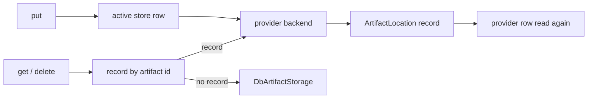

# Artifact Storage

This is a stub, written ahead of plan 09 task 12: it records how artifacts are routed between stores (the location record, the active
store, the delete and move refusals) as the code does it today. The filesystem and S3 backends (plan 09 tasks 8 and 9) are not built yet.

## 1. Purpose

Artifacts are the binary files the platform keeps for people and agents: images and files attached to messages (a session's or a channel's), the files an agent sends with
`inform_user`, the files a person sends back through an `ask_user` form, and the files of published service bundles. The subsystem decides
where each file is written, finds it again by its id, and keeps a store from being deleted or moved while it still holds files.

## 2. Conceptual model

- An **artifact storage provider** (`ArtifactStorageProvider`) is a row naming a backend kind (`db`, `filesystem`, `s3`) and its config.
  The reserved row `artifact-storage-default` is the database store and must stay `db`.
- The **active store** (`ActiveArtifactStorageConfig`, one row at id `_active_artifact_storage_config`) names the provider NEW artifacts
  are written to. With no row, it is the reserved default. It is read on every put and never cached, so a switch is seen by every
  process at once.
- A **location record** (`ArtifactLocation`, row id = artifact id) says which provider holds one artifact. It is written only for a
  backend whose ids the database cannot serve (`ArtifactStorage.needs_location_record`: filesystem, S3). Every `db` provider stores in the
  same `Artifact` table, so a `db` provider writes no record and always counts zero artifacts.
- The **database fallback**: an artifact id with no record is a database artifact, read and deleted through a direct
  `DbArtifactStorage`, never through a registry lookup, so a broken provider row cannot make the old artifacts unreadable.

## 3. Architecture patterns implemented

The provider pattern ([provider-pattern](../architecture/provider-pattern.md)): a discriminated config, a factory
(`build_artifact_storage`) and a registry that caches one live store per row (`ArtifactStorageRegistry`). The registry's
`invalidate` publishes on the `artifact_storage_provider` invalidation topic once the lifespan binds the bus, and every process evicts its
own copy. The REST routes follow [rest-api](../architecture/rest-api.md) (`make_crud_router`, RFC 7807 errors), and the pre-write checks
are shared by the routes and the system tools (the D3/D5 shared-validator pattern).

## 4. Code layout

- `primer/model/providers/artifact.py`: the provider row, its three config classes, the active-store row and the two reserved ids.
- `primer/model/artifact.py`: `Artifact` (the database rows) and `ArtifactLocation`.
- `primer/int/artifact_storage.py`: the `ArtifactStorage` ABC (`put`, `get`, `delete`, `needs_location_record`).
- `primer/artifact/db.py`, `primer/artifact/factory.py` (`BUILDABLE_KINDS`: only `db` today), `primer/artifact/probe.py` (the live
  round trip), `primer/artifact/routing.py` (`RoutingArtifactStorage`, `count_artifacts_held`), `primer/artifact/active.py` (read and
  select the active store), `primer/artifact/checks.py` (the write, delete and move checks).
- `primer/api/registries/artifact_storage_registry.py`, `primer/api/routers/artifact_storage.py`, `primer/toolset/_system_artifact.py`.

## 5. Data model

`ArtifactStorageProvider` carries `provider` and `config` (`DbArtifactConfig`, `FilesystemArtifactConfig` with `root`,
`S3ArtifactConfig` with `bucket`, `prefix`, `endpoint_url` and keys). `ActiveArtifactStorageConfig` carries `provider_id`.
`ArtifactLocation` carries `provider_id`, and both storage backends index that hot field (the SQLite and Postgres hot-field lists), so
counting what a provider holds is an index read.

## 6. Lifecycle

**Put** (`RoutingArtifactStorage.put`): read the active store, write the bytes to its backend, then, for a backend that needs one, write
the location record and read the provider row again. A failure from the record write on (a cancel included) removes the record, best
effort, and the bytes. A provider row that is gone at the re-read (the store was switched away and deleted while the upload was in
flight) removes the record and the bytes and fails with a 409; retried, the put goes to the store that is active now.

**Get and delete** follow the record, even when the recorded provider is not the active one. A delete removes the bytes first and the
record second, so a delete that fails in the store keeps the record and can be retried.

**Select** (`set_active_artifact_store`): read the provider, probe it, read it again, and write the selection with a compare-and-set
against the selection read before the probe (`patch_if_checked`; a create for the first selection). A provider deleted during the probe,
or a selection of another provider someone else wrote meanwhile, is a 409 and leaves the selection unchanged; a selection of the same
provider written meanwhile is the answer (a 200).

What is left of the put and select races is a window two statements wide: a delete whose check ran before the record (or the selection)
was written and whose row delete lands after the re-read.

## 7. Persistence

The provider rows, the active-store row, the location records and the database artifacts are storage rows; the live stores are cached in
memory by the registry and rebuilt from the rows. The reserved default row is seeded at boot.

## 8. Public surfaces

- REST: the CRUD routes under `/v1/artifact_storage_providers`, `POST /v1/artifact_storage_providers/_test` (a draft),
  `POST /v1/artifact_storage_providers/{id}/_test` (a saved row), `GET /v1/artifact_storage_providers/_types`, and
  `GET` / `PUT /v1/artifact_storage_active_config` (the PUT answers 409 for a lost race).
- System tools, all admin-only: the generic `create_`, `update_` and `delete_artifact_storage_provider`, and
  `system::test_artifact_storage_provider`, `system::get_active_artifact_store`, `system::set_active_artifact_store` (agent doc:
  `docs/agents/artifact-storage.md`).

## 9. Internal contracts

- The reserved default stays `db` (`check_artifact_provider_write`): every artifact without a record is read from the database.
- **Delete refusal** (`check_artifact_provider_delete`): the active store cannot be deleted (409 `cascade_blocked`), nor can a store
  that still holds records (409 `artifact_provider_holds_artifacts`, with the count).
- **Move refusal** (`check_artifact_provider_update`): changing `provider`, a filesystem `root`, or an S3 `bucket` or `prefix` of a
  store that holds records is a 409 naming the field: the records would point at a location that no longer has the files.
- Consumers call `ArtifactStorageRegistry.get_default()` and nothing else; `primer.artifact` must not import `primer.api`.

## 10. Testing patterns

`tests/artifact/` runs the routing store, the active store and the checks on a real SQLite storage with an in-memory store that needs a
record (`tests/artifact/_stores.py`); the race tests hold a put inside the store, or run the concurrent delete inside an injected probe.
`tests/api/test_artifact_storage_*.py` cover the routes and the registry, and `tests/toolset/test_system_artifact_tools.py` the tools.

## 11. Historical decisions

The routing store replaced the single fixed-id store (plan 09, design section 15.2): consumers kept `get_default()`, and the fallback to a
direct database store keeps every artifact written before the location records readable. The re-read after the record and the
compare-and-set selection came from the G5 audit (G5-03, G5-05, G5-06).
