# UI Pages

## 1. Purpose

This doc covers the operator console: the pure shell modules under `ui/foundation/shell-*.js`, the three-view console under `ui/components/console/nv-*.jsx` (plus the two `ui/components/shell/` survivors, `sh-api.jsx` and `sh-activity.jsx`), and the page components under `ui/components/` that it hosts. The console IS the studio. There is no page router, no sidebar and no per-page chrome: one workspace-scoped surface, whose navigation is a verb registry, whose documents are deep-linkable tabs, and whose management surfaces are overlays re-hosting the page components unchanged.

It owns the shell's own model (the URL grammar, the tab semantics, the verb registry, the dual-render rule) and the repeating page shapes those overlays still use: the list-bar plus detail-tabs structure on CRUD entities, the find-bar plus table plus create-modal triad, and the loader/error/empty/confirmation conventions every page reuses.

It deliberately does not re-document the primitives these surfaces build on. The HTTP client, the polled `useResource` cache, optimistic `useMutation`, the router shim, the toast queue, the tweaks store, the idle and viewport hooks, and the shared widgets (`Modal`, `Banner`, `Btn`, `Icon`, `StatusPill`, `CardList`, `Fab`, `BottomSheet`, `MobileTabs`) all live in [ui-foundation.md](ui-foundation.md). The load-bearing rule from the foundation (route all I/O through the hook layer, never `apiFetch` directly) is assumed throughout.

The backend REST contract these pages consume (the `/v1/*` CRUD surface, the `make_crud_router` family, RFC 7807 ProblemDetails, the reserved-id and cascade-conflict semantics) is documented in [architecture/rest-api.md](../architecture/rest-api.md). Pages are the UI half of that contract; where a page surfaces a documented anomaly (T0025, T0379, T0711, and similar) the page-level affordance is described here and the backend cause in the relevant subsystem doc.

## 2. Conceptual model

The console is three views over one URL (the 2026-08-23 designer handoff): STUDIO (the default - a rail of session bands and files, a centre of document tabs, the composer, an optional terminal panel and events sidebar), PLATFORM (grouped nav over per-entity card pages), and SYSTEM (dashboard, users, API keys, SSO, MCP, internal collections, activity, profile - reached from the profile menu). Overlays open above whichever view is active, and a command palette reaches every verb. `ui/app.jsx` is one mount, `AuthGate` wrapping `NV_Shell`, and nothing else.

**The verb registry is the routing table.** Every action a user can take is registered once, with an id, a label, the contexts it applies to and the surfaces it renders on (rail, tab menu, palette, overlay button). A surface renders the verbs the registry gives it rather than hard-coding buttons, which is what makes the dual-render rule checkable: a verb declared for a surface but never rendered from the registry, or a doc kind the URL can address that no verb opens, is an orphan, and a static guard fails on it.

**A document is a tab, and a tab is addressable.** Sessions, files, diffs and wiki pages are the four doc kinds (the trace opens as a split INSIDE the session doc; attention lives in the bands and the System dashboard). Tabs follow VS Code semantics: a preview tab is replaced by the next preview and is promoted to permanent by an edit or a pin, so browsing a file tree does not accumulate tabs.

**A management surface is an overlay, not a page.** The catalogue, agents, graphs, collections, toolsets and the rest re-host their existing page components with no chrome around them. Comparison never goes in an overlay: a trace opens beside its transcript as a tab in a second group, because an overlay cannot be looked at next to anything.

Components attach themselves to `window` at module scope rather than being imported, because the bundle shares one global Babel scope; this is also why several pages prefix every top-level binding (workspaces uses `WS_`, triggers `TR_`, internal-collections `IC_`, agents `AG_`, graphs `GR_`, channels its own helpers) to avoid colliding with siblings in that scope.

The page anatomies below still hold, because the overlays host those same components.

Almost every entity surface follows one of two anatomies.

A list page is a find-bar (text filter plus entity-specific dropdowns or status chips), a desktop table (with a mobile `CardList` plus `Fab` fallback under `useViewport().isMobile`), and a create modal launched from a "New X" button. Filtering, sorting, and pagination are overwhelmingly client-side over a single `GET /v1/<plural>?limit=200` page; the poll pauses while the filter input is focused so typing is not interrupted.

A detail page is a header (breadcrumb, id, action buttons such as Edit / Delete / Invalidate / Back) over a tab strip whose active tab is carried in the URL as `?tab=` and read back through the router. The create modal is reused in edit mode: the same component takes an `existing` prop, locks the id (and often the type discriminator), pre-fills the form, blanks any masked-secret field so the redaction is never written back, and submits a `PUT`-replace instead of a `POST`.

```mermaid
graph TD
    subgraph ListPage["List page anatomy"]
        FB["find-bar: text filter + chips/selects"] --> TBL["table (desktop) / CardList+Fab (mobile)"]
        TBL -->|row click -> navigate(/x/:id)| DET
        FB -.->|New X button| CM["create modal"]
    end
    subgraph DetailPage["Detail page anatomy"]
        DET["header: crumb + id + Edit/Delete/Back"] --> TABS["tab strip (?tab= in URL)"]
        TABS --> T1["Overview/Config"]
        TABS --> T2["entity tabs (Tools/Sessions/Messages/State/Files/Turn log/...)"]
        DET -.->|Edit button| CM
        DET -.->|Delete button| CONF["confirm modal (+ inline 409 banner)"]
    end
    CM -.->|POST/PUT then invalidate| TBL
```

A handful of surfaces break the mould: the System dashboard is a read-only metric board, the graph detail page is a drag-and-drop canvas editor rather than a tab strip, the internal-collections page is a three-state activation machine, and the docs page is a markdown reader. These are noted individually in the page index.

## 3. Architecture patterns implemented

- **The URL is the state.** Four facts are addressable and nothing else is: the workspace, the open document, the open overlay, and an anchor within the document. Palette state, toasts and every other transient are deliberately not representable, so a pasted link restores exactly what the sender was looking at and nothing they were not.

- **Registry-rendered surfaces, checked by the dual-render rule.** Verbs are registered once and each surface renders what the registry hands it. Two static guards enforce the consequences: every declared surface must actually render from the registry, and every addressable doc kind and overlay must be reachable by some verb. An address no verb reaches is a surface the user cannot find; a verb no surface renders is a promise the console does not keep.

- **Overlays re-host page components with no chrome and props only.** An overlay mount passes the component its own props and nothing else. Where a re-hosted page still calls `window.primerApi.useRouter()`, the shim answers from overlay state; see [ui-foundation.md](ui-foundation.md).

- **Every page builds on the foundation hook layer, never on raw fetch.** List polls, detail polls, modal submits, and confirmation deletes all go through `useResource` and `useMutation` on `window.primerApi`; cache keys are page-scoped strings (`sessions:list`, `session-detail:{sid}`, `graph-status:{id}`, `workspace-files:{wid}:{path}`, and so on) so a mutation on one surface can invalidate exactly the keys that need refetching. See [ui-foundation.md](ui-foundation.md) for the hook contracts and cache-key conventions.

- **List-bar plus detail-tabs is the default CRUD shape.** A `GET /v1/<plural>?limit=200` list with client-side filter/sort/paginate, a row-click navigation to `/<plural>/:id`, and a tabbed detail page whose tab lives in `?tab=`. Agents, toolsets, providers, semantic-search, channels, triggers, workspaces, collections, and graphs all instantiate this shape with entity-specific tabs.

- **Find-bar plus table plus create-modal triad.** The list bar exposes a text filter plus dropdowns or status chips; the create modal doubles as the edit modal via an `existing` prop and a `POST`-versus-`PUT`-replace switch. `PUT`-replace is the wire shape because the backend `make_crud_router` is full-replace, not PATCH.

- **Reuse-create-modal-for-edit with secret blanking.** Providers, channel-providers, semantic-search, and toolsets all pre-fill the create modal on edit, lock the id and type discriminator, and blank any field still holding the `**********` redaction so the stored secret survives. This mirrors the backend `SecretStr`-on-read masking documented in [architecture/rest-api.md](../architecture/rest-api.md).

- **Optimistic-write only for reversible edits; wait-for-200 for destructive or cascading mutations.** Description / metadata / config edits use the optimistic `useMutation` path; graph `PUT`-replace, workspace destroy, provider invalidate, and any delete wait for the response before refetching. The rationale lives in [ui-foundation.md](ui-foundation.md).

- **Anomaly surfaces are rendered in place, not hidden.** Documented backend quirks get a labelled banner or helper line on the owning page: T0025 model-list-is-static helper text in the embedding/cross-encoder provider and collection modals (the LLM provider form has no model list at all now -- see below), T0379 provider/config-not-cross-validated warning, T0711 MCP-HTTP 500 banner on the toolsets and agents Tools tabs, T0245/U0014 stdio-allowlist warning in the toolset modal. The backend cause is documented in the matching subsystem doc; the affordance is documented here.

- **Inline-for-input-validation, toast-for-action-outcome.** 422 ProblemDetails responses map `extensions.errors[].loc` to per-field inline errors in modals; non-422 failures and success acknowledgements go through the toast queue. Yielding-tool inputs (AskUser) render their 422/500 inline under the input rather than as a toast.

## 4. Code layout

The shell is split by testability. Pure logic lives in `ui/foundation/shell-*.js` as plain functions with no React and no DOM, so `tests/ui` can execute it in MiniRacer:

- `shell-url.js` - the URL grammar: `SH_parseUrl` / `SH_buildUrl`, `SH_DOC_KINDS`, `SH_OVERLAYS`, anchor parsing.
- `shell-verbs.js` - the verb registry, label lint and ranking.
- `shell-docs.js` - the tab model: open, pin, preview promotion, groups.
- `shell-status.js`, `shell-turns.js` - the status line and the transcript's turn folding.
- `shell-attention.js` - pending yields and approval records to attention items, tiered by consequence.
- `shell-router-shim.js` - `useRouter` over overlay state (see [ui-foundation.md](ui-foundation.md)).

The React surfaces live in `ui/components/console/nv-*.jsx` (the three-view flag day deleted the `sh-*` shell): `nv-shell.jsx` (the root: URL sync, the verb registry and chord dispatcher, the toast and confirm hosts), `nv-chrome.jsx` (activity bar + topbar: workspace menu with settings, search field, panel toggles, profile menu, and the theme helpers that menu, the phone's More tab and the theme palette verbs share), `nv-palette.jsx`, `nv-studio.jsx` (the studio frame and the pure band sort), `nv-sessions-sidebar.jsx` and `nv-files-sidebar.jsx`, `nv-doc-host.jsx`, `nv-session-doc.jsx` (transcript, binding chip, decision/ask cards, inline artifacts, trace split, composer, voice), `nv-file-docs.jsx`, `nv-terminal.jsx`, `nv-events-sidebar.jsx`, `nv-client-tools.jsx`, `nv-overlays.jsx` (the designer create panels plus the management-surface mount table), `nv-platform.jsx` and `nv-system.jsx`. Two shell-directory files survive: `sh-activity.jsx` (the events console the System view re-hosts) and **`sh-api.jsx`, the only file that names a URL**, so the endpoints the console depends on are enumerable in one place.

**A Platform form row names its control (console review C-003, beyond the auth forms).** `WS_FieldRow` (`ui/components/workspaces/shared.jsx`: the workspace provider and template forms) and `FieldRow` (`semantic-search.jsx`: the semantic-search provider forms) drew `<label class="field-label">` as a SIBLING of the input, with no `htmlFor` and no `id`, so a screen reader met unnamed edit fields and clicking a label focused nothing (72 fields). `FF_fieldControls` (`ui/components/shared/form-field.jsx`, inside `FormField`) gives the first native control among the row's direct children (`input`, `select`, `textarea`; its own `id` when it has one, else a `useId`-based one) the id the label points at, and an error (`err`) is `role="alert"` and tied to that control (`aria-invalid`, `aria-describedby`, merged with one it already has). A row whose control is a custom component or sits in a wrapper cannot be labelled by id, so the row is a `role="group"` named by its label (`aria-labelledby`). Only the first control of a row is labelled: a row with two inputs names the first. NOT done: the second control of a multi-control row (the hand-written `<label className="field-label">` sites elsewhere have the same defect and are counted by the ratchet in the next paragraph). (`tests/ui/test_form_rows_label_their_control.py` runs both components in V8, `tests/ui_e2e/test_form_rows_label_journey.py` the real template form.)

**One labelled form row, and a ratchet on the labels that name nothing (console review C-003, the rest of the console).** `FormField` (`ui/components/shared/form-field.jsx`; props `label`, `hint`, `help`, `err`, children, and `className`, `labelClassName`, `hintClassName` for a surface with its own look) is the console's one labelled row: `WS_FieldRow`, `FieldRow` and the console overlays' `NV_Field` are one-line wrappers of it, so the rule in the paragraph above has a single implementation, and a form draws `<FormField label="Name"><input /></FormField>` instead of a `<div className="field">` holding a bare label. The hand-drawn `<label className="field-label">` without `htmlFor` that remain are counted per file by `scripts/audit_field_labels.py` (a label that wraps its checkbox or input names it implicitly and is not counted; a comment that starts a line is skipped), and `tests/ui/test_field_label_ratchet.py` holds the count against `tests/ui/field_label_baseline.json`: a file may not have MORE than its baseline (a new bare label fails: use `FormField`) and may not have FEWER either, so the baseline is lowered with the conversion (`uv run python scripts/audit_field_labels.py --write`) and the gain cannot be given back later by a new bare label in the same file. The baseline started at 100 labels in 17 files (graphs 25, the harness form 11, workspaces 10, approvals 9, channels 8, the new-session form 7, internal collections 6, toolsets 6, then the rest); each surface converts in its own change and lowers its number. The scan also counts a `<div>` or `<span>` whose `className` literal carries `field-label` or `nv-field-label` (an element only styled as a label names nothing; the overlays' `NV_Field` was one and hid from the first version of the count), which adds 6 (workspaces 2: two block headings; agents 4: read-only value captions in the agent summary, which want a definition list rather than a field), so the baseline began at 105 in 17 files after the overlay fix and the graph-input row (each conversion PR lowers `tests/ui/field_label_baseline.json`, which is the count). A class that merely contains the name (`field-label-row`) is another class, and a component handed `labelClassName="nv-field-label"` draws no such element itself. `help` is a muted line under the control (`field-help`) that describes it: the control's `aria-describedby` lists it before the error, and a row with no native control is a group described by it. **The console overlays** (`ui/components/console/nv-overlays.jsx`: New session, New agent and the rest) draw their fields with `NV_Field`, which was a `<div className="nv-field-label">` over the control, so none of them named its control and the count above never saw them; it is now `FormField` with the overlays' class names (`.nv-field-label` is `display: block` so the `<label>` lays out as the div did), the Name and Initial instructions fields are found by their label (a `hint` is a word of its own in the name, "Name optional": the row puts a space before it, and `.hint` / `.nv-field-hint` have a 3px margin for that space's width), and the fields around a custom widget (the agent/graph picker, the autonomy switch) are groups named by it. The graph-input rows of the New session overlay are `SharedNewSessionSchemaField` (`new-session-form.jsx`), now a `FormField` whose `help` is the schema's description (baseline 7 to 6). **The agent form** (`agents.jsx`, `AG_NewAgentModal`) had already given its plain inputs an `id` and a `htmlFor`; its three custom-widget rows are now `FormField` groups named by their label (the model-profile picker, the system-prompt parts, the tool picker), every system-prompt part is a textarea with its own `aria-label` ("System prompt part 1"), and the locked summary of a harness-managed agent is a `<dl>` (`AG_ManagedSummary`) instead of four `<span className="field-label">` captions (baseline agents 7 to 0; a managed agent cannot be created through the API, so that summary is covered in V8, not in a journey). The large create form that shared that file (`SharedNewSessionForm`) had no consumer (the script was loaded, `window.SharedNewSessionForm` was read by nothing, only comments named it) and is removed with its 6 bare labels and its static tests (`tests/ui/test_retired_new_session_form.py` keeps it gone); `new-session-form.jsx` holds only the graph-input row, which the overlay renders. NOT done: the other conversions; the mobile New session sheet (`nv-mobile-shell.jsx`) has a name input and an instructions textarea with a placeholder and no label; the count does not see a label with no `field-label` class, a class set by an expression, or a comment trailing code on the same line. (`tests/ui/test_form_rows_label_their_control.py` runs `FormField`, the three wrappers and the graph-input row in V8, `tests/ui_e2e/test_new_session_overlay_labels_journey.py` the real overlay; `tests/ui/test_field_label_ratchet.py` checks the scanner on synthetic JSX before it checks the tree.)

**The console has landmarks, a page heading and live regions.** On desktop the activity bar is `role="navigation"` named "Views", the topbar `role="banner"`, the rail `role="navigation"` named "Sessions and workspaces", the Files panel `role="complementary"` named "Files", and the shown view (`.nv-view`) is the one `role="main"`, headed by a visually hidden `h1.nv-sr-only` ("Studio", "Platform" or "System settings"; the overlays and pages keep their own `h1.page-title`). On a phone `.nv-mobile-shell` is the `main` landmark. The toast host draws two sibling live regions inside a stack that is not one itself (`nv-toasts-status`, polite `role="status"`, and `nv-toasts-alert`, assertive `role="alert"` for error toasts; an alert nested in a status region is announced twice by some screen readers). Because they are two regions, toasts of the two kinds are not interleaved in arrival order: within each region they are in arrival order, and the polite region is drawn above the assertive one. In the session document only the WORDS of the running status strip are a live region (`nv-status-live`, `role="status"`; `SH_statusWords`), the elapsed time beside it (`nv-status-clock`) is not, because a status region is atomic and the clock ticks every second; the reconnect note is `role="status"`. A pending approval card (`NV_DecisionCard`, prop `live`) and a failed turn's error card are `role="alert"` only when they ARRIVE while the document is open: `NV_useFirstLoadKeys` freezes the keys the first load of the history and of the pending gates brought (those are history and stay quiet, so opening a session with three past failures fires no announcement), and a card on a session that is over is never an alert (`ended`). The composer's accessible name is its current hint (`composerHint`: "Message <agent>...", "Steer mid-run ...", "Send to reopen this session..."), the same string as its placeholder, which changes with state and is not a name on its own, and the Platform list filters are named "Filter <page>". The streamed reply itself is not announced token by token; the status strip and the settled records are.

**An approval card's reject form says when it sends and can be folded (console review C-018).** `NV_DecisionCard` (`ui/components/console/nv-session-doc.jsx`) keeps one button for both steps: "Reject with feedback" at rest, whose first click only opens the reason box (focused, `aria-label="Reason for rejecting"`). Once open the same button reads "Send rejection" (red outline through `data-armed`, disabled until the reason has text) and `Cancel` (`nv-reject-cancel`) folds the form without a request and drops the draft, so the next open starts empty and its first click cannot send old text. Approve is never affected by an open form, and an ended session keeps the card read-only. (`tests/ui/test_decision_card_reject_form.py` runs the card in V8; the CI journey `tests/ui_e2e/test_approvals_journey.py` drives the same open, cancel, reopen cycle.)

**A trace row says what its badge means and what a model call cost (console review C-017).** Both trace surfaces, the session document's sidebar one-liner (`NV_TraceLine`) and the maximize overlay's expandable row (`NV_TraceRow`), draw their badge through one component, `NV_TraceGlyph`: `T` is named "Tool call" and `A` "Model call" (a `title` for the pointer and an `aria-label` on a `role="img"` span for assistive tech; the letters alone had no legend). A model call's row also says its tokens before its duration, from the timeline node's own `input_tokens` and `output_tokens` (`NV_traceTokens`: "1.2k in · 56 out", exact below a thousand, then `k` and `M`; only the count a call reported is shown, nothing for a tool call or a call that reported none). Not done: a legend in the pane itself and a token total in the pane header. (`tests/ui/test_trace_row_labels.py`, `tests/ui_e2e/test_trace_labels_journey.py`.)

**The session state chip says Ready for a session that merely rests.** The served `session_state` is coarse on purpose: `parked` covers every WAITING or PAUSED row that has completed a turn (`WorkspaceSession.session_state`), so labelling it by that word alone told the operator that every session that had simply answered was blocked. The header chip (`NV_SessionStateChip` in `nv-session-doc.jsx`) keeps `data-state` as served (the e2e journeys and tools read it) and decides the label from what the row stores, in `NV_sessionStateChipView`: a `parked_status` is a real park (an approval, an answer or a timer) and reads amber `Parked`, `status: paused` is the operator's pause and reads `Paused`, and any other row that rests reads `Ready` with `data-resting="true"`, drawn neutral. The richer per-reason wording ("Waiting on approval") is `describeSessionState` in `session-state.jsx`.

**A worker that has not reported its load is unknown, not idle.** `GET /v1/workers` rows and `/v1/health` serve `in_flight: null` for a worker from before load reporting, or one that has not yet sent a heartbeat with a load (#484). The Workers page (`workers.jsx`) keeps the null: a row reads "? / 3" and its bar is drawn dashed and empty with the title "Load not reported", the detail panel says "load not reported", the drain dialog says "its in-flight sessions" instead of a count (`WK_inFlightText`), and the "Running now" tile (`WK_fleetLoad`) sums only what was reported and reads "? / <slots>" with "1 worker not reporting its load" or "N workers not reporting their load" (`WK_unreportedText`) while any worker that can run something has not reported (dead workers are tombstones and count for nothing either way). The legacy health page charts nothing and prints "n/a" for an unreported total. The system dashboard already printed "n/a". Before this the page turned the missing number into 0, so an overloaded fleet of old workers read as idle. Since 2026-10-18 (D4) the console no longer mounts the Workers page: the Dashboard's worker card is the one worker surface, and `workers.jsx` stays for the docs embed `workers-stats`.

**The Dashboard's Setup card (2026-10-18, D6).** `NV_SysSetupCard` (`nv-system.jsx`) renders the six live checks from `GET /v1/setup/state`, read once and never polled (each read lists the LLM provider's models). Failing checks are listed with their fixes: "Open Providers" navigating to Platform > Providers, or "Re-run seed". The actions menu offers Check again, Re-run seed, and Reset default agents behind a danger confirm dialog. Seed errors are told as error toasts, details are sanitized through `SW_tidy` to keep credentials out of view, and the Installed extras table is available as a folded list. Pinned by `tests/ui/test_system_setup_card.py` and the journey `tests/ui_e2e/test_system_setup_card_journey.py`.

**The System dashboard's health cards say what the server says (console review C-036).** `NV_HealthCards` (`nv-system.jsx`, also the phone's More tab) reads `GET /v1/health`, `GET /v1/sessions?session_state=running&limit=1` and, for the attention card, the aggregate `GET /v1/yields/pending`. The "sessions active" card used to ask for `status=running`, which also counts a session parked on a yielding tool and one queued for a worker that has not claimed it, so "running now" was wrong for both; `session_state=running` is the turn in flight right now, the same derived state every session row serves. The scheduler card shows `scheduler.detail` under its word when the scheduler is alive and not degraded ("in-memory scheduler (single process assumed)" on the default install, where the process cannot tell that it is the only one), "healthy" when the server sends none, `degraded_reason` when it is degraded and "no scheduler attached" when it is not alive; while `/health` has not answered it reads "checking…" in the neutral dot colour, not the red of "no scheduler". `tests/ui/test_health_cards.py` runs the component in V8 with the resource hook answered from a table (the path asked, the total, each reading) and `tests/ui_e2e/test_system_dashboard_cards_journey.py` compares the real cards with the real endpoints.

**Stop is acknowledged.** `POST .../interrupt` returns before the turn has stopped, so the session document shows a "stopping" state until it has: `SH_isStopping(session)` (`ui/foundation/shell-status.js`) is true while the served `interrupt_requested` flag is set on a live session (the worker clears it when the Stop lands), and it is OR-ed with `stopPending`, the click's own state, so the button disables the instant it is pressed. While stopping, the composer's Stop and the status strip's interrupt button are disabled ("Stopping..."), and the strip says `stopping` (or `stopping: ending <tool>`: a Stop cancels a running tool, except one that must not be cancelled, such as a file write, which it waits for a few seconds, and the strip cannot tell which; `SH_stoppingLine`). Every entry point (the buttons, the `session.interrupt` palette verb, the rail's session menu) goes through `NV_doInterrupt`, which shares the pending request when pressed twice and toasts what actually happened: "Stopping the turn" only when the returned row carries `interrupt_requested: true`; "Nothing to stop: no turn is running" when the server answered 200 as a no-op (it does so on every row that is neither running nor parked: idle, waiting, paused, a turn that just finished), which also clears the click's pending state at once; and an ERROR toast with the request id on a failure. Every entry point is also gated on `SH_canStop(session)` (the server's own condition: a RUNNING row that is not parked): the composer's Stop and the strip's interrupt button render only for such a turn (or while one is stopping), the rail's session menu offers Interrupt only for it, and the `session.interrupt` verb is registered with an `available(ctx)` predicate that the palette's ranker applies to the focused session's row (`NV_focusedSessionRow`; the verb registry keeps `available` on its explicit whitelist, as it does `requiresLive`, which nothing evaluates yet). A Stop's `cancelled` record reads "stopped" in the transcript and a Cancel's reads "cancelled" (`SH_lifecycleLabel`). A pending click clears itself after 5 seconds if the served flag never appears, and the client's pending leg obeys the same parked/ended exclusions as the served flag (`stopPending && SH_canStop(session)`), so a parked row never reads "stopping". A PARKED session is never "stopping": no turn is running while it waits and the server refuses a Stop on it with 409, so the rail's session menu does not offer Interrupt for it, and a Stop that is refused anyway (from the palette verb, or a race) shows the server's reason in the failure toast and clears the click's pending state.

**A clean turn end says nothing; an unclean one says why (console review C-016).** The slim row that closes a turn (`NV_LifecycleRow`, `nv-turn:<seq>`) is the turn boundary and carries the turn's trace button (`nv-trace-open:<seq>`). `SH_lifecycleLabel` returns no label for a `done` that ended cleanly (`stop`, `stop_sequence`, `other`, or no reason), so the row draws the button alone instead of printing the record's name ("· done") after every answer. A `done` that did not end cleanly is named: `max_tokens` "cut off at the output limit", `content_filter` "blocked by the content filter", `error` "ended with an error", `tool_turn_cap` "stopped at the tool-turn cap". `yielded` and `resumed` still read "· yielded" and "· resumed", and a cancelled turn reads "stopped" or "cancelled". The trace button stays on the row because there is no other per-turn place for it yet; moving it onto the answer block would let a clean end draw no row at all. (`tests/ui/test_done_marker_row.py`; `tests/ui_e2e/test_trace_sidebar_journey.py` checks a real turn.)

**End, Park and Delete are reachable from every menu a session has, and each says what happened.** `NV_doPark`, `NV_doEnd` and `NV_doDelete` (`nv-session-doc.jsx`, exported on `window` for the rail) back the rail's right-click menu, the session header's overflow menu (the only menu a phone has) and the palette verbs `Park Session` (alias Pause) and `End Session` (alias Close; it was "Close Session" and has always been the hard cancel, never a tab close). Park is the pause route and asks nothing, since sending a message resumes the session; End asks first, naming the action on the button, because it cancels a running turn, and says a message sent later reopens the session; Delete confirms with a Delete button. Each resolves `{ok}`, `{cancelled}` or `{failed}` and never rejects: a success toasts, and a failure is one error toast carrying the server's own reason and the request id (deleting a running session answers 409 and used to show nothing while the turn kept running; a failed End also re-reads the row so a stale chip catches up). Park is gated on one predicate, `NV_canPark` (not for an ended or an already paused session), in the rail row, the overflow row and the palette verb, and End is offered only while the session is live; the rail's Delete refreshes the list but does not close an open tab for the session (the overflow's does); the header's own rename failure is the same shared toast. The header's overflow menu hides Split Right at the phone breakpoint (a phone has one pane). `End` joined the verb allowlist in `shell-verbs.js`.

**An idle session document polls slowly; anything in flight polls fast.** One open session that was doing nothing made about 110 requests a minute (the session row every 2 s, the pending yields and the external-tool banner every 5 s, the session list and the Files tree every 5 s, the workspace list twice every 15 s). `NV_sessionIsCalm` (`nv-session-doc.jsx`) says when the live tap and the refetch on its frames carry every change, so the polls only catch up: the tap is connected, no live status is showing, no send or Stop is waiting for the row, and the row says `turn_status: idle` with no interrupt, pause or cancel requested. The session row, the pending yields and the banner (`pollMs` prop of `ExternalPendingBanner`) then poll every `NV_CALM_POLL_MS` (15 s) instead of 2 to 5 s. The state is reached only after the session has been at rest for `NV_CALM_AFTER_MS` (5 s), because a turn's last frame can arrive before the row shows where the session came to rest, and it is dropped the moment anything stirs; a tap frame (`yielded`, `resumed`, `done`) also refetches the row, so a slow poll never delays one. While a session is calm, a change to its row that sends no tap frame (a rename, or the session ended from another client) takes up to 15 s to show; a frame, a Stop or a send brings the fast cadence back at once. The Files tree polls every 15 s instead of 5 s while no session of its workspace is running (`NV_anySessionRunning` over the shared session list), and the rail, the shell and the Files sidebar read that list through one hook, `NV_useSessionList`, so they cannot disagree about its cadence. The session list itself stays at 5 s on purpose: a session created elsewhere emits no tap frame, so the poll is how it appears in the rail. The shell and the rail used to fetch `GET /v1/workspaces` under two cache keys; it is one (`nv-workspaces`). A hidden tab already stops polling (`use-resource.js`), and the global idle mode still skips every poll that has not opted out. A measured idle session document (30 s, steady state, `tests/ui_e2e/test_idle_session_polling_journey.py`) makes about 27 requests where it made about 55.

**The running strip is the tap's word, checked against the row.** The strip's live status (`thinking`, a tool name) is held by the session store (`ui/foundation/session-store.js`) and comes only from tap frames: a user message or a tool call sets it, a terminal record (`done`, `cancelled`, `error`) clears it. A lost or never-written terminal frame would therefore leave "running" and a Queue button for good, so the session document also reads the polled session row, which is the truth about whether a turn is executing: when the row is ended or serves `turn_status` `idle` for `NV_STALE_STATUS_MS` (4 s, at least two polls of the 2 s detail resource) while a live status is showing, `NV_rowContradictsStatus` marks it stale and `SS_expireStatus` drops it and the document re-reads the durable tail. The `sending` leg of a message in flight is never expired, and a status a newer frame replaced is left alone. A send that fails gives back the status it replaced; it no longer re-arms `thinking`.

**A workspace that cannot be read is said so, not drawn as an empty conversation.** The session document's history read (`GET /v1/sessions/{id}/messages`) answers a typed 503 `/errors/workspace-unreachable` when the session's workspace exists but its runtime does not answer (it used to answer an empty list, which looked like the history was gone). `NV_historyProblem(history.error)` turns that one type into a banner above the transcript (`nv-history-problem`, `role="alert"`: the workspace is unreachable, the conversation is not lost, check the workspace's status, with a "Try again" button that re-reads); the resource keeps polling, so the banner clears on its own once the workspace answers. Any other history failure keeps its old handling. A session whose workspace row is gone (deleted or lost) still reads as an empty log, because its row already says `workspace_lost`.

**Two Platform navs are custom pages, and exist only while their component is loaded (Platform revamp 01, Task 7; seam I-2).** `NV_PLAT_CUSTOM_PAGES` (`nv-platform.jsx`) maps `web` to `window.WEB_SettingsPage` (the Web page) and `templates` to `window.WT_TemplatesPage` (the Workspace templates page), each exported on `window` by the file that draws it, and `NV_PLAT_CUSTOM_LABELS` names them ("Web", "Workspace templates"). `NV_platNavAvailable(id)` is true for Providers, for a custom id whose component is a function on `window`, and for any other id that has an `NV_PLAT_PAGES` entry; the sidebar draws only the available rows (`NV_platNavLabel`: "Providers", the custom label, or the entry's `title`), and `NV_platResolveNav(nav)` turns a nav with no page behind it into Providers, so no placeholder page ever ships and a link to `view=platform:web` before the page ships opens Providers (every type) with its row current, not a blank page. A custom page mounts as `NV_CustomPlatPage`: `div.nv-plat-main > div.nv-plat-wrap[data-testid="nv-plat-page:<nav>"]` holding the component with no props (it reads `NV_useConsole()` itself). The sidebar's groups are Intelligence (Providers with its type entries, LLM Profiles, Agents, Graphs), Workbench (Workspace templates, Toolsets, Tools, Collections, Web), Automation (Triggers, Channels, Harnesses, Services) and Governance (Approvals), and `SH_VIEWS.platform` is that list flattened (`tests/ui/test_console_platform.py` holds the two equal). There is no Workspaces row: the Workspaces page left the Platform view. The phone's section list draws the same available navs, with Providers as a list of its types and the custom pages mounted (see the phone's Platform sections paragraph below). Pinned by `tests/ui/test_platform_nav.py` (the real sidebar and page chooser on the page harness); the journey is `tests/ui_e2e/test_platform_old_links_journey.py`.

**Platform › Web says where web searches and page fetches go (Platform revamp 04).** `window.WEB_SettingsPage` (`ui/components/web-settings.jsx`, loaded after the kit, the Register overlay and the provider catalogue in `ui/index.html`) is the custom page behind the `web` nav, on the desktop and in the phone's Platform sections. It is built from the platform kit only: a `PK_PageHeader` ("Web", the fetcher count, the filter "Filter fetchers", the pager and "+ Fetcher") over two `PK_Section`s drawn by one component, `WEB_ActiveConfigSection`, once for Web search and once for Web fetch. Each section reads its own pair of routes (`GET /v1/web_search_active_config` and `GET /v1/web_search_providers?limit=200`, and the web fetch twins), so one that fails to load says so in its own Banner with a Retry while the other keeps working. A section has a Mode (`PK_Segmented`, Single or Aggregated). In Single mode the default is a `<select>` of the providers, built-in row first and labelled "DuckDuckGo (built in)" or "Local (built in)", the others "<id> (<type>)". In Aggregated mode the order is a `PK_CheckTable`: the members first in their order, each with its position and up and down buttons, then the rest by id; ticking appends, and the last member cannot be unticked ("Keep at least one provider. Switch to Single to use one provider."), so the page never sends the empty list the server refuses. Switching Single to Aggregated starts the list with the current default followed by the list the page last saw in aggregated mode (kept in page state, ids that no longer exist dropped), and Aggregated to Single keeps the first id, so a mis-click on Single is undone without retyping the order. A configured id that is not in the list (deleted elsewhere) stays shown as "<id> (missing)" with a field error, never replaced by the first option. Every change is one `PUT {config}` to that section's route, saved at once with a toast that names the new choice ("Single: tavily-a (Tavily)", "Aggregated: a › b"); a change made while a PUT is out is ignored, and a refusal (`unknown_provider_ids` when a provider was deleted in another tab) is shown under the field and in an error toast with its request id, then both lists reload. The search section links to Providers › Web Search (`goView("platform", "providers", "web_search")`), where the search providers themselves are registered. The web fetch section holds the fetcher cards (`PK_Card`, built-in first, 12 a page): the type, "built in" on `local`, whether a key is set ("No key (rate-limited)" for a keyless Jina), and "Default fetcher" or "Fetch order: <i> of <n>". A card has no menu: "+ Fetcher" and a card's Open mount `PC_RegisterOverlay` locked to the Web Fetch class (Open hands it the whole listed row), Delete lives in the overlay's edit mode and is never offered on `local`, and closing the overlay (after a save, a delete or a Cancel) reloads the fetchers and the fetch config. Every route is admin-only, so a non-admin gets the notice "Web settings need the admin role" and the page asks for nothing (its resources get `null` keys, after every hook has run). The palette verb is `platform.open.web`, "Open Web Settings" (aliases "Web Search" and "Web Fetch"); the page adds no URL key of its own (`view=platform:web`). Pinned by `tests/ui/test_web_settings_section.py` and `tests/ui/test_web_settings_page.py` (the real kit and foundation in V8 through `tests/ui/_web_settings_harness.py`, refusals from the real router) and `tests/ui/test_web_settings_verb.py`; the journeys are `tests/ui_e2e/test_web_settings_journey.py`, and the standing a11y sweep visits the page and its "+ Fetcher" form.

**Platform > Providers has a sub-entry per provider type, and the type is part of the address (Platform revamp 01, Task 6; seam I-1).** The Providers row of the Platform sidebar (`NV_PlatNav`, `nv-platform.jsx`) is always followed by a group (`nv-plat-subs`, `role="group"`, `aria-label="Provider types"`) of one button per type (`nv-plat-sub:<type>`), labelled from `NV_PROVIDER_TYPE_LABELS` (LLM, Embedding, Semantic Search Storage, Cross Encoding, Workspace, Web Search, Channels, Artifact Store, TTS, ASR) in the order of the grammar's `SH_VIEW_SUBS["platform:providers"]`. `NV_platNavCurrent(view)` says which entry is current (a nav id, or `providers:<type>`), so the Providers row is current only on All and a type entry is never current beside it; both carry `aria-current="page"`. A click on a type calls `con.goView("platform", "providers", <type>)`, which writes `?view=platform:providers:<type>` with one history entry; a click on the Providers row is `con.goView("platform", "providers")`, All. `NV_PlatPage` mounts `NV_ProvidersPlatPage` at the view's type (`type={con.view.sub || "all"}`), and that page hands it to `window.ProviderCatalog` as `initialClass`. The catalog keeps its class and its open instance in state of its own and only seeds them from its props, so the page remounts it (a new `key`) whenever the view changes by a move the catalog did not make: a sidebar click (including the entry of the type already open, the way back to that type's list from one of its instances), Back, a pasted link. Without that a vector store's detail page was asked for the LLM provider that was open under the previous type. A move the catalog makes itself keeps it mounted: it reports its own class changes (a card click on All, a register that lands on a class) through `onNavigate`, and `NV_providersNavigate` turns a class that is a sidebar type into the same `goView` (and answers that it did, which marks the next view change as the catalog's own); it does nothing when the address is already on that type, and any other class (`web_fetch`, `model_profile`) and every instance stays in the catalog's own state. The catalog renders through the platform kit stack (`PK_PageHeader`, `PK_CardGrid`, `PK_Card`, `PK_usePagedFilter`, `PK_Fold`), the palette verb `provider.register` (`Register Provider`) opens `window.PC_RegisterOverlay`, and each provider card displays status and key facts. `con.goView(name, nav, sub)` sets `con.view = { name, nav, sub }` (the shell's default is `{ name: "studio", nav: null, sub: null }`), and the shell's URL write effect depends on `view.sub`. Pinned by `tests/ui/test_platform_nav.py` (the real sidebar and page on the page harness), `tests/ui/test_shell_view_sub.py` (the shell's real `goView`) and `tests/ui/test_shell_url.py`; the journey is `tests/ui_e2e/test_platform_provider_types_journey.py`.

**The phone's More tab reaches what the desktop menus reach.** A platform section opened from the More tab, or by a pasted `?overlay=<section>` or `?view=platform:<section>` link, fills the screen with its Back button: `NV_MobileMore` hides the profile card, the settings rows and the health cards while `NV_MobilePlatform` reports a section open (before, the list started about 1300px down, below them), and a link to a whole section (no row id) is consumed as soon as the section opens so an early Back tap does not re-open it. The phone shell acts on a platform view when a fresh view object arrives (`goView` hands one over on every call, so running the same link again after Back opens the section again, and a link pasted into an open console arrives the same way as a `hashchange`), and then CONSUMES it: it calls `con.clearView()`, which drops the view from state and, as a replace with no history entry, from the URL. A hashchange or popstate re-parses the URL into a fresh view object too, and on a phone nothing else cleared `?view=platform:<section>`, so an Android back gesture used to re-open the section behind whatever the user had moved on to; with the link consumed there is nothing left to replay. The system view is the screen itself and is not consumed. A row opens its fact sheet (`NV_MobileFactSheet`), which draws the card view model of the desktop page (`page.card(row, con)`, see "The Platform page entry" in section 9): the subtitle, the badge, the status and the facts, a string fact whole on one line. A status with an action is a touch-target button that closes the sheet, then runs the action. The Settings rows (`NV_mobileSettingsRows`) are Your profile (every role, as in the desktop profile menu: `goView("system", "profile")`) and, for any role but `restricted` as in the desktop profile menu, System settings, a full-screen takeover (`NV_MobileSystemScreen`, also reached by a `?view=system:<page>` link) that hosts the desktop System pages with the nav as a row of chips. Providers is not a Settings row: it is a section of the Platform list below it (the paragraph on the phone's Platform sections), and a second entry for the same place was a duplicate (the user's D4 and D6: no redundant surfaces). The providers overlay stays reachable by an `overlay=providers:<class>` link and from the desktop. The profile card carries the same Theme row as the desktop menu (Light, Dark and System, through `NV_applyThemeChoice` in `nv-chrome.jsx`; see the profile menu paragraph below) and Log out, and `NV_MobileShell` calls `NV_useThemeRestore`, so a phone restores the user's stored theme like the desktop (before D3 only `NV_ActivityBar` did, which a phone never mounts). The System pages are the desktop ones hosted as they are: a read-mostly phone layout for each is separate work. History on a phone, derived from the code and not tried on a device: the palette's Platform verb calls `goView`, which pushes an entry, and the shell then consumes the view (`clearView`, a replace), so that entry's URL is the plain workspace URL and an Android back gesture from an open section pops to an identical entry and appears to do nothing (the section's own Back button is the way out); a `?view=system:<page>` link is NOT consumed because the screen is the view, so its entry keeps the URL and Back pops it and closes the system screen back to the tabs.

**The phone's Platform sections are the sidebar's entries (Platform revamp 01, Task 8; seam I-2 on phones).** `NV_MobilePlatform` (`nv-mobile-shell.jsx`) lists every id of `NV_PLAT_GROUPS` for which `NV_platNavAvailable(id)` is true, labelled by `NV_platNavLabel` (`nv-mob-plat-nav:<id>`), so the phone offers what the sidebar offers: Providers, LLM Profiles, a custom page while its component is loaded, and no Workspaces. It used to filter on `NV_PLAT_PAGES`, which left Providers (no table entry: its page is the catalogue) and the custom pages off the phone. Four kinds of page sit behind a section. A generic nav is the filter and the read-only entity rows it always was, and a row opens the fact sheet. Providers opens a second-level list (`nv-mob-plat-page:providers`): "All providers" (`nv-mob-plat-sub:all`), then one entry per type of `SH_VIEW_SUBS["platform:providers"]`, labelled from `NV_PROVIDER_TYPE_LABELS` like the sidebar's sub-entries (`nv-mob-plat-sub:<type>`). A pick mounts `window.ProviderCatalog` with `initialClass` set to it and `initialInstanceId={null}`, under Back and the type's name (`nv-mob-plat-title`), and Back returns to the list of types, then to the sections. A custom page mounts its `window` component with no props under Back and its label (`nv-mob-plat-page:<nav>`), and is a section only while the component is loaded; if it goes away while the page is open, the section list shows, never a blank screen. The catalogue and the custom pages are the desktop pages hosted as they are, in a box (`.nv-mob-plat-body`) that scrolls sideways by itself instead of the tab or the document. A `view=platform:<nav>[:<sub>]` link opens the section, and for Providers the type, through the pending link, which carries `sub` and is consumed as before (a type the grammar does not list opens the list of types; a nav with no page behind it leaves the section list showing; a type means nothing on any other nav). Every link to a type starts its catalogue over, the type already open included (the desktop's rule), by a counter that keys the catalogue; on mobile the catalogue uses the same platform kit stack (`PK_PageHeader`, `PK_CardGrid`, `PK_Card`, `PK_Fold`). Pinned by `tests/ui/test_mobile_more_reachability.py` (the real component, helpers and grammar in V8) and `tests/ui/test_console_mobile_shell.py`; the journey is `tests/ui_e2e/test_mobile_platform_nav_journey.py`.
**Every generic Platform page draws through the platform kit (Platform revamp 01, Task 10; design 5.1 to 5.3, 13.5 and 20 Q1).** `NV_PlatListPage` (`nv-platform.jsx`) renders a `PK_PageHeader` (`ui/components/shared/platform-kit.jsx`): the page's title (`page.title`, an `h2`) and its count (`NV_countText(page.noun, paged.total, cards.length)`, "12 agents" or "3 of 12 agents" while a filter hides some) on the left; on the right, in this order, the entry's secondary button if it has one (`extraNav`: `button.pk-extra`, `nv-plat-extra`; Channels' "Rules", Harnesses' "Build outbound"), the filter (`nv-plat-filter`, named "Filter <title>"), the pager (`pk-pager`, `1-12 of 13`, Previous and Next) and the page's one compact filled action (`nv-plat-create`). The filter and the pager are one `PK_usePagedFilter(cards, { pageSize: NV_PLAT_PAGE_SIZE, text: NV_platFilterText })`: twelve cards a page, typing a filter sends the page back to the first, and a list that shrinks under the open page lands on its last (never an empty page or "25-24 of 13"). The filter matches a card's name, its type line and its id (`NV_platFilterText`), so a tool is found by its toolset (`github` finds `github__search_code`). There is no pager below the grid. An entry's `createLabel` is the action's full text, the "+" included: "+ Agent", "+ Graph", "+ Toolset", "+ Collection", "+ Trigger", "+ Channel", "+ Harness", "+ Service", "+ Policy", "+ Aggregate" (the historical decisions below say "New toolset", "New agent" and the like: those are the buttons' old labels), and a page with none (Tools) draws no action. The cards are a `PK_CardGrid` (`nv-plat-grid`: auto-fill columns of at least 240px) of `PK_Card`s whose props are `NV_platCardProps(nav, vm)`, the entry's card view model read straight (the record id, the name as the title, the type line as the subtitle, the badge, the status, the facts, the icon, which defaults to the page's own). `.nv-plat-wrap` has no width cap, only its padding, so a page is as wide as its pane (the System pages share the frame and fill their pane too). Delete is in the card's "⋯" menu (`pk-card-menu:<id>`, then `nv-plat-delete:<id>`), for a row whose entry's `delPath(row)` answers a path (a built-in toolset, a system collection and the read-only tool catalogue have no menu), and asks what it always asked (`NV_deleteConfirm`, unchanged). The states keep their test ids, and the loading line is new: `nv-plat-loading` ("Loading…", a `role="status"` line while the first load is in flight), `nv-plat-error` (the failure, `.nv-form-error`) and `nv-plat-empty` (the page's own `emptyText` and way out, or "Clear filter" when a filter hides every row). Pinned by `tests/ui/test_platform_list_page.py` (the real page and the real kit on the page harness) and `tests/ui_e2e/test_platform_page_conventions_journey.py`.
**The Tools page loads on open and on Refresh instead of polling (Platform revamp 01, Task 11; design 13.5).** `GET /v1/tools/catalogue` asks every toolset live (ten seconds each at worst) and the page used to ask again every 15 s for as long as it stayed open. The `tools` entry of `NV_PLAT_PAGES` says `poll: false` and `refresh: true`: `NV_PlatListPage` gives its list resource `pollMs: 0` (every other page keeps `NV_PLAT_POLL_MS`, 15000) and the header gets a Refresh button (`nv-plat-refresh`, a `pk-extra` button) that calls `res.refetch()`. While a load is on its way the button reads "Refreshing…" with `aria-busy="true"` and `aria-disabled="true"` and a click does nothing. `useResource` reports `loading` for the first load of a resource only (a refetch keeps the data it has and reports nothing), so the page counts the loads it starts itself (one more when the fetcher is called, one less when it answers, fails or is superseded) and reads busy from that count or from `loading`. An overlay opened from a tool card (its toolset) still refetches the catalogue when it closes (ADM-16: one load after a user action, not a poll). The phone's list reads the same `poll` flag, and the phone matches the desktop (audit G1-17): a section whose entry says `refresh: true` has a tap-sized Refresh under its filter (`nv-mob-plat-refresh`, the same busy rules and the same count of loads in flight), every phone section says "Loading…" (`nv-mob-plat-loading:<nav>`, `role="status"`) until its first answer instead of drawing nothing, and the phone filter uses the desktop's `NV_platFilterText` (exported on `window`). The filter finds a toolset's tools by its id: a tool card is named by the bare tool name and its id is the scoped `<toolset>__<tool>`, which the filter matches. Pinned by `tests/ui/test_platform_tools_page.py` and, for the phone, `tests/ui/test_mobile_more_reachability.py`; the journey is `tests/ui_e2e/test_platform_tools_page_journey.py` (no second request within 20 s, exactly one after Refresh, a filter on a toolset id keeps its tools).

**The approvals decisions audit has a filter and a pager of its own (Platform revamp 01, Task 12; design 13.5).** The table under the approval policies (`NV_ApprovalsAudit`, `nv-plat-audit`) used to show the 30 newest decisions and nothing else. Its section header is a `PK_PageHeader` of its own: the title "Decisions audit" and its count (`NV_countText(["decision", "decisions"], paged.total, allRows.length)`), the sort select (`nv-audit-sort-by`) and direction button (`nv-audit-sort-dir`) as the header's `extra`, a filter ("Filter decisions", `nv-audit-filter`) and a pager (`NV_AUDIT_PAGE_SIZE`, 20 rows a page). The rows are sorted first, then filtered on `[sessionId, toolPattern, status, decidedByText]`, then paged by one `PK_usePagedFilter`, so sorting by oldest puts the oldest decision on page one and the 30-row cut is gone. With no decision at all the table says "No decisions recorded yet." (whatever is typed in the filter: there is nothing to match), but only once `GET /tool_approval/records` has answered: before that it says "Loading decisions…" (`nv-audit-loading`, `role="status"`), and a failed read says "Couldn't load the decisions: <reason>" with Retry (`nv-audit-error`, `role="alert"`), above any pending rows, which come from other reads (audit G1-16); when a filter hides every row it says what matches nothing (`NV_emptyText`). The Approvals page therefore holds two kit headers, so the kit's test ids (`pk-header`, `pk-count`, `pk-pager`, `pk-pager-next`) occur twice there: a journey scopes the audit's with `page.get_by_test_id("nv-plat-audit")`. Pinned by `tests/ui/test_approvals_audit_pager.py`; no new journey (a decision row needs a gated tool call that a journey cannot seed cheaply), and `tests/ui_e2e/test_approvals_journey.py` still covers the approval cycle.

**The workspace menu and the profile menu close from the keyboard (C-027).** Both used to close only on a click outside, so Escape left them open (and the open workspace menu intercepted clicks aimed at the rail behind it) and a keyboard user who tabbed out left one hanging over the page. `NV_useMenuDismiss` (`nv-chrome.jsx`) listens for Escape only while its menu is open, closes it and returns focus to the button that opened it (`nv-ws-chip`, `nv-profile-btn`); with no menu open Escape is left to the palette and the overlays. `NV_menuFocusLeft` closes a menu when focus moves to an element outside the menu's container and outside its button; a blur with no target (a click on a non-focusable part of the menu) keeps it open.

**The profile menu offers Light, Dark or System, and Your profile (2026-10-18, D3).** The menu's Theme row (`nv-theme-row`: a `Theme` label over a three-button `nv-seg` group, full width) replaces the unlabelled Dark/Light pill, which shrank to its text because a later `.nv-seg` rule is `display: inline-flex`. `nv-chrome.jsx` owns the helpers: `NV_themeChoice(username)` reads the stored choice (the per-user key `primer.theme.<username>`, else the browser-wide `light` or `dark` an older version left in the tweak, else `system`; it never throws), `NV_applyThemeChoice(env, choice)` is the one place a choice takes effect (the tweak, `null` for System; `<html data-theme>`, resolved by `NV_resolveTheme` from `NV_osTheme()` so it is always `light` or `dark`; the per-user key; and `env.bump()`, which redraws the pressed button), and `NV_useThemeRestore(con)` re-applies the user's stored choice once the username resolves (`NV_ActivityBar` on the desktop, `NV_MobileShell` on the phone). The three buttons are written out, each with a literal `data-verb`, because the dual-render guard reads literals; the same choices are the palette verbs `theme.light`, `theme.dark` and `theme.system` (`Switch To Light Theme`, `Switch To Dark Theme`, `Switch To System Theme`), registered with the core verbs in `nv-shell.jsx` and acting through `themeEnvRef`, a ref refreshed on every render because the verbs are registered once. `Your profile` (`nv-go-profile`, `data-verb="view.profile"`, every role) sits above `System settings` and runs the `Open Profile` verb, `goView("system", "profile")`. Pinned by `tests/ui/test_profile_menu_theme.py` (V8, with the real `tweaks.js` and the real bootstrap script of `index.html`) and, in a browser, by `tests/ui_e2e/test_profile_menu_theme_journey.py`.

**The phone's session screen is tap-sized and readable (console review C-035).** Inside the phone's mount of `NV_SessionDoc` (`NV_MobileChatScreen`'s wrapper) every interactive control is at least `--tap-min` (44px) in both dimensions and no text is under 11px. The header buttons and the tool-call row simply grow, as list rows do on a phone; the two dense icon buttons that sit inside a row (`nv-rewind-here`, `nv-trace-open`) grow their box and take the extra back as a negative margin so the rows around them do not move; the composer's input is 44px high inside a pill with no padding of its own, so a tap anywhere in the pill lands on the text. `scripts/audit_touch_targets.py` still audits the `max-width: 639px` block statically; these rules are scoped by that wrapper's class instead, so `tests/ui_e2e/test_mobile_tap_targets_journey.py` measures a real finished turn (bounding boxes and computed font sizes) at 390px. Not covered: the ask card, a running turn (the Send button reads "+Q" while one runs, the inline interrupt) and the session header's binding chip, which a finished turn does not show.

**The phone's running and asking states are tap-sized too (console review C-035, the rest).** On the phone's session screen the header's binding chip, the buttons of a decision or question card (`.nv-card-actions button`: Answer & resume, Approve, Reject, Cancel) and the status strip's inline interrupt are at least `--tap-min` (44px); the interrupt sits in a slim strip, so it takes the extra back as a negative margin and the strip does not grow. The mid-run send button reads "Queue" on the phone as on the desktop: the mobile mount no longer passes the mockup's compact `queueLabel="+Q"`, which told a reader nothing (`NV_SessionDoc` still accepts the prop). Measured by `tests/ui_e2e/test_mobile_tap_targets_states_journey.py` on a slow mock-LLM stream and on a real `system__ask_user` park at 390px. Not covered: the radio options of a question with a response schema (the whole row is the tap target), the More tab's 10px section headers, and the decision card's own preview (a diff or text block, not a control).

**Human-input controls mirror the session rank floor.** `SH_mayDecideFor(viewer, session)` in `shell-attention.js` mirrors the server's role order and own-session exemption for affordances only: system and admin are never outranked, a user or API token may act on its own session by the same type-and-id identity rule, and otherwise the viewer must rank at least as high as `session.initiated_by`. Unknown viewer, role, session, or creator data fails open and the server remains authoritative. The shell gets the stable viewer projection from `GET /v1/auth/status`; the cross-workspace Inbox gets `initiated_by` on each pending row. The desktop approval and question cards, the legacy approval banner and question panel, the phone Inbox, and every yield Skip or Cancel control hide their mutation buttons when the helper refuses and show the creator's role floor in one short line. A stale role can still race the UI, so the existing 403 refusal handling remains unchanged. `tests/ui/test_rank_ui_controls.py` runs the helper and every surface in MiniRacer, including an API-token-owned session and unknown-data cases.

**The phone's Spaces list reads as a list, clears its button and can be searched (console review C-037).** `NV_MobileSpaces` (`ui/components/console/nv-mobile-shell.jsx`) opens with a title row, "Spaces" and a search button (`nv-mob-search`, tap-sized) that opens the command palette, the console's only search (it was reachable from a phone only through a keyboard chord). The workspace and session rows are `<button>`s, so their text is left aligned explicitly (a button centres it by default, which left the title floating between a chevron and a dot at the edges). A session row carries its state under its title in the session header chip's own words (`NV_sessionStateChipView`, exported on `window`: Running, Waiting, Parked, Paused, Ready, Ended; `nv-mob-session-state:<sid>`), so a long list says which sessions are doing something without opening each. The panel keeps `--fab-size` plus two `--mobile-pad-y` of room under its last row, because the floating "+" sits above the tab bar and used to cover the right end of whatever row scrolled under it. Not done: the Files tab's own list was not changed, and there is no search button on the Inbox or Files tabs. (`tests/ui_e2e/test_mobile_spaces_list_journey.py`.)

**A failed session says why, and a failed turn is one card.** The end divider (`session ended . <reason>`) gets a note under it from `NV_endedLine` (`nv-session-doc.jsx`): for a failed session the reason in user language and the next step (`ended_detail` `never_started` reads "It never started: the workspace or the agent could not be prepared."; a code the table does not know is shown rather than hidden; the snake_case codes a failed model call carries, `server_error`, `network_error`, `rate_limit`, `auth_error`, `stream_timeout`, `generation_timeout`, `context_overflow_unrecoverable`, `bad_request` and `connect_timeout`, read from one table, `NV_failureWords`, as a plain clause plus a next step specific to that failure), the same for workspace lost and the tool-turn cap, and nothing for the quiet endings (completed, cancelled, deleted). A failed stream writes its error with the cause and then a bare terminal marker (`{reason, terminal}`); `SA_toTranscript` (`session-adapter.jsx`) folds that marker into the cause written earlier in the same turn (a turn is what lies between two user messages), while a marker with no cause in its turn stays so the failure is never invisible. A model that dies mid-answer writes the stream's own Error row and then dispatch's ERROR record with the same message; the later copy from the same node is folded into the first, which carries the specific code. The same rule can fold a crash or reclaim marker into the retried attempt's failure when both carry the same words in one turn; that is accepted, since they say the same thing. The fold leans on the writers' order (the cause is written before its copies and its marker): a copy written before its cause would be the row kept, a marker that came first is removed when the cause arrives, and a row without a node id matches a cause of any node, so two graph nodes failing with the same words stay two cards only when both rows name their node. Parent and subagent failures never fold into each other (`SA_failureScope`: a delegated record carries `delegated` and `delegate_run_id`, or `delegate_tool_call_id` before runs had ids), because a subagent's row is drawn inside its own block and a parent turn that hit the same provider error would otherwise have no card of its own at the top level; a bare marker belongs to the scope that wrote it. The scope is the run id when the record has one, else the delegating call id, else a single shared `delegated` scope: two runs of one tool call stay two scopes, records written before either id existed all share the one, and a grandchild's failure (a subagent's own subagent) carries its own run id and draws in its own block. A non-fatal error (an explicit `fatal: false`: the provider reported a problem and the stream went on) is not a failure and is not folded: `SA_toTranscript` makes it a `retry_notice` row, never the cause a later failure folds into, and it is usually the first half of a failure: the agent loop holds a stream's first Error as the call's end and raises when the stream finishes, so dispatch writes its own ERROR with the SAME words (then the release marker), and a failure of the same scope (and node, as for copies) with the same words ABSORBS the notice, in either order and whatever output lies between them, leaving one red card (the failure keeps the notice's specific code when it has only the generic `/errors/internal`, since the code chooses the card's words) (the failure row, which is the one the server counts as the turn's end). A failure with other words, or in another turn or scope, leaves the notice. `NV_noticeView` draws it as a quiet line (`.nv-turn-note`, no alert role, no trace button) in one of three states settled by `SA_settleNotices` from the rows after it in the same turn and scope: `retrying` (amber: nothing followed yet), `recovered` (grey: output, or a done, followed) and `ended` (a failure card, a cancel or the next user message followed with no output). Output wins over a later ending, whatever came between. With the producer that exists today (the OpenResponses `error` event) `recovered` cannot happen: the loop fails the turn on ANY held Error, so the notice is always absorbed by dispatch's failure; the state is kept for an Error yielded after Done and for a loop that goes on (design ticket 01a11c07). A notice stays amber while live parts stream after it, because the live parts are not rows of the transcript yet and `retrying` is settled from the rows. A subagent's notice and a subagent's failure sit in its subagent's block, and `NV_subagentRows` draws both there (they carry no `label`, their words are in `payload.message`, so the label rule alone used to drop them and a subagent that failed showed nothing): the failure as the same red card with the same words (`NV_errorView`), the notice as the same quiet line (`NV_noticeView`), each under the subagent's name, neither announced as an alert (it arrives inside a block the reader may not be looking at; no `role`, no `aria-live`) and neither with a trace button (a trace belongs to the session's turn). The name is the delegating `system__invoke_agent` call's `arguments.agent_id`, because `DelegationRecorder` stamps no `agent_id` on the records it writes (a record that does carry one keeps it). The only producer of a non-fatal Error (the OpenResponses stream) makes the agent loop hold the Error, yield the Done first and the Error last, and raise, so the delegating call is answered with an ERROR result and the delegated scope gets NO failure record of its own for the notice to be absorbed by: a delegated notice whose delegating call FAILED and whose words the call's error output QUOTES is therefore drawn as the failure, the block's one red card, in the notice's words (`SH_callQuotesNotice`: a failed `invoke_agent` answers `{type, message}` with `subagent 'x' LLM stream failed: <the stream error's message>` and the resume path `{error}` with `subagent LLM stream failed: <the stream error's message>`, so the words END the text (read from `message`, else `error`, else the text itself; at a word boundary); the same words in the middle of an unrelated failure promote nothing; when a scope has several notices it is the LAST one the output quotes, so a call never shows two red cards, and a call that failed for a reason no notice names promotes none); a notice whose call has any other result never says the turn is continuing (the call is over, so a `retrying` notice reads as carried on); while the call is still running it is the quiet line in its own state. A call is paired with its result by RUN and scoped call id (`SH_nestWithResults`, `SH_resultForCall`: the key is the record's `delegate_run_id`, else `call:<delegating call id>`, else empty for the parent turn's own records, then `|` and the call id), with the index taken over the WHOLE transcript before nesting: the recorder writes a delegated run's tool results like any other row (`run_agent_turn` yields the call's `_ExecutorToolResult`, `run_subagent` feeds it to the recorder) and numbers scoped ids per run, so a child's call and its parent's are both `x:tool:1:1`; indexed by the id alone, and only at the top level, a nested call block showed its PARENT's result and a grandchild's notice read the parent's OK result ("carried on") or, with no collision, found none ("continuing") under a finished parent. A grandchild's failure is drawn in the CHILD's call block it belongs to. The record is still persisted as an `error` record; a record with no `fatal` flag and `fatal: true` are failures. The server does not count an ERROR with an explicit `fatal: false` as a turn end (`terminals.closes_turn`, ticket 01a11bf6), and neither does the console: a `retry_notice` row is no terminal to `SH_closesTurn` (nor is a raw error carrying the flag), so the ordinal asked of the trace is the server's. The failure fold decides what is DRAWN, not how turns are numbered: the server reads a failed turn as ONE window however many error records it wrote (`terminals.TurnWindowScanner`, ticket 01a11ca5: the first error of a failure ends the window; dispatch's copy of it and the release marker are filed with it), and a graph turn is one window too (a record with a `node_id` is inside it and the graph's own end, a node-less `done` the writers append, closes it, ticket 01a11f35; an `invocation_divider`, written only to an ENDED session, closes a graph run still open before it (a log or a path that wrote no end: rule (c); `SH_newWindowScanner` keeps the same open-run flag and `tests/ui/test_shell_turns_graph_reopen_parity.py` compares it with the server); `tests/ui/test_shell_turns_graph_windows.py` compares the console with the real server windows over a hand-built corpus whose node records come from a real fan-out), and the console numbers turns with the same scanner, `SH_newWindowScanner` / `SH_windowsOfSeq` (`shell-turns.js`), run over ALL the raw records (rewound ones included, as the server counts them; not `SA_visibleRecords`, which drops them), not over the rows the fold left. `SH_turnOfSeq(rows, windows)` gives each drawn row the window its record is filed in (a row the records do not hold, an optimistic or live one, takes the first window before the first record and the open window after the last). Nothing counts what the fold removed any more: the earlier mechanism (`foldedSeqs` on the surviving row, stepping the ordinal at each folded seq) numbered a failed turn as 2 or 3 windows to agree with the old server rule, and is gone. `tests/ui/test_shell_turns.py` compares the console's verdict with the real scanner's for every record of every shape the writers produce (`tests/session/test_failed_turn_is_one_window.py::SHAPES`) and the window map with the real `turn_windows`. `NV_errorView` states the problem type, or the stream's snake_case code, in words ("The model provider had a server error.") and keeps the provider's own text below it as detail; a fatal stream error with no code at all reads "The model stopped answering part-way through." The header's context meter exists only when there is usage to show and is labelled for assistive tech, and on the mobile session screen the header title is hidden because the screen's top bar already names the session, and the header's overflow menu offers Rename so a phone keeps what click-to-rename gave the desktop.

**A session that rests after a transport failure says so in its chip and its note (console review C-024, the console part).** An interactive session whose turn failed with a transport code (`primer.session.dispatch._RESTING_FAILURE_CODES`: `server_error`, `rate_limit`, `network_error`, `connect_timeout`, `stream_timeout`, `generation_timeout`, or a stream that died with no code, `llm_stream_error`) no longer ends: it rests (`status` `waiting`, `ended_reason` null) and every session read serves `last_turn_error {code, at}`, cleared when the next turn starts. Two things were missing in the console. The state chip (`NV_sessionStateChipView`, the header and the phone list) said Ready or Waiting: it says "Last turn failed" (`data-failed`, drawn in the danger token, border included) for a session that rests with the stamp, whether it had completed a turn or failed its first, and only while the row is idle: a send or a Retry wakes the row to running and claimable and KEEPS the stamp until the worker's flip clears it, and a queued turn is not a failed one (`NV_restedWithFailure`, which the note asks too). And `NV_endedLine` runs for an ended session only, so the advice of `NV_failureWords` (what to do about THAT failure) was shown nowhere: `NV_RestedNote` draws it under the transcript where the end note sits (`data-testid="nv-rested-note"`; its inputs, the newest terminal row and whether it arrived live, are one pure function, `NV_restedNoteInputs`): the state ("This session is waiting: its last turn failed.", "paused" for a paused session, not a repeat of the card above it) and the failure's own advice. The gate, `NV_restedNoteLine`, hides it while a turn is shown running and draws it only when the newest visible terminal row (`NV_newestTerminalRow`) is the failure card, so a Retry, a rewind that kept the stamp or an answer after it does not leave a stale note; it is a polite `role="status"` only for a failure that arrived while the page was open, as the card's `role="alert"` is, and the tap's error frame refetches the row. A code the table does not know has one form in the note ("its last turn failed (the failure code is X).") and in the end note ("the failure code is X"); `turn_failed` names nothing a person can act on and is not shown. An ended session keeps its end note (and, when its `ended_detail` is empty or is the stuck-session sweeper's `failure_exit_unfinished`, names the code its row stamped in `last_turn_error`, except `turn_failed`; a real `ended_detail` is never replaced by the stamp). The composer's optimistic "sending" leg is dropped ten seconds after the POST resolved, once the polled row says no turn is executing or queued (`NV_optimisticLegOver`), whether the session ended or rests, and a message to a parked session drops it too (the row stays idle; "queued" is the row's own state): a failed resend used to leave "sending" on and the note hidden until a reload when the tap's frames arrived before the POST's response. The drop is driven by the clock (`NV_useOptimisticLegDrop`: at once if the window is over and the row has settled, else a timer for what is left of it), because `useResource` does not re-emit an unchanged poll, so an effect that waited for the row to CHANGE never re-checked a turn that settled inside the window; `tests/ui/test_optimistic_sending_leg.py` runs the hook with the real `use-resource.js`, the mini React and a fake clock. `tests/ui/test_rested_failure_note.py` runs the functions and components in V8 for every code the server rests on; `tests/ui_e2e/test_rested_failure_note_journey.py` drives a real upstream 500 through the mock LLM, checks the chip and the note, and the Retry that clears them once the row says the turn has settled.

**A failed turn can be sent again from its card (console review C-024).** A model call that answers 500 leaves, after the loop's own retries, the one error card and "Send a message to try again"; an interactive session RESTS on it (a transport failure, see the paragraph before this one) and an autonomous one ends. The card now carries a Retry (`nv-turn-retry:<seq>`, tap-sized on the phone) that sends the failed instruction again through the composer's own path (`SS_sendUserMessage`), so a resting session continues the same invocation and an ended one reopens as a fresh invocation, and the message shows at once; the transcript keeps the failed attempt above it. `SH_retryInstruction` (`ui/foundation/shell-turns.js`, pure) decides whether the button exists: the row is an error, the session is not running, nothing the operator would be re-running over (a later user message, answer or tool call) follows the error, and the message that opened the turn was plain text (attachments and non-text parts are not resent, because the text alone is a different instruction). A subagent's failed turn (nested) never gets one: `SH_retryInstruction` knows nothing of depth, so the card's `depth ? null : ...` is what keeps a delegated run's failure from offering the operator's instruction again. The text resent is the nearest user message before the error, so after a mid-turn steer (a user message too) Retry sends the steer alone, not the instruction that opened the turn. The card's detail line is the provider's own words, scrubbed (`describe_failure` and `scrubbed_event_text`, `docs/dev/subsystems/model-providers.md`): `Model provider 'lm-studio-box' (openchat/lmstudio) had a server error (HTTP 500): upstream exploded`. (`tests/ui/test_retry_failed_turn.py`, `tests/ui_e2e/test_retry_failed_turn_journey.py`, `tests/ui_e2e/test_nested_failure_has_no_retry_journey.py`.)

**A workspace that does not exist says so.** `#/w/<wid>` for a workspace that is not there (deleted, or a mistyped id) used to leave a half-working Studio: the Files sidebar headed `FILES <wid>` and saying "This workspace has no files yet" although its request was a 404, the previous page's session tab kept (reconnecting, red), and seven 404s with nothing naming the cause. `NV_Studio` (`nv-studio.jsx`) now reads the workspace's OWN row (`SH_api.workspace`, cached by id, no poll; no key and so no request without a workspace id) and treats a 404 on it (`NV_isWorkspaceGone`, the status alone: a blip, a refusal or a 5xx is not "gone") as a state of its own: the center shows `NV_WorkspaceGone` ("Workspace '<wid>' was not found", a polite `role="status"`, and up to eight buttons to real workspaces that run `workspace.switch`) in place of the tab groups, and the Files sidebar and the terminal are not mounted, so what polled the missing workspace is gone. The list `GET /v1/workspaces` is deliberately not used for the decision: it is capped at 200 and polled every 15 s, so a workspace created a moment ago would flash as missing. The first render still asks optimistically (a valid link is the common case, so nothing waits on the row); the 404s of that first burst are not suppressed. The phone's Files tab (`NV_MobileFiles`) does the same with the same card; its Inbox and Spaces tabs are not workspace-scoped and are untouched. The rail keeps listing the real workspaces. A link to a missing SESSION is the neighbouring state above.

**A session that does not exist says so.** `#/w/<wid>?doc=session:<sid>` for a session that is not there (a mistyped link, or a session deleted elsewhere whose tab is restored) used to open a live-looking empty tab: a binding chip, a "Waiting" status, an empty transcript and a composer that accepted input, while the row, the history and the pending yields answered 404 underneath. `NV_SessionDoc` (`nv-session-doc.jsx`) now treats a 404 on the session row (`NV_isSessionGone`: the error's status alone, so a row kept from before and found deleted by a later poll counts too; a blip, a refusal or a 5xx does not) as a state of its own: it renders `NV_SessionGone` ("This session no longer exists", the session id, a polite `role="status"`, and a Close this tab button that closes the active tab like `onDeleted` does) instead of the document, so there is no composer, and every poll of the session stops (the row, the history, the pending yields; the pending-yields resource also takes no key, so no request, while the workspace id is unresolved, so a URL is never built from a null workspace id). The same card is what a phone shows behind its Back button. A link to an unknown WORKSPACE is the neighbouring state in the paragraph above.

**The open tabs survive a reload (console review C-023).** The URL names one document, so a reload used to keep one tab of three and lose a split's second group. `NV_Shell` now writes the tab groups' working set to `localStorage` under `primer.console.tabs.v1:<username>` (`TG_serialize` in `ui/foundation/tab-group-model.js`: each tab's kind and ref and whether it is a preview, each group's id and active tab, the focused group and the split direction; no names, results or content) and reads it back once at the next load (`TG_restoreInto`), merging the load's own model into it, so the URL's document is still the active tab and a document the link opened is focused rather than duplicated. The key is `NV_tabsStoreKey(status)`: one per SIGNED-IN user (`authenticated: true` and a username; an install with auth off is the user `system`), none for a signed-out status or one without a name, so nothing is read or written until the status says who (the first paint shows the URL's one tab, the rest joins it a moment later). The restore runs once under the key it read (`tabsKeyRef`) and the write only ever uses that key, so a visibility refetch of the auth status that turns out to be another user (a window shown again after someone else signed in) can neither store the tabs on screen under that user nor read theirs; the write also waits for the restore (`tabsRestored`) or the first render's one-tab model would overwrite what was stored. Both effects are skipped on the phone (`isMobile`): its shell shows any open document full screen and its Back closes the tab, so a restored desktop set would take the phone over (a bare URL, a `?view=` link or a deep link would show the old document) and a phone's Back would delete what the desktop stored. Two windows of one user share the key: the last writer wins. `TG_restore` trusts nothing it reads: a value that is not what `TG_serialize` wrote, or holds no usable tab, is no value; a tab of a kind the shell cannot open (`SH_DOC_KINDS`), without a usable ref (empty or over 1024 characters) or already open in another group is dropped; a second preview tab in a group is kept as an ordinary tab; the active tab, the focused group and the direction are repaired; a stored group id is reused only when it is a short plain token (at most 32 letters, digits, `_` and `-`) and is otherwise replaced; and the working set is bounded (6 groups, 60 tabs). Storage that throws (private mode, quota) is the same as an empty one. A restored tab whose session or file has since been deleted is the same as a link to it: whatever that shows, it is not special-cased here. Not done: a signed-out user's key is not cleared, and the set is per browser, not per account. (`tests/ui/test_tab_group_persistence.py`, `tests/ui_e2e/test_tab_groups_survive_reload_journey.py`.)

All page components live under `ui/components/` as self-invoking `<script type="text/babel">` files that attach `window.<Name>Page` / `window.<Name>Detail` globals; the overlay host mounts them. The workspaces sub-tree (`ui/components/workspaces/`) holds the providers, templates, and shared form-helper files.

Two provider files are MOUNTED, not routed. `provider-form.jsx` is the one parameterized provider form: it renders whatever the class's own `_types` endpoint describes, so no field table lives in the console. Until that answer has arrived and names the draft's kind the form has no fields to show, so it says "Loading the fields for this kind" (`provider-form-loading`) and keeps Save and Test off (before, `shape` was `{}`: Save was ENABLED once the Name was typed, with no Limits and no API key box, and the POST went out without `limits` and answered 422); a `_types` error is an alert in the form (`provider-form-types-error`) with the form's Cancel and, after the alert (not inside it), Try again, which says "Trying again" and stays focusable while the retry is out and, when it is answered, whatever the answer says (the fields, or a map that does not name the kind), hands the focus to the form's first field (the button it was on is gone), and a kind the install does not serve is said (`provider-form-kind-missing`). The Register menu and the form read the same URL under ONE cache key (`PC_typesKey(plural, typesPath)`, built from the URL that is fetched), so a form opened from a class's Register menu finds the answer the menu already has instead of fetching a second copy; the Platform > Providers "all" view's Register menu fetches nothing, so a form opened from it fetches `_types` itself, and that is the path the loading line is for. The entry is shared, so a menu request that FAILED reaches every form opened after it (an edit form included): a form that mounts on a failed entry with nothing in flight asks once, and the Register menu asks once when it is opened on one (before, such a form showed the menu's old error with Save off and never fetched, because `useResource` only copies an entry's state to whoever joins it and nothing polls, and the menu said "No kinds available." until a reload). A Save the server refuses is an alert in the form (`provider-form-save-error`, the words of `readRefusal`), Save is `aria-disabled` and `aria-busy` (NOT `disabled`) while the request is out and a ref refuses a second submit, and the click handler's promise never rejects (the catalog's `save()` throws what the server answered, and a button ignores what its handler returns, which made every refusal an unhandled rejection with nothing on screen); the edit (PUT) path is the same form. A button whose request is in flight keeps its focus: a focused button that turns `disabled` drops the focus to `<body>`, outside the dialog (the focus trap listens on the dialog node), so Tab would walk the page behind the scrim; about 70 older buttons are still `disabled` while busy, a known gap this does not change. `tests/ui/test_provider_form_save.py` runs the real form in V8 with the `/_types` maps the route functions return and the 422 the real `llm_providers` router answers, and `tests/ui_e2e/test_provider_form_save_journey.py` counts one `_types` request from the Register menu, holds the form's own request back in the Platform > Providers view, follows the focus (read from the modal, the overlay behind it is a dialog too) through a refused Save and a Try again, and opens a row after the menu's own request failed; the requests it holds are released by the test, never timed (board task 01a12350-792d; found by `test_u0047_provider_list_reflects_new_row_after_modal_create` failing on main). `model-profiles.jsx` holds the LLM Profiles overlays: `MP_ProfileModal`, a hook-free dispatcher that `NV_ProfileModalHost` mounts; `MP_AggregateOverlay`, create and edit of a `kind: "aggregated"` profile; `MP_SingleProfileOverlay`, view and edit of a single profile; and the plain-JS `MP_` helpers the `profiles` page entry uses for its cards. The form also sends what the server names: a row or config field the shape does not mark required is omitted when its value is empty after trimming (an emptied optional box used to post `""`, which the server reads as a value: ticket T3, design 13.4); a kind that serves config fields always posts the `config` key, so a Hugging Face embedding with the untouched optional token box posts `config: {}` rather than no key (no key is a 422 `body.config: Field required`, and the cross-encoder form had the same fault); and the web classes are named at the wire by the catalog's `save()` through `PC_wireBody` (the form's `provider` becomes `provider_type` and the config gains the `type` discriminant the model validator checks) and by `openEdit` seeding the draft through `PC_draftFromRow` (the served row's `provider_type` becomes the form's `provider`); every other class passes both through unchanged. `tests/ui/test_provider_form_wire.py` runs those helpers in V8 against the `_types` maps the route functions return, and `tests/api/test_web_provider_wire_body.py` posts the body `PC_wireBody` returns through the real routers (the old body `{id, provider: "tavily", config: {api_key}}` is pinned as the 422 it answered).

**The Register provider overlay (Platform revamp plan 02, Tasks 9 to 11).** `window.PC_RegisterOverlay` (`ui/components/providers/register-overlay.jsx`) is the one overlay that registers and edits a provider of every class, built on the platform kit's `PK_FormOverlay` (a shared `Modal`, so a bottom sheet on a phone). Its props are seam I-3 of the revamp's master plan with two optional extensions: `{ initialClass, allowedClasses?, excludeKinds?, editRow?, onClose(), onSaved(row), onDeleted?(id) }`; `excludeKinds` names kinds the Type select leaves out on top of the built-in ones, and without `onDeleted` the overlay closes itself after a delete. At the centre top a type selector reads `Register a [icon] <Type> provider` and lists the classes in the sidebar order (`PC_selectorOptions`: LLM first, ASR last; Web Fetch has no Providers entry and is offered only to a caller that allows it); it starts on the class asked for, on LLM when opened from All or from a hidden class (`PC_startClass`), and is locked when there is one option. Changing the type remounts the page, so values typed for the previous type are dropped; the shell stays mounted (the dialog, its scrim, its focus trap and the selector), so the open animation does not play again, focus stays on the selector after a pick, and Cancel or Escape returns focus to the element that opened the overlay. A page renders INTO the overlay: it is handed `frame` and returns `frame({ body, footerLeft?, footerRight, error?, busy? })`, so the page owns its state and its footer (Cancel left, the action right) while the overlay owns the shell, the error line (`pc-register-error`, `role="alert"`, the body's last line), Invalidate and Delete. The page is rendered beside the shell, not inside it (a keyed page that returned the Modal would take the Modal with it when the type changes): `frame` hands the parts to the shell's slots, which draw the body and the two sides of the footer inside the dialog, and a page that re-renders on its own is refreshed into them by a layout effect. The store is written while the publisher renders, which is sound only while a render is never abandoned between the write and the commit, so `ui/` uses no `startTransition`, `useTransition`, `useDeferredValue` or `Suspense` (`tests/ui/test_ui_uses_no_transitions_or_suspense.py` keeps it so). Three rules follow for a page. Its effects run before its new body is in the DOM whenever it re-renders on its own (the slots draw the body in a nested update that follows the page's commit), so a page effect that reads or focuses body DOM must wait a task or live inside the body, as a small component in it whose effect runs once the body has been drawn; the form's focus hand-off after a Try again (`PC_FocusAfterRetry`) is one, and the page effect it replaced saw the old Try again button still focused, did nothing, and let the focus fall to `<body>` (`tests/ui_e2e/test_register_overlay_focus_journey.py` pins it in a browser). React context that a page provides does not reach its body, because the body is drawn in the shell beside the page and not under it: hand the body what it needs in props. And a page must keep returning `frame(...)`: it is the page's only way into the dialog, anything else a page returns is drawn beside the dialog and not in it, and when a page stops calling `frame` its publisher takes back what it published, so the dialog shows no body and no footer for it and no stale handler can be pressed. `busy` says that a request of the page's own (a save, a test) is out: the overlay then keeps the type selector shut and holds Delete off until it is answered (a switch would unmount the page and swallow the answer), and a request starting clears a refused Delete's message from the error line. The page is handed the same word the other way round: `blocked` is true while the overlay's own request, a Delete, is out, and the page holds its actions off meanwhile (`Btn blocked`: `aria-disabled`, a refused click, no `aria-busy`), so a Save or a Test cannot run beside a Delete of the same row (the framed form does). Each class says how it registers (`PC_CLASSES[i].form` in `register-common.jsx`): a "wizard" class gets the page registered for it in `window.PC_REGISTER_PAGES` (a merged registry: LLM is `register-llm.jsx` (below); Embedding, Cross Encoding, TTS and ASR fill it in later tasks), a "form" class (Web Search, Web Fetch, Artifact Store) gets the schema-driven `PC_ProviderForm` in its framed layout, and a "panel" class (Semantic Search Storage, Workspace, Channels) gets its own create form from `PC_PANEL_FORMS`, handed `{ existing, frame, onSaved, onClose, pushToast }` (its detail page stays). A wizard class whose page is not loaded falls back to the framed schema form, so the overlay registers every class from the start. Given `frame`, `PC_ProviderForm` returns `frame(...)` instead of laying itself out: Cancel on the left, Test (only for a class with a draft `_test` route, `draftTest`, so no Test answers 405, and never for an edit: the draft holds the served mask of every secret and `_test` builds its adapter from the draft alone, so it would report a failure for a provider that works) and the submit on the right, the fields as kit fields (the label alone on its line, the help under the control; a secret's help says that a stored secret is shown masked and kept when left as it is), a Type select of the served kinds minus the built-in ones (locked when editing; a change writes `provider` and clears `config`), the id through `PC_IdField` and the id rule `^[A-Za-z0-9][A-Za-z0-9._-]*$` (`PC_idProblem`), and the limits through `PC_LimitsSection`; without `frame` its layout is the one the catalog has always mounted. Its Test, framed or not, posts the wire body (`PC_wireBody`), so a web search or web fetch Test no longer answers 422. An edit starts from the whole served row (`PC_draftFromRow`) and sends every field it did not show back unchanged, and a save toasts "Provider registered" or "Provider saved", hands the row to `onSaved` and closes (`onSaved(row, words?)`: a page whose toast has more to say than the id hands `{ title?, detail? }` and the overlay toasts those words instead; the caller still hears only the row). Edit mode titles `Edit <id>`, locks the type, shows Invalidate (`pc-register-invalidate`) for a class whose registry caches adapters, and offers "Delete provider" after the page's own left footer, behind a confirm that names the provider, then `DELETE /{plural}/{id}` and a "Provider deleted" toast; a refusal stays on the error line with the overlay open. Delete is never offered on a built-in row (`PC_BUILTIN_IDS`: the console's one copy of the server's reserved ids, which `tests/ui/test_provider_builtin_ids_match_server.py` holds to `RESERVED_*_IDS` and `DEFAULT_ARTIFACT_PROVIDER_ID`), a built-in row whose kind has nothing to configure is read-only ("Built in; nothing to configure.", no submit), and the local workspace provider, whose PUT the server refuses too, is in `PC_READONLY_IDS`. The limits box shows only the `Limits` fields the class's adapters read (`PC_LIMIT_FIELDS`: all seven for LLM, max concurrency and connect timeout for the OpenAI and Gemini embedders, max concurrency for the Hugging Face embedder and the cross encoder, the two timeouts for ASR, timeouts, retries and backoffs for TTS), so it never offers a control the server ignores; a new provider starts from the model's defaults with max concurrency 1 always (the speech adapters never read it but the model requires it), an emptied timeout is sent as no limit, and for speech the help says that an empty timeout is the adapter's own default (300 s to read, 5 s to connect). `PC_useTypes(plural)` reads `_types` under the form's own cache key and asks once when it mounts on a failed, idle entry; `PC_requestRegister(classKey)` and `PC_useRegisterRequest(handler)` let a verb ask for the overlay before a page that opens it has mounted (the request waits for the first page that takes it, and is taken once). `tests/ui/test_register_common.py`, `tests/ui/test_provider_form_frame.py` and `tests/ui/test_register_overlay_shell.py` run all of it in V8 with the real kit, form and foundation (`tests/ui/_register_harness.py`), against the `_types` maps the route functions return and the refusals the real routers answer. Two journeys drive it in a browser against the real server and read what it stored back over REST: `tests/ui_e2e/test_register_provider_journey.py` (a registration for each page set, the LLM import with a real 409 and a failed profile and its Retry failed, the imported profile id answering GET 200, an LLM edit that keeps every field, the built-in rows, the speech defaults, a store's detail page and the sheet on a phone) and `tests/ui_e2e/test_provider_edit_keeps_every_field_journey.py` (Channel, Workspace and Semantic Search Storage edits that keep every field and the stored secret).

**The LLM pages of the Register provider overlay (Platform revamp plan 02, Tasks 12 and 13).** `ui/components/providers/register-llm.jsx` registers `window.PC_REGISTER_PAGES.llm` (`PC_LlmRegister`) and exports `PC_llmBody` and `PC_importProfiles`. An LLM provider is registered in two pages and its models are brought in as LLM profiles. **Page 1, the connection:** Id (`PC_IdField`), Type (the kinds `/llm_providers/_types` serves, in `PC_KIND_LABELS` order, starting on `openchat`), Flavor for the two OpenAI kinds (the served options, labelled by `PC_FLAVOR_LABELS`; the draft starts on `other`, the model's own default, so the box shows what is sent), URL where the kind serves one (required and placeheld as served; OpenRouter has none), API key ("Optional for local servers" for a kind with a URL, the served words for a hosted kind, none for a key the kind requires), any other served field (OpenRouter's App name and App URL) two to a row, and `PC_LimitsSection` with all seven `Limits` fields the LLM adapters read, starting at the model's defaults (`PC_initialLimits`). The draft is filled in once (`PC_llmFill`) and everything the page shows and sends is read from it. **Next** is `disabled` while the id breaks the id rule, a required served field is blank or a limit is wrong (`PC_limitsProblems`), and sends `{provider, config}` (the form's wire rules, so an emptied optional box is omitted, never sent as "") to `POST /llm_providers/_discover_models`. A list goes to page 2. A refusal, or a list with nothing in it ("The provider answered but listed no models."), stays on page 1 with the reason on the overlay's error line, and the footer then offers **Register without models** before Next (design 6.3), which posts the provider alone. An answer is used only while the draft still makes the body that was sent (a URL fixed under a request that is out would otherwise register the new address with the old server's models); going Back and Next again with the same connection keeps the list and what was ticked in it. **Page 2, the models:** `Models found at <id>` and `✓ Connected; N models listed`, then a `PK_CheckTable` (`pc-import`), one row per model in the server's order, none ticked, with a context window box (`pc-import-context:<name>`, filled in from `context_length` when the provider reports one; Anthropic and real OpenAI report none) and a status (`pc-import-status:<name>`). A ticked row needs a whole number of 1 or more (the row says "Required") before **Import N models** is on; a name that no profile id can be made from, or whose id another listed model already makes (`a/b` and `a-b`), says so and cannot be ticked. **Import** posts `POST /llm_providers` once per overlay (a refusal is on page 2 and nothing else is posted; Back is still there to change the id), then ONE `POST /model_profiles` per ticked model, one after another (no bulk route, design 13.3), with `{id: PC_profileIdFor(provider, model), provider_id, model_name, context_length, description: "Imported from <provider>"}` (`PC_importProfiles`): 2xx is "imported", 409 is "already imported" (not a failure), anything else is `failed: <the refusal>`. When every ticked row is done the overlay toasts "Provider registered" with `<id>: N profiles imported` and closes. Otherwise it stays open: the provider exists (Back is gone), the failed rows can have their context window corrected or be left out by unticking them, **Retry failed** posts only the failed rows that are still ticked (the provider is never posted twice), and **Close** hands the provider to `onSaved` (the toast says `<id>: 2 of 3 profiles imported`). The right footer button is one element throughout, so React keeps the node the import was started from when it becomes "Retry failed". The import stops where it is if the overlay is closed under it. **Editing** (design 6.9) is page 1 with the id and type locked, "Save" (`PUT /llm_providers/{id}` with the served row as the draft, so every field the page does not show goes back unchanged and a masked key goes back as the mask, which the server restores) and **Import more models**: off, with "Save your changes first" in the body, while the draft differs from the row; it reads `GET /llm_providers/{id}/discovered_models` (the SAVED provider is probed, its stored secret is read on the server) and `GET /llm_providers/{id}/models` (the names that already have a profile), shows only the models without a profile, says "Already imported: N" (the listed models that have one), and imports as above without touching the provider (toast "Profiles imported"). An edit never sends its draft to `_discover_models`: the draft holds the mask of the key. The probe stamps `last_probe_at`, `last_probe_ok` and `last_error` on the stored row whether it works or not, so once it has answered the page reads the row again (`GET /llm_providers/{id}`) and the draft takes those three fields, and only those (what was typed meanwhile stays): a Save pressed after Back would otherwise send the stamps the row had when the overlay opened and put the provider's reachability badge back. The read is a courtesy; if it fails the page goes on without it. The page holds every action off while the overlay's Delete is out (`blocked`) and reports its own requests as `busy`, so the type selector stays shut. Leaving a page takes away the button that was pressed, so a small component in the body (`PC_LlmFocus`) hands the focus to the models page's heading going forward and to the first field going back, and to the first field after a Try again that worked, once the body has been drawn and only when the focus was lost (the page's own effects run before the body is in the DOM: see the rules above). The footer's buttons carry keys of their own too: React keeps the DOM node of an element with the same type and key at the same place, so Back (models page) and Cancel (connection page), both first on the left, would otherwise be one node, and a focus left on Back would stay on a button now called Cancel, where a second Enter closes the overlay. `tests/ui/test_register_llm.py` runs both pages in V8 with the real kit, form, overlay and `_types` maps and the refusals the real error handlers (and, for a 422, the real router) answer; `tests/ui_e2e/test_register_llm_focus_journey.py` is the journey for the focus, which needs a DOM.

**The Embedding and Cross Encoding pages of the Register provider overlay (Platform revamp plan 02, Task 14).** `ui/components/providers/register-models.jsx` registers `window.PC_REGISTER_PAGES.embedding` and `.cross_encoder` (`PC_ModelsRegister`: one component, the class is `klass.key`). A provider of either class is registered in two pages, and its models are part of its row (`models`), not rows of their own. **Page 1, the connection:** Id; Type (the kinds `/embedding_providers/_types` serves, in `PC_KIND_LABELS` order: OpenAI, Gemini, Hugging Face; the cross encoder serves one kind, so it has no Type); Flavor for OpenAI (the draft starts on `other`, the model's own default, so the box shows what is sent); URL where the kind serves one (OpenAI only: a Gemini config is a key and nothing else); API key (OpenAI says "Optional for local servers", Gemini keeps the served words) or, for Hugging Face and the cross encoder, API token ("Used to pull the models; optional for public ones"); for a Hugging Face provider and for the cross encoder the MODELS table (`pc-models`: "+ Add", one empty row to start; the cross encoder's has a Max pair length column, a whole number of 1 or more or empty); and `PC_LimitsSection` with only the limits the kind's adapters read (OpenAI and Gemini: max concurrency and, under "More timeouts", the connect timeout; Hugging Face and the cross encoder: max concurrency). **Next** is `disabled` while the id breaks the id rule, a required field is blank, a limit is wrong, or a MODELS row is blank or no row has a name (a name typed twice, a bad pair length or more than 50 names says why under the table, `pc-models-problem`). OpenAI and Gemini send `{provider, config}` to `POST /embedding_providers/_discover_models` (the form's wire rules: an emptied optional box is omitted, never sent as ""); Hugging Face and the cross encoder send `{models, token}` (the token is `null` when blank) to `POST /huggingface/_check_models`, which answers one verdict per typed model. A refusal, or an empty list ("The provider answered but listed no models."), stays on page 1 with the reason on the overlay's error line; there is no "Register without models", because the `models` list needs an entry. An answer is used only while the draft still makes the request that was sent. **Page 2, the models:** a `PK_CheckTable` (`pc-import`). A listing shows `Models found at <id>` and `✓ Connected; N models listed`, with the names that contain "embed" first and ticked and the rest unticked (design 13.2). The Hub's verdicts are the typed models in the order they were typed, each with the Hub's sentence beside it (`pc-import-status:<name>`; a cross encoder's row adds its pair length), ticked only when the Hub confirmed the model. A model the check could not confirm can still be ticked: the API pod may not reach the Hub the worker pulls from, and the worker pulls a model the first time it is used. The Hub is asked again every time Next is pressed, because a verdict can change while the operator is away (a gated model's terms accepted, a token fixed); a listing for the same connection is kept, with its ticks. **Register with N models** posts `{id, provider, config, models, limits}` in one request: a Hugging Face provider with no token posts `config: {}` (the server answers `config: Field required` to a body with no `config`), a cross encoder's model carries `max_pair_length` as a number only when one was typed, and the limits are the ones the kind shows, so a limit typed for a kind the operator has since left is not sent. The overlay toasts `<id>: N models`; a refusal stays on page 2 with its reason, and Register works again. What the page tells the caller is the row the server answered, never the request, which holds the key as it was typed (`PC_savedRow`). **Editing** (design 6.9) is one page: Id and Type locked, the kind's fields, the models table for every kind prefilled from the row, and "Save", which is off when no named model is left and drops blank rows. The draft is the whole served row, so every field the page does not show goes back unchanged (a pair length the operator empties becomes the null the server served; a model keeps the fields of its own that the page does not know for as long as its name stands), and a masked key or token goes back as the mask, which the server restores. An edit has no Next and probes nothing, because its draft holds the mask and a probe would authenticate with it. The pieces the wizard pages share are in `register-common.jsx`: `PC_useWizard` (the step, the request that is out, the error line, the hand-off), `PC_PageFocus` (hands the focus to the models page's heading going forward and to the first field going back, once the body has been drawn and only when the focus was lost: the page's own effects run before the body is in the DOM), `PC_PageHead`, `PC_ServedField`, `PC_TypesNotice`, `PC_startConfig`, `PC_fillDraft` and `PC_savedRow`; the footer's buttons carry keys of their own, so that Back and Cancel, both first on the left, are never one DOM node. `tests/ui/test_register_models.py` and `tests/ui/test_register_wizard_common.py` run all of it in V8 with the real kit, form, overlay and `_types` maps, the bodies checked by the server's own models (`EmbeddingProvider`, `CrossEncoderProvider`) and request bodies (`_DiscoverModelsBody`, `_HfCheckBody`), and the Hub's answers built by `HfModelCheck`; `tests/ui_e2e/test_register_models_speech_focus_journey.py` is the journey for the focus, which needs a DOM.

**The ASR and TTS pages of the Register provider overlay (Platform revamp plan 02, Task 15).** `ui/components/providers/register-speech.jsx` registers `window.PC_REGISTER_PAGES.stt` and `.tts` (`PC_SpeechRegister`) and exports `PC_RadioList`. A speech provider needs only a URL and a key to be tested, so it is registered in two pages. **Page 1, the connection:** Id; URL ("The API base, not the /audio/... path"); API key ("Optional for local servers"); for TTS the Default model (text, required: a TTS draft has no model listing, design 13.1); and `PC_LimitsSection` with only the limits the adapter reads (ASR: the request timeout and, under "More timeouts", the connect timeout; TTS: the timeouts, the retries and the backoffs). One kind (`openai`, OpenAI-compatible) is served, so there is no Type. No speech adapter reads max concurrency, so it has no box, but the model requires it and every new provider sends `max_concurrency: 1`; the help under a timeout says that an empty one means the adapter's own default (300 s to read, 5 s to connect), not no limit. **Next** is `disabled` while the id breaks the id rule, the URL is blank, a limit is wrong or (TTS) the default model is blank, and posts `{provider, config}` and nothing else to `POST /stt_providers/_test` or `POST /tts_providers/_test`, which accept a partial draft and answer `{ok, models}` or `{ok, voices}` (`ok: false` carries the reason, already scrubbed of the key). A list goes to page 2. `ok: false` stays on page 1 with the server's words, an empty list says "The server listed no models." (ASR) or "The server listed no voices." (TTS), and a refused request says the refusal, all on the overlay's error line; an answer is used only while the draft still makes the request that was sent. A server that lists nothing therefore cannot be registered through Next (the REST routes take it): the plan stops at page 1 with the reason. **Page 2, the choice:** `Models found at <id>` (ASR) or `Voices found at <id>` (TTS), `✓ Connected; N models listed`, and a radio list (`PC_RadioList`, `pc-pick`) with nothing picked. The kit has no single-choice control, so `PC_RadioList` is the one local control: a `PK_Section` titled by the list's name holding one native radio per option (`data-testid="<testid>:<value>"`), all of one group, so the browser lets one be chosen and the arrow keys move between them. **Register** is off until something is picked and posts `{id, provider, default_model, default_voice (TTS), config, limits}` in one request: ASR's pick is its `default_model`, TTS's pick is its `default_voice` (its `default_model` was typed on page 1). Back keeps the list and the pick for the same connection (the default model and the limits are not part of it) and asks again for another. **Editing** (design 6.9) is one page: the id locked, the URL, the key (the served mask, kept when left as it is), the default model and, for TTS, the default voice as text, the limits, and "Save", which is off while a required field is blank. The draft is the whole served row, so every field the page does not show goes back unchanged (the stored `max_concurrency`, and for ASR the retries its adapter never reads); an edit has no Next and tests nothing, because its draft holds the mask. No voice or model name is written in the file: they come from the server. The page uses the pieces the wizard pages share (`register-common.jsx`) and the same rules: it always returns `frame(...)`, holds its actions off while the overlay's Delete is out (`blocked`), reports its own requests as `busy`, hands the focus over through `PC_PageFocus` and gives its footer buttons keys of their own. `tests/ui/test_register_speech.py` runs it in V8 with the real kit, form, overlay and `_types` maps, the bodies taken by `SpeechToTextProvider`, `TextToSpeechProvider` and the real `_test` route functions, and the rows it edits built by those models; `tests/ui_e2e/test_register_models_speech_focus_journey.py` is the journey for the focus.

**Semantic Search Storage in the Register provider overlay (Platform revamp plan 02, Task 17).** `ui/components/semantic-search.jsx` registers `SSPCreateModal` in `PC_PANEL_FORMS.ssp`. The create and edit form renders inside the overlay frame via `frame({ body, footerLeft, footerRight, error, busy })` with "Register" on create and "Save" on edit. When saving, `onSaved(row)` reports success without navigating. On edit, every unshown field is preserved via `PC_mergeKeep(existing.config, built)`; Lance preserves stored `hnsw_ef_search` and falls back to 100 when absent; and passwords left blank keep the stored encrypted secret (restored by `preserve_masked_secrets_on_update`). `SSPListPage` opens `PC_RegisterOverlay` with `initialClass="ssp"`. `SSPDetail` stacks kit sections (`PK_Section`: OVERVIEW, CONFIGURATION, COLLECTIONS) without tabs, provides a back link (`ssp-detail-back`) to `‹ Semantic Search Storage`, opens `PC_RegisterOverlay` in edit mode on Edit, and calls `onDeleted` upon deletion while omitting the Delete action for the built-in `lance` provider.

**Files > History reads `commits`.** `GET /v1/workspaces/{wid}/log` answers `{"commits": [...]}`, not the `{"items": [...]}` list envelope the other routes use. Both Files sidebars (`nv-files-sidebar.jsx` and the mobile Files tab in `nv-mobile-shell.jsx`) take their rows through `SH_api.commitRows(body)` (`ui/components/shell/sh-api.jsx`), so the key is named in one place; reading `items` made History say "No turn commits yet." for every workspace. `tests/ui/test_files_history_reads_the_log_shape.py` feeds the real response shape through the real module, and an items-shaped body is deliberately not a commit log.

**An OAuth MCP toolset connects from its detail overlay (Platform revamp 07, Task 16).** The Config tab reads `GET /v1/toolsets/{id}/oauth/status` and gives an admin Connect or Reconnect through `POST /v1/toolsets/{id}/oauth/start`, plus Disconnect through `POST /v1/toolsets/{id}/oauth/disconnect`; other roles see the state but cannot act. A browser sign-in opens the provider in a new tab that cannot reach back to the console (`TS_openSignIn`: the tab opens on `about:blank`, its `opener` is set to null, then it is sent to the provider, so the provider's page, which the MCP server's metadata names, cannot navigate the console tab; a blocked pop-up falls back to this tab; audit G4-09) and the public `GET /v1/toolsets/{id}/oauth/callback` sends the browser back to the same overlay, where the one-shot result becomes a toast and is removed from the URL. Meanwhile the panel that started it reads the status every two seconds for up to ten minutes, one chain at a time (audit G4-20): the timer lives in a ref, a new Connect replaces the chain, closing the panel stops it, and a read that answers after its chain stopped does nothing. The poll ends on `connected` (a toast) or on an `error` the toolset did not have when the sign-in started (`TS_isNewAuthError`: the reason inline and as a toast); an error it already had, a failed refresh that keeps the tokens, is left for the sign-in to replace. A sign-in refused at the callback leaves the status as it was, so the opener learns of it only from the other tab. The Tools tab and the post-save connection result show the same panel when listing answers `mcp-sign-in-required`. The toolset card (the Platform card and the legacy list's pill) prefers the sign-in state to the plain available/unavailable (`TS_cardAuthStatus`), but a toolset whose server did not answer the listing never looks healthy (audit G4-12): a connected one reads "Connected, unreachable" in red, and with `available: false` every sign-in state carries `unavailable_reason` as its tooltip (the status's `title`, which `PK_Card` draws). The panel is desktop only: on a phone a toolset opens the read-only fact sheet ("Edit on desktop") like the phone shell's other admin surfaces, so there is no Connect, Reconnect or Disconnect there (the lead's ruling on audit G4-21, which removed the panel's stacked-buttons phone branch that the phone shell never rendered). The old fake Re-link probe is gone: the panel drives the real shared sign-in routes and reports their status.

**The toolset form's Authentication section saves what the operator left alone unchanged (audit G4).** `TS_applyAuth` (`ui/components/toolsets/mcp-auth.jsx`) builds the HTTP config the form PUTs from the stored config and the section's fields. An empty client secret is sent as `null`, never `""`: a public pre-registered client is stored with a null secret and shown as an empty field, and an empty string is a different secret, so an unchanged save used to count as an OAuth change (an admin's save signed the toolset out, a user's was refused with 403; G4-03). A browser sign-in sends `token_endpoint: null`: the endpoint applies to client credentials only and its field is hidden in browser mode, so a switch from client credentials used to keep it and be refused with nothing on screen to clear (G4-04). A 422 is drawn where it belongs, on the whole toolset form (G4-05). The server's locs are not field paths: pydantic names a field inside a union through the member it tried (`config`, `function-after[_validate_config_matches_transport(), McpConfig]`, `config`, `HttpConfig`, `oauth`, `token_endpoint`), the PUT route validates the body itself so its locs have no leading `body`, and every member of a failed union reports (an http toolset's refused token endpoint also brings StdioConfig's `command` and four PythonConfig errors). `TS_errorPath` (`toolsets.jsx`) drops the validator and member segments (`TS_CONFIG_MEMBERS`) and puts `body.` in front, `TS_fieldErrorsOf` keeps the errors of the members the body chose (`TS_bodyMembers`; all of them when that keeps none) without pydantic's `Value error, ` prefix, and an error goes under its field when the form draws one for what is on screen (`TS_shownErrorKeys`, with the auth section's `TS_authErrorKeys`) and otherwise into the banner above the form (`toolset-form-errors`, `role="alert"`), labelled by its path (`oauth: token_endpoint applies to client credentials only`). A refused resource is drawn outside its "More" fold, which does not mount what it hides. Pinned by `tests/ui/test_toolset_auth_section.py`, `tests/ui/test_toolset_form_422.py` and, with the real form building the body for the real `PUT /v1/toolsets/{id}` and its 422 handed back as the real `ApiError`, `tests/api/test_toolset_console_oauth_form.py`.

**Platform › Workspace templates is one card per template (Platform revamp 08, Tasks 9 to 11; design 14.2).** `WT_TemplatesPage` (`workspaces/templates.jsx`, on `window`) is the custom page of nav `templates` (seam I-2): `NV_CustomPlatPage` mounts it with no props inside the frame that carries `nv-plat-page:templates`, so the page's own root is `wt-templates-page` (lead ruling 14), and the phone mounts it under More › Workspace templates. It lists EVERY template, a page of 200 at a time in id order (`WT_fetchAllTemplates`, at most 100 pages, polled every 15 s), behind the kit's header ("Workspace templates", the count, the filter over the id, description, provider, kind and image, the pager and "+ Template") and one kit card per template: the backend's icon, the id, the description and up to three facts (`WT_cardFacts`: `Provider` `<id> · <Label>` with the label from `GET /v1/workspace_providers/_choices`, `Image`, and one `Size` line such as `2 CPU · 4 GiB · 10 GiB disk`). The built-in `local-default` has the `built in` badge and no menu; any other card's menu has Delete, except, for a non-admin, on a template that holds admin-only settings (`WT_heldAdminFields`, the server's `admin_only_settings_held`), which the server would refuse. Delete (`WT_deleteTemplate`) asks "Permanently delete <id>? New workspaces can no longer be made from it; existing workspaces keep the copy of the template they were made from." (a workspace keeps its template snapshot, #829), then toasts `Deleted <id>` or `Delete refused: <the one reader's message>`. A card opens `WT_TemplateOverlay` as the page's own state, and "+ Template" opens it to create; `overlay=workspaces:templates:<id>` (the workspace provider detail page links there) draws the same overlay with its own chrome (`NV_LegacyOverlay` bypasses its wrapper, as for an agent or a collection), and its Close closes the overlay. The overlay is a kit `PK_FormOverlay`: "Runs on" picks the provider (locked once the template exists) and swaps the provider section (KUBERNETES: image, CPU, memory and disk in GiB, storage class, disk access, pull policy, GPU, service account, node selector and tolerations tables, and a More fold with the command, arguments, working directory, the two JSON volume lists and the four pod settings; DOCKER: image, CPU, memory and a More fold with the user, working directory and extra mounts; Local: a note), then FILES (`WT_FilesEditor`), ENVIRONMENT, start-up commands and an Advanced fold. A new Docker template is given the provider's runtime image and a new Kubernetes one the runtime command (`python -m primer_runtime.server`, which the backend does not start by itself). Only what the person changed is written, onto a copy of the row the overlay opened (`WT_templateBody`), so every field the form does not show, an ignored legacy field, a masked env value or url password (the server restores those) and a stored quantity in other units (`500Mi` shown as 0.49 GiB) goes back as it was served. The built-in template, and for a non-admin a template that holds admin-only settings, open read-only with the reason; a non-admin's admin-only controls (service account, a GPU resource other than `nvidia.com/gpu`, tolerations, the volume lists, the pod settings, extra mounts, a Secret file source) are disabled or read-only, and admins read `WT_ADMIN_ONLY_NOTE` at the top of each More fold. A refusal lands under the field its `loc` names (`WT_fieldKeyForLoc`; a folded field's fold opens), and the rest is one line above the footer (`wt-error`, each with its field). An edit says that existing workspaces keep the copy they were made from. The verb `template.create` ("Create Workspace Template", surfaces palette and overlay-button) opens the page and asks it to open its create overlay (`WT_requestCreate`: a flag the page takes when it mounts, and a `wt:create` event a mounted page takes at once); its pointer affordances are the new-workspace dialog's "Create a template" (`nv-nw-create-template`) and the page's empty state. The page's own verb `platform.open.templates` ("Open Workspace Templates") is registered after the shell's Platform loop. Pinned by `tests/ui/test_wt_helpers.py` (the pure helpers against the server's own rules and real refusal envelopes from `tests/ui/_wt_envelopes.py`), `tests/ui/test_wt_template_overlay.py`, `tests/ui/test_wt_templates_page.py` and `tests/ui/test_wt_template_verb.py`; the journey is `tests/ui_e2e/test_workspace_templates_page_journey.py`.

Page-by-page index follows. The first column is the overlay target that reaches each surface, in the `<name>[:<section>[:<id>]]` form the URL takes.

| Overlay target | Page component | Source file | Primary REST dependency |
| --- | --- | --- | --- |
| `workspaces` | WorkspacesPage | `workspaces.jsx` | `GET /v1/workspaces?limit=200` |
| `workspaces:detail:<wid>` | WorkspaceDetail | `workspaces.jsx` | `GET /v1/workspaces/{id}` + files/log/sessions/channels sub-resources |
| (Platform nav templates) | WT_TemplatesPage | `workspaces/templates.jsx` | `GET /v1/workspace_templates` (every page), `GET /v1/workspace_providers/_choices`, `DELETE /v1/workspace_templates/{id}` |
| `workspaces:templates` | WorkspaceTemplatesPage (the old list, until Platform revamp 08 Task 15) | `workspaces/templates.jsx` | `GET /v1/workspace_templates` |
| `workspaces:templates:<id>` | WT_TemplateOverlay | `workspaces/templates.jsx` | `GET`/`PUT /v1/workspace_templates/{id}`, `GET /v1/workspace_providers/_choices` |
| `agents[::<id>]` | AgentsPage / AgentDetail | `agents.jsx` | `GET /v1/agents`, `/v1/agents/{id}` |
| `graphs[::<id>]` | GraphsPage / GraphDetail | `graphs.jsx` | `GET /v1/graphs`, `PUT /v1/graphs/{id}` |
| `collections` | CollectionsPage | `knowledge.jsx` | `GET /v1/collections`, `/collections/{id}/documents`, `/collections/{id}/search` |
| `toolsets[::<id>]` | ToolsetsPage / ToolsetDetail | `toolsets.jsx` | `GET /v1/tools`, `/v1/toolsets/{id}/tools`, `/v1/tool_approval_policies` |
| `tools` | ToolsPage | `toolsets.jsx` | `GET /v1/tools/catalogue`, `/v1/tool_approval_policies` |
| `providers[:<class>[:<id>]]` | ProviderCatalog | `provider-catalog.jsx` | `GET /v1/{llm,embedding,cross_encoder,stt,tts,web_search,web_fetch,artifact_storage}_providers`, each class's `_types`, `/v1/speech_active_config` |
| `providers:ssp` | SSPListPage | `semantic-search.jsx` | `GET /v1/ssp`, `POST /v1/ssp/{id}/invalidate`, `/v1/collections` |
| `providers:workspace` | WorkspaceProvidersPage | `workspaces/providers.jsx` | `GET /v1/workspace_providers` |
| `providers:channel` | ChannelProvidersPage | `channels.jsx` | `GET /v1/channel_providers` |
| (Platform nav `web`) | WEB_SettingsPage | `web-settings.jsx` | `GET` and `PUT /v1/web_search_active_config`, `GET` and `PUT /v1/web_fetch_active_config`, `GET /v1/web_search_providers`, `GET /v1/web_fetch_providers` |
| `channels` | ChannelsPage | `channels.jsx` | `GET /v1/channels` |
| `channels:rules` | ChannelRulesPage | `channel_rules.jsx` | `GET` and `POST /v1/triggers` (the `POST` find-or-creates the room's channel trigger; the `GET` lists them with `?kind=channel`), `GET` and `POST /v1/triggers/{id}/subscriptions`, `DELETE /v1/triggers/{id}/subscriptions/{sid}` |
| `approvals` | ApprovalsPage | `approvals.jsx` | `POST /v1/sessions/find`, `.../tool_approval/pending`, `/v1/tool_approval_policies` |
| `triggers[::<id>]` | TR_TriggersPage | `triggers.jsx` | `GET /v1/triggers`, `.../subscriptions`, `POST .../fire_now` |
| `harnesses[::<id>]` | HarnessesPage | `harnesses.jsx` | `GET /v1/harnesses` (+ harness instance/outbound sub-forms) |
| `services[::<id>]` | SV_ServicesPage | `services.jsx` | `GET /v1/services`, `.../versions` |
| `new-session` | NV_CreateSessionOverlay (graph-input rows: SharedNewSessionSchemaField) | `console/nv-overlays.jsx`, `new-session-form.jsx` | `GET /v1/agents`, `/v1/graphs`, `POST .../sessions` |
| `new-workspace` | NV_CreateWorkspaceOverlay | `console/nv-overlays.jsx` | `GET /v1/workspace_templates`, `POST /v1/workspaces` |
| (System view navs) | NV_System re-hosts ADM_AdminUsersPage, AT_ApiTokensPage (+ API key), SSO_ProvidersPage, MC_McpPage, InternalCollectionsPage, SH_ActivityPanel; NV_SysSetupCard on Dashboard | `console/nv-system.jsx` | users, SSO, API tokens, MCP, internal collections, activity, profile |
| `collections` (subsystem view) | InternalCollectionsPage | `internal-collections.jsx` | `GET/PUT/DELETE /v1/internal_collections/config` (the `GET` with `?allow_missing=true`, so "not configured" is a 200 and not a console 404), `/bootstrap[/status]` |

The user docs render at `/docs` outside the shell, served by `ui/components/docs.jsx`; they are a reader, not a console surface.

Supporting files not directly routed: `approvals.jsx` also exports the shared `ApprovalBanner` consumed by `session-detail.jsx`; `workspaces/shared.jsx` exports the form-row and list-editor helpers (`WorkspacePairListEditor`, `WorkspaceEnvPairEditor`, `WorkspaceFileRowEditor`, and siblings) reused by the workspace, template, and provider modals; `auth.jsx` is the boot gate that wraps the whole shell; `harness_form.jsx` and `harness_outbound_builder.jsx` are mounted by the harnesses page. The overlay vocabulary lives in `ui/foundation/shell-url.js` (`SH_OVERLAYS`) and the mount table that picks each `window.*` component lives in `ui/components/console/nv-overlays.jsx`.

**The Inbox says what it asks you to decide, and an inline decision is never blind.** `GET /v1/yields/pending` (the cross-workspace attention aggregate behind the rail's Inbox and the phone's Inbox tab) carries, per row, the parked `tool_call_id` and, for an approval, `approval: {tool_name, arguments, truncated, argument_keys}` (`_approval_preview` in `primer/api/routers/workspaces.py`: a one-line `key=value` preview where the keys that name a target lead, payload keys such as `content` are counted as `<N chars>` instead of shipped, a value is cut at 80 characters and the line at 240, line breaks collapse to a space, and the preview scrubs what it shows (`_redact` and `_scrub_text`): the value of any credential-looking key name (`secret`, `token`, `password`, `api_key`, `authorization`, `auth`, `credential`, `private_key`, `cookie`, `session_token`, a whole-word `key`, and `pass`, `pw`, `pwd` or `pswd` as a whole name component, snake, kebab or camelCase: `DB_PASS`, `login-pw`, `dbPass`, `adminPw`, but not `bypass`, `Bypass`, `compass` or `passenger`) at any depth, the value of a name/value pair such as `{"name": "Authorization", "value": ...}` or `["Authorization", ...]` (nested, or the arguments themselves), a JSON document inside a string at any depth, and secret-shaped text in any string or raw-text argument (`Bearer` and `Basic` credentials, `://user:pass@`, the `sk-`, `ghp_`, `gho_`, `xox?-` and `AKIA` prefixes, a JWT, `--password x` flags (and `--pass x`, `--db-pw x`), `key=value` assignments (and `DB_PASS=x`), an attached `-p<value>` after a `mysql`-family or `mariadb`-family command, quoted or not (`mysql -phunter2`, `mysqldump -p'correct horse'`, `mariadb-dump -phunter2`; the command name is case-insensitive but the flag is not, so `mysql -h db -P3306` keeps its port; not `ssh -p22` or `find -print`, and not past a `;`, `&&` or `|`), a `user:password` after `-u`, `-U`, `--user` or `--proxy-user`, quoted, attached or with an empty user, the whole password and not its first word (`curl -u admin:hunter2`, `curl -u 'deploy:correct horse battery staple'`, `curl -uadmin:hunter2`, `curl -u :token`, `curl -u 4242:hunter2`; but not `git push -u origin`, `curl -u admin` or a `docker run -u 1000:1000` uid:gid, which is the one digits-only pair left alone) and any base64 or hex run over 32 characters, a UUID excepted) all show `<redacted>` and mark the preview `truncated`; a list that holds a string (and any numbers, `null`s, objects or lists among the other words) is scrubbed as the command line it is, safe by construction: every word is its floor (what the member-by-member walk always showed for it, so a list is never worse than that walk) or the literal `<redacted>`, and never text derived from the other words. The ORIGINAL words are also joined with U+001F, which every rule sees as whitespace (a word with spaces and no quote is wrapped in single quotes for the line only, so `-u 'deploy:correct horse'` is one value, whatever it starts with: the flag rule refuses a value that starts with a dash (`--password --verbose` is two flags), so the quote is what lets `--password '-p4ss word'` through, and a SECOND pass of the mysql rule sees a `-p` behind that quote (`'-pcorrect horse'`; a second pass and not a looser first rule, because a quoted word that merely starts with `-p`, `LIKE '-p%'` or `-w '-price > 0'`, would end the first rule's match and leave a real `-phunter2` later in the command shown); the quote characters of a word with no space are swapped for private-use stand-ins for the scan, so a `'` inside a secret does not end it; an object, list or JSON document is already walked and enters as one opaque word) and scrubbed once with a length-preserving mark (`_scrub_text(line, mark)` writes one mark for each character a rule hides, so where the marks fall says which word a rule found something in); a word with a mark on a character that its own text does not get alone is shown as `<redacted>`. So `["mysql", "-u", "root", "-phunter2"]`, `["curl", "-u", "admin:hunter2"]`, `["deploy", "--pass", "hunter2"]` and `["mysql", "-pS3cr3t!"]` hide their secret like the text forms do (the word the line found is `<redacted>`, the others stay; a header split into words, `["Authorization:", "Bearer", "x"]`, is three list members), and a script given to `sh -c` keeps its floor, the readable text with the secret replaced. The result is always a list, no shell parser touches a word and no text of the line is shown. The work is bounded by constants: at most 50 words, and only the words that fit in 2000 characters of line are taken (the rest are counted in `<N more>`), and everything handed to the scrubber (the floor's text, the word alone, the line) is charged to the walk's shared budget; a list of one, or with no string in it, is walked member by member (`tests/api/test_inbox_preview_argv_lists.py`, which holds the security review's probes and the differential property: for any list, every word is its floor or `<redacted>`); the false positives of the text rules apply to a list too (`--no-password db` and `--password-stdin registry` hide the word after them); this is shoulder-surfing protection, not access control (`Show all` and the session's own pending-yields route return the whole call) and a heuristic that errs towards hiding, with misses it keeps on purpose: a secret with no recognisable shape under a harmless name (`{"note": "correct horse battery staple"}`) a base64 secret under a harmless name that a `/` or `.` splits into runs of 32 characters or fewer (the blob rule matches an unbroken run of letters, digits and `+ _ = -`; adding `/` or `.` to it would redact the long paths an approver needs to read), the new rules' own misses (a `-p` or `-u` more than 32 words after the `mysql` command, a camelCase name such as `dbPASS` or an all-caps `DBPASS`, `-p` after any tool but the mysql family, and, in a command given as a list of words, a header split from its value across two words whose first holds a space: `["curl", "-H", "Authorization: Bearer", "tok123456"]` shows the token, because the line wraps that word in quotes, which hides its `Bearer` from the rule, and the per-word scrub never hid it either; the test that pins it fails when it is fixed; and a value that starts with a dash and has no space, `--password -p4ss`, which the flag rule reads as another flag, in text too, a spaced value that starts with a dash after a bare `Bearer` word, `["fetch", "Bearer", "-tok en"]`, whose quote hides it from the Bearer rule, and a quoted spaced `-p` password after a quoted decoy, `mysqldump -w '-price > 0' '-pcorrect horse'`, because the decoy's match ends at its closing quote and leaves the rule no command to start from, which main showed too) and, accepted as false positives because hiding a harmless value costs a click on `Show all`, `find /var/lib/mysql -print`, `docker run --name mysql -p3306:3306 img` (a `-p` after a word that starts with `mysql`), `mysql -p$MYSQL_PWD`, `docker run -u root:root` and `pass: 12`; the structural answer to these misses is the per-tool allowlist (a shapeless secret under a harmless name is never drawn when the tool or the policy did not allow that name: the scrubber is then the second line, on the values the allowlist lets through, and stays the only line for a tool that declares nothing and for a free-text argument that is allowed on purpose, such as a shell `command`), and the work is bounded by CONSTANTS, not by what a tool call contained, because the route runs synchronously on the event loop for every open console on every poll (8 levels, 50 members per container with a `<N more>` marker for the rest, 2000 characters per string, 12000 characters in one walk, and an ask or wait `prompt` cut to 1000 characters BEFORE it is scrubbed, a cut never ending on the front half of a token (`_bounded` goes back to the whitespace before it; a single token the budget cuts in two is shown as `<redacted>`, not as its head; a cut that ends inside an open quote (one opens at the start, after a character that is not a letter or a digit, or directly after a short flag such as `-p'..'`) is scrubbed with the quote CLOSED, so the rules see the whole quoted value they start, and the head of a harmless command (`bash -lc '...'`, `git commit -m '...'`) stays; that branch runs AFTER the document check, as on main, because its quote scan does not know JSON escapes (a capped text that is one JSON document with an escaped quote in a value is walked key by key, so `auth` and `name`/`value` are seen), and the closing quote it adds is one more character handed to the scrubber, which is charged to the budget like the rest); what the walker does not look at is hidden), every scrub pattern is linear (anchored starts and atomic groups; a quadratic one froze the server for minutes on 200 000 characters of the word `token`), an argument NAME is scrubbed like a value (a token used as a key shows as `<redacted>` in the line, in the nested JSON and in the rail's names; two names that scrub to the same text collapse into one displayed member, which only ever hides a member of an already-redacted structure), and `argument_keys` lists the argument NAMES in the same order (at most 12) for the passive rail line; `approval` is `null` when the park does not say what it is waiting on; since the allowlist (design note 01a11cd3-66b0, `docs/agents/tool-approval.md`) the PARK stamps which arguments the card may show and `_approval_preview(call, stamp)` applies it before any value is looked at: an argument not allowed is its name and `<hidden>` (never read, never measured: `content=<hidden>`, not `<N chars>`; `<redacted>` stays the word for a secret the scrubber FOUND in an allowed value), a row with no usable stamp takes the default rule by the value's type (a boolean, a number or `null` is shown, text and containers are not), and the row carries `hidden_keys` (the withheld dotted paths, at most 12) and `preview` (`policy`, `tool`, `default` or `unstamped`); the walk of the allowlist (`_allow_only`) is bounded like the scrubber and charges the SAME budget (each visited position costs a member plus the length of its path, a container is cut at 50 members, and what the budget does not cover is withheld and counted as `<N more>` in `hidden_keys`: lists are transparent, so an uncharged walk of nested lists under a part path was `width ** depth` work on every poll); a dictionary key that is not one path segment (`is_segment`: it contains a dot, a space, a slash, or is over 200 characters) is withheld, never matched as a nested path; a name/value pair whose NAME is not shown whole has its value withheld too (the name was not read, so a secret name cannot be told); a name the DEFAULT stamp allows shows only a boolean, a number, `null` or a string of at most 40 characters (the gate parks before schema validation); and a withheld value under a secret-looking name is drawn as `<redacted>` (still in `hidden_keys`); the phone card names what is withheld, "Hidden on this card: note, content" (first six, then "and N more", or "and more" when the server's list is at its cap of 12 and the real count is not known; an argument named "" reads "(unnamed)"), and is BLIND whenever ANYTHING is withheld, whatever the source (`tool`, `policy`, `default`, `unstamped` or unknown: the declared list decides what is drawn, never whether a hidden argument is safe to approve unread, review of #643) and when it cannot tell (a `hidden_keys` that is not a list or holds garbage, or a value withheld whole: `arguments` is `<hidden>` with no names): Approve is then not offered until Show all has loaded THIS PARK (`NV_inboxFullFor`: the loaded text names its call id AND the park time `created_at`, because the raw call id is not unique across rounds (Ollama's `call_{idx}` restarts per stream), so a new call for the same session never inherits the unlock), the card says to tap Show all or open it (the note says who chose the list when it was declared, and nothing else differs), and Deny (never blind) and Review stay; who declared the list (`tool`, `policy`) only changes the note's words and never the blindness, truncation (an ellipsis plus Show all) does not make a card blind (D3 is about withheld arguments: a truncated value is visible and says so), and an older server that sends neither key gets the card as it always was; `NV_mobileInboxView(it, who, shownAll)`, `tests/ui/test_mobile_inbox_withheld.py`, `tests/ui_e2e/test_mobile_inbox_journey.py`); an approval row also carries `approvers` (the stored `ApproverSpec`, `null` for anyone); for a question or a wait it carries `prompt`, cut to 240. The rail draws one line under the row (`NV_Rail_inboxLine`): the tool and the argument NAMES from `argument_keys`, never a value (the rail is drawn in every open console without anyone asking; an older server that sends no names gets the tool alone), and a question or wait is scrubbed the same way as an argument. The phone's cards (`NV_MobileInboxCard`, own markup) read `NV_mobileInboxView`: a kind label, the session, the tool or question, the arguments in monospace and, when something was left out, `Show all` (`NV_inboxFullCall`: one request for that exact call, only when asked). Approve and Deny are offered only when the card shows the tool, names the call and the user may decide it (`NV_mobileMayDecide` mirrors `ApproverSpec.allows`; a non-approver sees a note instead of buttons, since the route would answer 403); a card with no `approval` (which may not be a real `_approval` gate at all) offers "Open to review". Deny is one tap with no reason. `NV_inboxDecide` posts the card's own `tool_call_id`, so a session that has since parked on something else answers 404 and the card says it moved on and refreshes away, instead of approving whatever the session is parked on now (the old Approve fetched the session's first pending yield after the tap). Every outcome is a toast. An EMPTY phone Inbox (a first-time user's first screen) says what the tab is for and offers "Start a session" (`nv-mob-ib-start`): the shell raises a `startRequested` flag and switches to the Spaces tab, whose panel owns the Create session sheet, opens it and lowers the flag so it does not reopen later The empty state is a claim about the queue, so it needs the queue to have loaded (`loaded={inboxRes.data != null}`): while the first fetch is in flight the panel says "Loading..." (`nv-mob-ib-loading`) and the heading stays blank, and when the first fetch failed it shows the error with Try again (`nv-mob-ib-error`, `nv-mob-ib-retry`) instead of "Nothing needs you"; a poll that fails after a good load keeps what was loaded. (`tests/ui/test_mobile_inbox_empty.py`, `tests/ui_e2e/test_mobile_inbox_empty_journey.py`).

**Dialogs carry no developer annotations, and Create session names its workspace.** The uiv2 mockup labels each panel with its palette verb ("verb: Create Session"); that is a designer's note, not UI, and no component renders it (the overlay panel takes no `verb`, and the agent, workspace and model-profile modals never show one; the provider modal's "schema-driven from /providers/_types" pill was the same kind of note and is gone too). A create dialog acts on the selected workspace, so the Create session overlay says so (`nv-ns-workspace`, "Creating in workspace <name>", from `NV_workspaceLabel`: the workspace's name, else its id). `tests/ui/test_dialogs_have_no_verb_chip.py` scans every component for the chip.

**The Create session overlay says where files go (ticket 01a11dd7-fc79).** The overlay has no file picker and the create call takes no attachments: `attachments` is a field of the steer body (`SteerBody` in `primer/api/routers/workspaces.py`) and needs an `instruction` to ride in on, so a file reaches a session on a message, not at creation. Someone who wanted to give a new session a file found no way and no explanation. The `Initial instructions` field now carries a help line (`NV_Field`'s `help`, drawn under the field and listed in the textarea's `aria-describedby`): "To attach files, create the session parked and attach them to your first message." The park is the `Create parked` switch under `Advanced` > `Autonomy`; the session's composer then attaches files to that first message (`nv-session-doc.jsx`). The agent-facing docs are unchanged on purpose: the MCP `workspaces::steer_workspace_session` tool takes no `attachments` argument, so there is no MCP route to document (the console and the REST steer body take files). Attaching on the create call itself (idea C of the ticket) is parked, not built (`tests/ui/test_new_session_attach_help.py`, `tests/ui_e2e/test_new_session_attach_help_journey.py`).

**System > API keys makes the admin's own key (2026-10-18, D5).** The single `AT_ApiTokensPage` component renders both the admin view (System > API keys) and personal view (System > Profile) with the platform kit header (`PK_PageHeader`, `PK_usePagedFilter`), 20 keys per page. The admin table includes an Owner column displaying `(you)` for keys owned by the signed-in user. The create dialog shows an acts-as line (`This key acts as you, <username>.`) above the name input when the username is known. There is no option to mint a key for another user because `POST /v1/auth/tokens` mints only for the authenticated caller.

**The Profile page is laid out in the kit style (2026-10-18, D7).** The System > Profile view (`NV_SysProfile` in `nv-system.jsx`) uses the platform kit throughout: the title reads "Profile" (no username em-dash join), an identity card (`nv-sys-identity`) shows the user's initials, username, role, and the sign-in method or provider line (`NV_signInText`) derived from cached `GET /v1/auth/status` resource data, and the Password section uses `PK_Section` with a 3-column `PK_Grid` holding current, new, and confirm password fields. Client validation (`NV_passwordFormErrors`) refuses an empty current password, a new password shorter than 8 characters, and mismatched confirmations before submitting `POST /v1/auth/change-password`. Beneath Password, the page embeds `AT_ApiTokensPage` in personal mode for the user's own API keys and `LA_LinkedAccountsPage` for linked SSO identities, both adopting `PK_PageHeader` and `PK_usePagedFilter` (20 items per page). Tests include `tests/ui/test_profile_page_kit.py`, `tests/ui/test_linked_accounts_page.py`, and `tests/ui_e2e/test_profile_page_journey.py`.

## 5. Data model

The console's own data model is its URL grammar, which is the only thing it persists between loads:

```
#/w/{wid}?doc=<kind>:<ref>&overlay=<name>[:<section>[:<id>]]#<anchor>
```

The grammar also carries the view (`view=platform:<nav>[:<sub>]` / `view=system:<nav>`; absent means studio, so every historical URL parses forward). A nav that has sub-entries takes a third segment, the `<sub>`: today only Platform > Providers does, and its sub is the provider type, one of `llm`, `embedding`, `ssp`, `cross_encoder`, `workspace`, `web_search`, `channel`, `artifact_storage`, `tts`, `stt` (`view=platform:providers:tts`; the sidebar's order, TTS and ASR last; every one is a key of `PROVIDER_CLASSES`). The lists live in `SH_VIEW_SUBS` (`ui/foundation/shell-url.js`), keyed `<name>:<nav>`, and the manifest mirrors them as `view_subs`. A sub the list does not name is dropped on parse and never written, so a link to `view=platform:providers:bogus` opens Providers (every type) and the address bar is rewritten to `view=platform:providers`. The Platform navs are `providers`, `profiles`, `agents`, `graphs`, `templates`, `toolsets`, `tools`, `collections`, `web`, `triggers`, `channels`, `harnesses`, `services`, `approvals` (the sidebar's order) and the System navs `dashboard`, `users`, `apikeys`, `sso`, `mcp`, `internal`, `activity`, `profile`; `web` and `templates` are custom pages (section 4). Two retired navs are answered by a redirect that `SH_parseView` applies before it validates the nav (`SH_VIEW_REDIRECTS`, on `window`): `view=platform:workspaces` opens the studio and `view=system:setup` opens the System dashboard, and the address bar is rewritten to the target (`view=platform:templates` needs none: it is the new page). `overlay=workspaces:<id>` (a workspace's settings) and `overlay=providers:<class>[:<id>]` keep parsing. Four doc kinds are addressable: `session`, `file`, `diff`, `wiki`. The overlay names are: `providers`, `collections`, `agents`, `graphs`, `triggers`, `toolsets`, `approvals`, `harnesses`, `services`, `channels`, `workspaces`, `new-session`, `new-workspace`, `internal-collections`, `activity` (the old `admin` overlay's sections are the System view's navs). An anchor is either `turn-<n>` or an `L<from>[-L<to>]` line range. Both lists are pinned against `ui/fixtures/shell/manifest.json` by a test, so the vocabulary cannot drift from what the designer package documents.

Beyond that, pages own no durable server data of their own. The entity schemas they render (Agent, Graph, Collection, Toolset, the provider models, WorkspaceSession, Trigger, ApiToken, and so on) are owned by their backend subsystem docs. The only page-held state is ephemeral React state: the active filter/sort/page, the selected row, the open-modal draft and its `fieldErrors` map, and per-page UI-only data such as the graph editor's `x/y` node coordinates (stripped before `PUT`). Cache keys are page-scoped strings on the foundation `useResource` map, listed per page above; they are an index into the shared cache, not a data model.

## 6. Lifecycle

**The registration and forced password-change forms name what is wrong in their own words.** `AUTH_registerErrors` and `AUTH_passwordChangeErrors` (`ui/components/auth.jsx`, pure) return one message per field before any request: `password must have at least 8 characters` (`new password ...` on the forced change), and a username the server's `_USERNAME_RE` would refuse (`strip().lower()` then `^[a-z0-9_.-]{1,64}$`: a space, an accent, more than 64 characters) is named beside its field instead of coming back from the server as a "Validation Error" banner with a request id. The sign-in form does not check the username shape (an existing account is whatever the server stored). The card under "Create the operator account" says the first account is the administrator and that users and SSO are added under System. Validation runs on submit, not as the user types. (`tests/ui/test_register_form_copy.py`, `tests/ui_e2e/test_register_form_copy_journey.py`)

**Boot is one gate.** `AuthGate` (`ui/components/auth.jsx`) owns the whole branch: register or login, the forced password change, the restricted screen, and the setup wizard for admins or the waiting screen for everyone else. It returns its children only once the install is complete, and its child is `NV_Shell`. `SetupWizardGate` is a LEAF that renders the wizard and never renders children, so it never appears in the mount chain; nesting the shell inside it would render the wizard forever. The shell used to carry a `setup_complete` branch of its own while both consoles coexisted, and it was removed with the flag day: two gates disagreeing about one decision is how a console strands itself. A FAILED read of `GET /v1/auth/status` is not a status: the gate shows what failed (`AUTH_failureView`: "Cannot reach the server" for a dead connection, which `apiFetch` reports as an `ApiError` with status 0; "The server is not ready" for a 5xx, "The server is busy" for a 408 or 429), retries on its own every few seconds after those (`AUTH_RETRY_MS`; the pending timer is cleared when the gate leaves the tree and when a click starts the next attempt), shows any other 4xx as an answer the server meant and does NOT poll it (it waits for the Try again button, which every failure screen offers), and never guesses that no account exists or that setup is incomplete (it used to, and offered to create the operator account on an install that has users). The wizard's own checklist (`SetupWizardGate` after step 2) never draws the setup state it read BEFORE the wizard ran: finishing step 2 clears the state, so the page says "Loading…" with Enter Primer off until the post-seed read arrives (it used to show a red "LLM provider responds: no LLM provider configured" for a moment right after the provider was configured), and a seed that FAILS still re-reads the state, so the checklist shows what is true with the failure banner and the row's Re-run seed instead of the stale read; the banner of a failed seed is titled "Couldn't run the setup seed", not "Couldn't load setup state" (that is the title of a failed READ), and a good re-run clears it (`tests/ui/test_setup_wizard_gate_mount.py` mounts the real gate in V8 with a scripted `apiFetch`; `tests/ui_e2e/test_setup_wizard_finish_checks_journey.py` drives it in a browser). Step 2 names its profile with `PC_profileIdFor(providerId, model.name)` (`ui/components/providers/register-common.jsx`, loaded in `index.html` after `provider-form.jsx` and before `provider-catalog.jsx`): the id rule is `^[A-Za-z0-9][A-Za-z0-9._-]*$`, each part replaces every other character with `-`, collapses runs, and trims leading and trailing `-`, `.` and `_`, and the two parts are joined with `--`, so an OpenRouter-style model name (`anthropic/claude-3.5:beta`) yields an id the console can address; an empty result omits the `id` key and the server makes one (`tests/ui/test_profile_id_helper.py` runs the helpers in V8 against the transpiled file and pins the index order; the wizard's step 2 pin is in `tests/ui/test_setup_wizard.py`).

**The auth forms are labelled and their errors are announced.** `_PasswordField` (`ui/components/auth.jsx`) takes a required `id`: its `<label htmlFor>` points at the input (clicking the label focuses the field and a screen reader names it), its reveal button is named after the field it reveals (`Show password`, `Show current password`, `Show confirmation`) and reads `Hide ...` once revealed, and an input that has an error carries `aria-invalid` and `aria-describedby` pointing at its `field-err`. A `field-err` and the server banner (`auth-banner`) are `role="alert"` regions, so a failed submit is spoken. The username inputs of the register and sign-in forms follow the same rule. The password inputs on other surfaces (System > Users, the setup wizard's key field, the channel and trigger forms) are not changed by this. (`tests/ui/test_auth_password_field_a11y.py` runs the three forms in V8; `tests/ui_e2e/test_auth_form_accessibility_journey.py` finds the fields by label and reads the errors by role in a browser.)

**Every dialog takes focus, keeps it and gives it back.** `useFocusTrap(ref, active, opts, deps)` (`ui/foundation/focus-trap.js`, on `window.primerApi`) moves focus into the dialog when it opens (`opts.initial(node)` names the element, else the first focusable, else the node; focus already inside, such as an `autoFocus`'d input, is left alone), cycles Tab and Shift+Tab inside it (from the ends, and from any element that holds focus beyond them without being a tab stop, such as a `tabindex="-1"` heading a removal hands focus to: a Tab from after the last tab stop, or from inside it, wraps to the first, and a Shift+Tab from before the first wraps to the last, decided by document order; it used to wrap only from the first and last tab stops themselves, so a focus parked beyond them let the next key leave for the page behind the scrim, board task 01a122c8-33c6), and on close returns focus to the element that had it when the dialog opened, if that element still exists. The opener is captured during render, not in the effect: React runs an `autoFocus` during commit, before any effect, so by then the opener is already lost. A handler that has already wrapped (a nested dialog) is not wrapped a second time (`defaultPrevented`). A Tab while focus is NOT inside the top-most open dialog is answered by one `keydown` listener on the document (it returns while focus is inside the top-most dialog, so a handler on the focused control, such as the Python editor's Tab-indents, still goes first whatever the phase; the phase would matter only for a Tab handler on a control OUTSIDE the top dialog, and none exists): a focused control that is disabled (the Create session submit while its request is out) or removed hands focus to `<body>`, where a key never reaches the dialog node, and the next Tab used to land on the first control of the page behind the scrim; only the top-most dialog (the one that became active last, by render order, as the Escape stack does for traps) answers, so a dialog over an overlay takes the focus. The listener knows the open TRAPS and nothing else, so every layer that holds focus above a dialog must be a trap itself: the graph builder's add-step palette and the Ctrl+K command palette were not, a Tab from them (or from `<body>` while the add-step palette's second stage was open, its search box disabled) went to the overlay's close button behind the scrim, and the next Enter closed the overlay with its unsaved draft (review of #729, round 2); both call `useFocusTrap` now, and the add-step palette's second stage hands focus to its own first control (`tests/ui/test_focus_layers_are_traps.py` keeps a `role="dialog"` from appearing without the hook, `tests/ui_e2e/test_focus_trap_layers_journey.py` presses the keys). A focus lost from the MIDDLE of the dialog continues from where the lost control was (the trap remembers the last element focused inside it and how many stops precede it), as the browser would: the Create session bind menu's search box is removed by Escape and the next Tab goes to the next field; a focus with nothing to continue from (on the page behind the scrim) restarts at the first stop, or the last on Shift+Tab. What counts as a stop is what the browser tabs to: a negative `tabindex` on any element is not (the selector used to exclude it only on the bare `[tabindex]` clause), a `tabindex` that is not a number is no tabindex (a `div` with `tabindex=""` is no stop, a button with it is), a control that is `:disabled` is not (the attribute, or a `<fieldset disabled>` above it), nothing under `[inert]` is, a `display:none`, `visibility:hidden` or `visibility:collapse` control is not (`checkVisibility` with `{ visibilityProperty, checkVisibilityCSS }`, which without those options reports `visibility:hidden` as visible; else a box from `getClientRects` and the computed style, which keeps a `position:fixed` control), a radio group is one stop (the checked radio, else the first; `type="RADIO"` is a radio), only the first `<summary>` of a `<details>` is one, and `[contenteditable]`, `iframe` and `audio`/`video` with `controls` are (the Python editor in the toolsets overlay was past the last listed control, so Tab wrapped over it and it could not be reached with the keyboard); keys pressed inside an iframe never reach the parent document and shadow DOM is not read (board task 01a124ad; `tests/ui/test_focus_trap_behaviour.py` evaluates the selector in a fake page, `tests/ui_e2e/test_focus_stops_match_the_browser_journey.py` compares the list with Chromium's own Tab order, `tests/ui_e2e/test_focus_trap_body_journey.py` is the busy-submit journey). The shared `Modal` (every form modal, `confirmDialog`, `promptDialog`), the console's own overlay panel (`NV_OverlayPanel`: `role="dialog"`, `aria-modal`, named by its title through `aria-labelledby`, focus lands on the first field of its body, not on the close button) the phone's `BottomSheet` (trapped only while `open`), the command palette and the graph builder's add-step palette all use it (the hand-rolled modal of `semantic-search.jsx` and the non-modal trace drawer of the session document have none), so the Create session overlay no longer leaves focus on the "+" behind the scrim. Before this only `Modal` had a trap; the overlays and the sheet had none. Dialogs and sheets carry `aria-label` when their title is a string.
**One Escape closes one layer (board task 01a12147).** `useEscape(handler, active)` (`ui/foundation/escape-stack.js`, on `window.primerApi`) registers a layer for as long as it is mounted and `active`, and one window `keydown` listener calls the handler of the TOP-MOST layer only: the layer that became active last. The order is the render order (a counter set the first render in which the layer is active), not the effect order, because React runs a child's effects before its parent's and a modal that is open on the first render of the overlay it sits in would otherwise sit under it. The shared `Modal`, the overlay panel, the phone's `BottomSheet` (while `open`), the command palette (while open), the session document's lightbox, an open menu (`NV_useMenuDismiss`, and the Python toolset editor's "Add function" menu, which closes and gives focus back to its button), the graph builder's add-step palette (in its second stage nothing in it has focus, so a key handler on its search box never heard the key and the Escape went to the overlay under it), its readiness popover and reference picker, and the Create session overlay's binding menu are on it. Before this the overlay panel and `Modal` each added their own window listener, so one Escape closed every layer that was listening: a confirm dialog over the graph builder closed the builder, with its unsaved draft, and left the dialog on screen. Now the first Escape closes the dialog, the builder and its draft stay, and the second closes the overlay; two modals close top first; a top layer that ignores Escape (a request in flight) keeps everything below it. An Escape that was already handled (`defaultPrevented`) or that belongs to an IME composition (`isComposing`, or `keyCode` 229 on the keydown that ends one) is not an Escape for the stack, so an input that closes its own list or editor (the add-step palette's search box, the reference editor's value picker, the session title input) calls `preventDefault` and the layer behind it stays; `tests/ui/test_escape_stack_wiring.py` fails on any window or document `keydown`, `keyup` or `keypress` listener that answers Escape (a named or an inline handler; `"Escape"`, `"Esc"` or key code 27); it does not see a listener on an element or a key compared through a variable. The layer's place is taken at render and set when it is committed, so a render React throws away moves nothing that is on the stack. `tests/ui/test_escape_stack_behaviour.py` runs the real stack in V8 and `tests/ui_e2e/test_escape_closes_one_layer_journey.py` does it in the browser.

**A dialog's and a toast's close button names itself (console review C-003, found by the runtime sweep of the main surfaces).** The shared `Modal` (`shared.jsx`) and the semantic-search dialog drew their close control as `<button className="close"><Icon name="x" /></button>`: an icon and no text, so a screen reader met an unnamed button on every dialog of the console (ten surfaces in the sweep). Both carry `aria-label="Close"` now, and the toast's close (`nv-shell.jsx`), which was the letter `x`, carries `aria-label="Dismiss"`. `tests/ui/test_close_buttons_have_names.py` pins each site and scans every `className="close"` button of the components for a name or words; `tests/ui_e2e/test_modal_close_button_has_a_name_journey.py` finds the button by name in a real dialog and closes it.

**A list filter and a plain create-form input name themselves (console review C-003, found by the runtime sweep of the main surfaces).** The sweep found 26 inputs and selects whose only text was a placeholder (which vanishes as soon as the user types and is not every screen reader's name for the field) or, for a filter `<select>`, its first option, and the #668 review (2026-10-09) found two more of the same class (28 now): the filter boxes of the agents, graphs, toolsets, services, workspaces, channels, channel provider, provider catalog and semantic-search pages, the workspace, template and provider filters, the channel and channel-rule provider and platform filters, the workspace name input (rename and create), the collection id and description of the New collection form, the New workspace overlay's extra init command, the agent form's tool-picker search and each group's select-all checkbox ("Select every tool of <toolset>"), the speech settings' provider ids and voice select, and the three Activity filters ("Event type", "Entity kind", "Workspace id", from one table above `SH_ActivityPanel`), the channel rules page's rule filter, and the platform approvals' decision-audit sort select. Each carries an `aria-label` that says what the control is for ("Filter agents", "Filter by kind", "Workspace name", "Sort decisions", ...); the placeholder stays as the example. `tests/ui/test_filters_and_inputs_have_names.py` pins each site (the file, an anchor in or after the control's opening tag, the attribute it must carry); `tests/ui_e2e/_a11y.py` is the one definition of "a visible control with no accessible name" (`aria-labelledby`, `aria-label`, a `<label>`; a button also its text, `title`, image `alt` or svg `<title>`; a placeholder is not a name) and `tests/ui_e2e/test_platform_filters_and_inputs_named_journey.py` opens each of those pages, the three create forms, the two overlays and the Platform view (its nav rows and the service card grid, filtered to one seeded service by its id, the services card shows the id as its name) in one browser and fails on any visible control with no name.

**A standing sweep fails on any control of the main surfaces with no name (console review C-003).** The label ratchet counts only labels drawn with the `field-label` classes, so it cannot see a control drawn any other way; `tests/ui_e2e/test_console_controls_have_names_sweep.py` looks at the REAL page, and the NAME COMES FROM CHROMIUM. `tests/ui_e2e/_a11y.py` only ENUMERATES the candidate controls (`input`, `select`, `textarea`, `button`, `summary`, `a[href]`, `[contenteditable]` and the control roles `link`, `textbox`, `combobox`, `listbox`, `option`, `tab`, `menuitem*`, `treeitem` ..., zero-size focusable ones included; displayed and not under `aria-hidden` or `inert`), and each one's name is read from the accessibility tree over CDP (`Accessibility.getPartialAXTree`, each node found by the mark its candidate carries and the whole look repeated once when the page changed under it, because the lists poll); `verdict` is the pure rule applied to the answer: a control that is not in the tree is skipped (a control behind a `showModal()` dialog is), an empty name (or one of only blanks, non-breaking spaces or zero-width spaces) is unnamed, and a name whose only source is the `placeholder` is unnamed, also when an `aria-labelledby` that points at the control itself is what reads it; every other source counts as Chromium computes it, a `title` included. (The DOM heuristic it replaced passed shapes Chromium names empty, among them hidden labels, `aria-hidden` button text, `role=switch` checkboxes, icon-only links and a bare `contenteditable` editor.) In one browser, one after the other, it visits the Studio shell, a session document (with a failed delegated run and the session's own failure, so the Retry and trace buttons are on the page), the three create overlays, every Platform page as an overlay section by section AND as a view (`view=platform:<id>`, what every nav row of the Platform view opens), every System view (`view=system:<id>`), the create forms each of them has, the graph builder (a step of each kind the seeded graph has, the palette and the JSON import) and the four phone tabs. The forms come from explicit tables (`tests/ui_e2e/_a11y_surfaces.py`: for each form the button that opens it, the root it opens and, for a provider, the menu item picked after the button, because Register provider is a dropdown and the form is a modal opened by a kind; a form that does not open FAILS the sweep, it is not skipped, and its root is never its page's root and is absent before the click), the Platform create buttons and the System views' create buttons are held to the console's own (`NV_PLAT_PAGES`, the three System pages), a channel provider is seeded so that New channel and the rules toolbar draw, and `tests/ui/test_a11y_sweep_surfaces.py` holds the tables to the shell's own list of views (`SH_VIEWS` in `shell-url.js`) and to the overlay titles. A surface passes by being drawn, not by being empty or broken, in three layers (`tests/ui_e2e/_a11y_sweep.py`, `Sweep`). It is looked at only after its own marker is on screen (`nv-plat-page:<id>` and a loaded list, `nv-sys-page:<id>`, the overlay's section title and, for a provider class, a loaded card or its empty state, `nv-mobile-panel:<tab>`, the step's id in the inspector, the form's first field); a marker that never shows is a note and the sweep goes on. Then the NETWORK, independent of how a page draws failure: every `/v1` response of 500 or more and every request that failed (not one the console aborts itself, not its event streams) since the previous look is a note for the surface, and a look waits until the `/v1` requests in flight have answered, so a form whose fields come from a request is looked at after they arrived. Last the selectors, the second line: what is still loading (a spinner, `aria-busy`, text that starts Loading, Checking or Reading in any case, or only an ellipsis) and the banners the console draws (`.nv-form-error`, `.banner-error`, `.nv-doc-problem`, `[role=alert]`, `.sh-file-conflict`, a `.field-help.warn` hint that says it could not load something, a red `.nv-bind-empty`); a red span in a table row (toolsets), a stuck title (health) and a provider body that says "No providers match" while its list loads have no shape a selector can know and are left to the network. The BODY of each surface (the fixed chrome around it is not counted) holds at least the floor set for it (about half of what it held on a fresh install, in `FLOORS`; the table of what each surface examined, in its body and hid from assistive technology is printed on every run). Every wait is bounded and the bound is shared (`Budget`): once enough looks have used their wait up the rest wait briefly and are noted, and the sweep has a wall-clock deadline of its own (600 s from the start of the test, seeding included: past it no wait is handed out, `Budget.wait_ms` and `check` raise `SweepDeadlineExceeded`, an ordinary exception, because Playwright treats `timeout=0` as no timeout at all and a 0 handed out after the deadline waited for ever; so the findings are reported and the seeds deleted with a live browser; every navigation and click of the sweep is handed what the budget has left (`Sweep.bound_defaults` makes it the page's default timeout too, for the calls a helper makes with none of its own; a call that is handed a timeout takes it as given, and `Sweep.close` gives the page Playwright's 30 s default back), and a page that cannot be OPENED (a legacy overlay or view and its forms, the three create overlays, the graph builder, the phone shell) is a note and an empty look, `Sweep.reach`; a step that fails inside an opened page still ends the sweep, with the report); pytest-timeout stays only as the thread-method last resort above it, because a signal timeout hangs Playwright's sync API (the dispatcher greenlet dies and every later call spins). A look also waits for the `/v1` requests in flight after a round trip to the page and a quiet window (the set empty on two checks a quarter of a second apart), forgets the requests of a document a page load replaced when the navigation starts and again when its response arrives (the old document is alive until then, and a request it makes in between is never reported finished), and notes (does not raise on) a surface whose modal did not close, and a probe that gave up; the network problems of the last look are noted when the sweep closes. The sweep seeds a semantic-search provider of its own, so the populated toolbar (the backend filter) is always swept. Only the FIRST kind's form of a provider class is swept (the first item of its register menu). The Artifact storage page is swept through its Register provider form like the other provider classes (its menu lists db, filesystem and s3 since `GET /v1/artifact_storage_providers/_types` is served, ticket 01a1214c; the first, db, is the one built); no page is excused from its form, and a page with none says why in `NO_FORM`. The sweep fails on an unnamed control (listed by surface, with what a sweep that died part-way had found), on a visit that did not happen (the visited list must equal the table's), on a root that matches nothing visible (it never falls back to the whole page), on a page error, and on an allowlist entry that excused nothing; all of it is judged by one pure function (`evaluate_sweep`) that has a unit test per guard, and its seeds are deleted at the end even when it dies. The definition is run on a page whose answer is known (`tests/ui_e2e/test_a11y_definition_known_answers.py`: named, unnamed and not-exposed controls of every kind, so the sweep can fail). `ALLOWLIST` in `_a11y.py` is empty and `tests/ui/test_a11y_sweep_classifier.py` pins it empty: each entry would be a regex over the first 220 characters of the control's outer HTML (name a `data-testid`) with a reason, every entry that matches a control is credited with it, and an entry that matches nothing in a run fails the sweep. The lane itself is kept collectable: `tests/ui/test_ui_e2e_modules_import_what_exists.py` fails on a name that a `tests/ui_e2e` module imports from another and that is not defined there (one such import stopped the whole lane at collection) and on a new import of a private name from a `test_*.py` (thirteen older ones are baselined; the baseline can only shrink). NOT covered: the fields of the other kinds of a provider class (the artifact storage page builds db, so the s3 and filesystem fields are not swept), detail pages, edit forms, the confirm host, menus (the provider register menu is only opened to pick from it), the command palette, the Files sidebar and terminal, the phone's drill-downs and sheets, 422 states, the row actions of a populated list, the setup wizard (the Setup view's provider fix action opens it), the controls inside a closed `<details>` (the advanced settings of a form), the builder's sub-graph, map and tee steps and its edge inspector, controls inside iframes and shadow roots, a dialog's own name, and what is only a `div`, `span` or `<a>` without `href` with a click handler or a `[tabindex]` without a role (they are not exposed as controls at all), and the quality of a name; it checks that a name exists.

**Landing.** With a workspace resolved, the shell opens the most recent session as a pinned tab. An empty workspace creates one lazily, bound to the system default agent, so the console is never an empty frame asking what to do.

```mermaid
sequenceDiagram
    participant Op as Operator
    participant L as List page
    participant R as Router
    participant D as Detail page
    participant M as Create/Edit modal
    participant API as /v1 (REST)

    Op->>L: open /x
    L->>API: useResource GET /v1/x?limit=200
    API-->>L: rows -> table / CardList
    Op->>L: filter (poll pauses on input focus)
    Op->>R: click row -> navigate(/x/:id)
    R->>D: mount SessionDetail/AgentDetail/...
    D->>API: useResource GET /v1/x/{id} (+ tab sub-resource)
    API-->>D: row -> header + active ?tab=
    Op->>M: Edit (modal reused with existing) / New X
    M->>API: POST or PUT-replace
    alt 200/201
        API-->>M: ok -> invalidate keys, refetch L+D, toast
    else 422
        API-->>M: ProblemDetails -> inline fieldErrors
    else 409 (delete cascade)
        API-->>D: conflict -> inline Banner in confirm modal
    end
```

The dominant lifecycle inside an overlay is the CRUD-page round trip: the list bar mounts and its `useResource` poll loads the page of rows; the operator filters and clicks a row, which `navigate`s to the detail route; the detail page mounts, polls its own key, and renders the active `?tab=`; the operator opens the create/edit modal or a delete confirmation; on submit the `useMutation` fires the `POST`/`PUT`/`DELETE`, invalidates the relevant cache keys, and both surfaces refetch. A detail's Delete (after its toast) and Back call `navigate("/<plural>")`, which the shim reads as "close the overlay and select the entity's Platform page" (see [ui-foundation.md](ui-foundation.md)), so the list is never drawn inside the overlay. Success pushes a toast; a 422 maps to inline field errors in the modal; a 409 cascade conflict renders inline inside the delete confirmation as a `Banner` so the operator can resolve the dependency.



Loader, empty, error, and confirmation conventions across pages: on first load a list shows a skeleton table (or simply renders zeros on metric boards); `loading=true` fires only on the first fetch for a key so background polls never flicker (a foundation guarantee). An empty result renders an entity-specific empty-state row or card with a "New X" call to action rather than a blank table. A fetch error retains the last good data (stale-while-error) and surfaces the error title; after three consecutive failures the poll halts until a manual Refresh. Destructive actions always go through a confirmation `Modal` whose body spells out consequences (in-flight counts, idempotency notes, the "second DELETE returns 404" caveat, the list of dependent rows for cascades) before the mutation fires.

A few pages run non-CRUD lifecycles. The session detail page reads the authoritative top-level `GET /v1/sessions/{id}` (never the nested workspace path, which is known to drift) and routes signals through the workspace-scoped POSTs; its five tabs are Overview, Messages, State, Files, and Turn log, and it additionally mounts a live stream panel fed by the workspace tap (an SSE `EventSource` on `GET /v1/workspaces/{wid}/tap`) plus the yielding-tool panels (AskUser, WatchFiles, Sleep, ApprovalBanner) and the `TurnLogTab` whose endpoint resolver picks the session route for agent bindings and the graph-run route for graph bindings. The internal-collections page derives one of three states (Inactive / Configured / Active) from a single config probe and drives a phase-aware bootstrap progress panel with adaptive 1s/5s polling. The graph detail page seeds an editable draft, auto-lays-out node coordinates, runs a client-side topology validator that gates Save, and issues a destructive `PUT`-replace.

## 7. Persistence

Pages persist nothing of their own to the server beyond the CRUD mutations enumerated above, and nothing to client storage. The small set of client-persisted preferences (theme, sidebar collapse state, the force-desktop opt-out) is owned by the foundation tweaks store and documented in [ui-foundation.md](ui-foundation.md). One historical client-persistence heuristic was deliberately removed: the internal-collections page once contemplated a `localStorage` "bootstrapped" flag, but the shipped page derives its state from the server-side `activated_at` field on the config row instead, so every client and operator sees the same truth. The `useResource` cache is in-memory and rebuilt from the API on every load.

## 8. Public surfaces

The public surface of this layer is the console's globals plus the page components it hosts. The console exports `window.NV_Shell` (the mount), `window.NV_OVERLAY_MOUNTS` and `window.NV_OVERLAY_TITLES` (the overlay table and its headings), and the `NV_*` surfaces each `nv-*.jsx` file attaches. The addressable vocabulary is `SH_DOC_KINDS` and `SH_OVERLAYS` in `ui/foundation/shell-url.js`.

Each page attaches `window.<Name>Page` and, for entities with a detail view, `window.<Name>Detail`; `ui/components/console/nv-overlays.jsx` is the sole dispatcher that maps an overlay target to one of those globals.

Cross-page exports that other pages depend on:

- `window.ApprovalBanner` (from `approvals.jsx`) is embedded by `session-detail.jsx`; both poll the same `tool-approval:session:{id}` cache key, so a respond from either surface refetches the other.
- `window.AG_NewAgentModal` (from `agents.jsx`) is launched inline from the new-graph dialog (`GR_NewGraphModal` in `graphs.jsx`) so an operator with no agents can create one without leaving the dialog.
- `window.WorkspaceTemplateCreateModal` (from `workspaces/templates.jsx`) is launched inline from the New-Workspace modal when no templates exist.
- The `workspaces/shared.jsx` form-helper widgets are exposed on `window.Workspace*` for reuse by the workspace, template, and provider modals.

Pages do not expose a programmatic API. A page navigates by calling `window.primerApi.useRouter().navigate(path, query)` exactly as before; the shim translates that into opening an overlay rather than changing a route, except for a bare list path (it closes the overlay onto the entity's Platform page) and `/sessions/<id>` (it opens the session in the studio).

**Platform verbs and the custom-page verb rule (Platform revamp 01, Task 9).** Every Platform page and every provider type is a palette verb on the `platform-nav` surface, with the ids `platform.open.<nav>` and `platform.open.providers.<type>` and labels such as "Open Providers", "Open Providers: Semantic Search Storage", "Open LLM Profiles" and "Open Approval Policies". `NV_platVerbSpecs()` (`nv-platform.jsx`, exported on `window`) lists them in the sidebar's order, Providers then its types then every other nav, from the data the sidebar draws (`NV_PLAT_GROUPS`, `NV_platNavLabel`, `NV_platProviderTypes`, `NV_PROVIDER_TYPE_LABELS`); a page title or a type label is capitalised word by word, because the registry's label lint throws on anything but verb-noun Title Case and a throw inside the shell's registration effect takes the console down; a label the lint still refuses (a title word that starts with a digit or a symbol) is skipped by the loop with a console warning, so one odd title costs its own verb and nothing else. The shell registers them in one loop at the END of its core verb effect (`nv-shell.jsx`), with `surfaces: ["palette", "platform-nav"]` and a `run` that calls `goView("platform", s.nav, s.sub)`; they come after the other core verbs because the palette lists the first eight verbs of an empty query in registration order. The palette ranks by match tier before score (`SH_matchTier`, `shell-verbs.js`): a query that is a verb's whole label or an alias (case-insensitive) puts that verb first and one that is a prefix of it comes next, because labels that match a query with the same longest contiguous run tie on the fuzzy score ("Open Providers: TTS" with "Open Providers: Artifact Store", "Open Tools" with "Open Toolsets") and registration order would pick the winner; the destructive dampener, frecency and the remembered choice order the rows within a tier, and an empty query has no tier and keeps registration order. Their pointer affordance is the sidebar row: `NV_PlatNav` gives every nav row `data-verb={"platform.open." + id}` and every type entry `data-verb={"platform.open.providers." + t}`. The custom pages (`web`, `templates`) have a row with its `data-verb` and no spec: the plan that ships a custom page registers its own verb with one `reg` call right after the loop (`platform.open.web`, "Open Web Settings" with the aliases "Web Search" and "Web Fetch", shipped by Plan 04 and registered only while `window.WEB_SettingsPage` is loaded; `platform.open.templates`, "Open Workspace Templates", in Plan 08; surfaces `palette` and `platform-nav`), and its row is the affordance the dual-render guard needs. The guard (`tests/ui/test_shell_dual_render_guard.py`) counts the nav-row verbs as rendered, `platform.open.<nav>` for every nav of `SH_VIEWS.platform` and `platform.open.providers.<type>` for every type of `SH_VIEW_SUBS`, only while both literal row attributes are in `nv-platform.jsx`. Pinned by `tests/ui/test_platform_verbs.py` (the real registry, the shell's loop cut out of `nv-shell.jsx`, the real sidebar).

## 9. Internal contracts

- **Detail pages carry their active tab in `?tab=`, read back through the router.** This makes tab state linkable and survives reload. Session detail uses `overview/messages/state/turnlog`-style ids; agents use `config/tools/sessions/metadata`; toolsets use `config/tools/sessions`; semantic-search uses `overview/config/collections`; workspaces use `files/sessions/log/channels/config/destroy` (no `destroy` for the default workspace, see the historical decision on it).

- **The create modal is the edit modal.** A non-null `existing` prop switches the submit from `POST` to `PUT`-replace, locks the id and type discriminator, and blanks masked-secret fields so the redaction is never round-tripped. Any page that edits an entity follows this, which is why there is no separate edit form to keep in sync.

- **Cache keys are page-scoped and mutations invalidate by key.** List and detail of the same entity use distinct keys (`sessions:list` versus `session-detail:{sid}`) so their independent poll cadences do not stall each other and a mutation can target exactly one surface. Shared keys are used deliberately where two surfaces must stay in lockstep (the tool-approval pending key, the IC config key shared by the sidebar bell, the knowledge OFF banner, and the dashboard tile).

- **422 maps to inline field errors; the loc-to-field mapping must match the backend emission.** Modals read `extensions.errors[].loc`, join it, and key inline errors by that path. Some backends flatten a segment out of the loc tuple (channel-provider config emits `body.{field}` not `body.config.{field}` because the model validator pre-instantiates the inner config), so the matching modal looks up the flattened key. Tool-approval validation forces a `body.*` loc prefix specifically so the approvals modal lights up.

- **409 cascade conflicts render inline in the delete confirmation, never as a bare toast.** Toolset delete blocked by an approval policy, SSP or provider delete referenced by a collection, workspace or template delete referenced by a child, and channel-provider delete all surface the conflict detail in a `Banner` inside the confirm modal so the operator can act on it.

- **Managed rows hide mutation.** Any entity carrying a `harness_id` (agents, toolsets, collections, documents, graphs) renders a "managed by harness" banner and hides the Edit button, mirroring the backend's 409-on-public-CRUD discipline.

- **The Platform page entry.** Each id of `NV_PLAT_PAGES` (`ui/components/console/nv-platform.jsx`) is one generic Platform page: `title`, `noun` (singular and plural), `list(apiFetch, signal)`, `card(row, con)`, `open(con, row, setModal)`, `create(con, setModal)` with its `createLabel` (the header action's full text, the "+" included: "+ Agent"; `null` for a page with no create), `delPath(row)` (null when the card's "⋯" menu has no Delete, as for a built-in toolset), an optional `extraNav` (a secondary header button) and, for a page whose list is slow to build, `poll: false` (no 15 s re-poll) with `refresh: true` (a Refresh button in the header).
  - `card(row, con)` answers the one card view model of every Platform page (seam I-8): `{ id, name, sub, label?, badge?, icon?: { path, tone? }, status?: { label, tone, onClick?, testid?, title? }, facts }`; `label`, when set, names the card's controls where `name` alone is ambiguous (the Tools entry sets the scoped id, so two toolsets' `search` tools are "Open acme__search" and "Open docs__search", audit G1-21). An entry maps its own row fields freely; only the returned shape is fixed (`tests/ui/test_platform_card_view_model.py` holds every entry to it).
  - `id` is the record id (a tool's scoped id, since two toolsets may each have a `search`). `badge` is a short neutral word: "built in", a tool's toolset, a backend kind, "system". `status` is the row's state, with a tone of `ok`, `warn`, `error` or `muted`. `facts` are strings (one line) or `[key, value]` pairs, `null` for a missing one (`NV_fact`); every renderer drops the nulls and draws at most three.
  - `con` is the console (`NV_useConsole()`), so a status with `onClick` can open a dialog or an overlay. Such a status is drawn as a button named by its label (test id `status.testid`) above the card's stretched Open, and a click on it never opens the card. On the phone it is a touch-target button on the fact sheet that closes the sheet, then runs.
  - An entry may set `emptyText` and `emptyAction: { label, run(con) }` (seam I-9). With no rows, the empty state shows `emptyText` instead of the generic `NV_emptyText` sentence, and a button that runs `emptyAction.run(con)` (`nv-plat-empty-action`; on the phone a tap-sized `nv-mob-plat-empty-action`). Without `emptyAction` the page keeps its create button when it has one. A filter that hides every row still says "No X match" and offers Clear filter (`tests/ui/test_platform_empty_states.py`).
  - The LLM profiles page uses both hooks. It has no single-profile create: a single profile comes from the Register provider overlay's import. Its one action is `+ Aggregate` (`createLabel`; its `create()` hosts the profile overlay with no row, and `MP_ProfileModal` draws that as the aggregated profile's create form, `tests/ui/test_llm_profile_overlays.py`). Its empty state reads "No LLM profiles yet. Register an LLM provider to import its models." and offers "Open Providers › LLM" (`con.goView("platform", "providers", "llm")`). Its cards are `MP_profileCard`'s (`model-profiles.jsx`): a single profile is badged "imported" with "provider · model" under its name, an aggregated one "aggregated" with "N profiles · sequential fallback" (or "· round robin"); the facts are the context window, the usage ("bound by 2 agents · 1 graph node", or "unbound") and "managed by <harness>" when a harness owns the row, every one a `[label, value]` pair of strings for the phone's fact sheet. Its `list` passes the answer through `MP_withWindows`, which gives each aggregate `_window`, the smallest window of its members in the same answer (the minimum `primer/model_profile/resolver.py` takes at resolve time, served on no route), so the card reads "262,144 tokens (smallest)" or "unknown" when a member is not in the answer, never a guess. `delPath` answers null for a harness-managed row (the server answers 409), so its card has no Delete (`tests/ui/test_llm_profiles_page.py`).
- **`con.goView(name, nav, sub)` is the one way to change the view.** `sub` is optional and is the provider type when the nav is `providers` (`con.goView("platform", "providers", "web_search")` writes `?view=platform:providers:web_search`); it means nothing for a nav that has no types, and the URL builder drops it there. A page that sends the operator to a provider type names the type: the empty channel create ("Add a channel provider") goes to `channel`, the empty LLM profiles page to `llm`.
- **Session detail pins the authoritative read path.** It always reads top-level `GET /v1/sessions/{id}` (and polls it), never the nested `/v1/workspaces/{wid}/sessions/{sid}` path, which is known to drift after signals; signals themselves still go through the workspace-scoped POSTs.


## 10. Testing patterns

Per-page coverage is split between Python static-source assertions and gated browser end-to-end journeys. The Python `tests/ui/` suite asserts page invariants without a runtime: that a page opts into `useViewport` and emits its mobile `CardList`/`Fab`/stack class (`test_agents_mobile.py`, `test_sessions_list_mobile.py`, `test_workspaces_mobile.py`, `test_dashboard_mobile.py`, `test_health_mobile.py`, `test_workers_mobile.py`, and siblings), that the graph editor renders its branch/edge/per-kind fields (`test_graphs_*`), that anomaly helper text and tags appear in modals (`test_providers_create_anomaly_helpers.py`), and that the triggers and api-tokens pages render their expected dialogs. The shell's pure modules under `ui/foundation/shell-*.js` are executed directly in MiniRacer from `tests/ui`, which is why they hold no React and no DOM. Two static guards replace the retired sidebar-routes guard: the dual-render guard (every declared verb surface renders from the registry; every addressable doc kind and overlay is reachable by a verb) and the deep-link guard (every URL round-trips through `SH_buildUrl` and `SH_parseUrl`). Two more pin the cutover itself: the legacy sweep (no test reads a deleted path, every e2e module navigates through the facade) and the flag day (the deleted set is gone and no reference survives).

The `tests/ui_e2e/` suite (gated behind `PRIMER_RUN_UI_E2E=1`, with mobile suites driven at a 375x812 viewport) drives real Playwright journeys and is the release gate: `test_shell_journeys.py` covers the shell itself, and the older journeys (session create-to-signal lifecycle, agent create happy-path, knowledge collection traversal, workspace file-download and destroy-cascade, channel onboarding and per-platform validation, approvals policy modal) follow the shell through `tests/ui_e2e/_shell_helpers.py`, whose legacy-route table translates each retired route into the overlay that succeeded it. Per-feature mutation tests follow the project smoke-test convention of exercising the page against a live `uv run primer api` instance. Backend route behaviour each page depends on is covered by the matching `tests/api/` files (for example `test_turn_log_routes.py`, `test_workers.py`, `test_builtin_toolsets_endpoint.py`).

## 11. Historical decisions

- **Session detail pins the top-level `GET /v1/sessions/{id}` read for both initial fetch and polling, never the nested workspace path.** Why: the nested path drifts after pause/resume/cancel/steer (pinned by T0399/T0555/T0611) and the top-level row is the only authoritative view. Spec: docs/superpowers/specs/2026-05-16-ui-sessions-design.md.

- **List and detail of the same entity use separate `useResource` cache keys with separate poll cadences.** Why: detail is the action surface and polls faster (2s) while the list is a directory view that polls slower (3s to 5s); separate keys keep one from stalling the other and let mutations invalidate either independently. Spec: docs/superpowers/specs/2026-05-16-ui-sessions-design.md.

- **The create modal doubles as the edit modal across every CRUD page, with id/type locked and a `POST`-versus-`PUT`-replace switch.** Why: it avoids duplicating the form schema and the 422 field-error mapping between create and edit, and `PUT`-replace matches the storage-level full-replace contract. Spec: docs/superpowers/specs/2026-05-16-ui-providers-design.md.

- **Edit mode blanks any field still holding the `**********` secret redaction before submit.** Why: round-tripping the literal asterisks would clobber the stored secret; blanking lets the backend keep the existing value when the operator leaves the field untouched. Spec: docs/superpowers/specs/2026-05-25-designer-handoff-ui-spec.md.

- **The agent create form refuses a bad name and a missing description before it posts, and the agent status strip prints no developer line.** Why: `Bad Name!` was accepted as an agent id (`POST /v1/agents` answered 201, the model had no id pattern) and one press of Create on an empty form made a nameless agent whose description the form had replaced with "(no description)"; an id is permanent and sits in URLs and references, and a description is how OTHER agents find an agent (admin review 2026-10-08, ADM-14). The pure `AG_validateNewAgent(id, description)` (`agents.jsx`) returns refusals under the server's own field paths (`body.id`, `body.description`), so a client refusal and a server 422 share one display (the id field had none for a server error). The id is optional (the backend assigns `agent-<hex>`), but a typed one is lowercase letters, digits, hyphens and single underscores (two in a row are reserved for the agents a harness install mints, `<slug>__<template>`), starting with a letter or digit, at most 63 characters; surrounding spaces are dropped and a whitespace-only id is a blank one (it used to be sent as `"  "`, which the server then accepted); the description is required, on create AND on edit: clearing the description of an existing agent used to save the literal "(no description)", and what is sent is the trimmed description. An edit passes a blank id to the check (an existing agent's id is locked), so it can only be refused for its description. The backend enforces the same two rules on create (`primer/agent/agent_checks.py`, ticket 01a11c1c: a 422 at `body.id` or `body.description`, which this form's `fieldErrors` already displays; the system tools and the builder answer `validation-error`), and `tests/ui/test_agent_form_validation.py` fails when the form's regex and the backend's `AGENT_ID_PATTERN` differ or when the two disagree about an id; the client check stays so the person is told before the request goes. The status strip under "All references resolve" printed `GET /v1/agents/<id>/status · last checked just now · polled every 30s` (ADM-15: an endpoint and a poll interval, and "just now" was a fixed string); it now says "Checked automatically while this window is open" with the endpoint and interval in a tooltip. `tests/ui/test_agent_form_validation.py` runs the check in MiniRacer and pins how the form uses it; `tests/ui_e2e/test_agent_form_journey.py` drives the real form and the seeded operator's strip.

- **An agent edit keeps an unbounded `max_tool_turns` and a multi-part `compaction_prompt`, and `tests/ui/test_agent_form_body.py` pins the whole save body.** Why: `AG_NewAgentModal` (`agents.jsx`) PUT-replaces the agent, so its body must carry back every field the operator did not change, and two did not (platform revamp plan 05, open point 1; master Review Focus 1): a stored `max_tool_turns: null` (no limit, `primer/model/agent.py`) showed as 50 and was saved as 50, and a stored multi-part `compaction_prompt` showed as one text joined with a blank line and was saved as that ONE part. A stored null now starts as an empty Max tool turns field with the placeholder "No limit", and an empty field saves null; a new agent still starts at the server default, 50, and a non-positive number still falls back to 50. A compaction text that is still the joined text the form showed is saved as the stored parts, and an edited one as one part, as before (the runtime joins the parts with a blank line, `primer/agent/compaction.py`, so an edit keeps the prompt's words). `tests/ui/test_agent_form_body.py` mounts the real form in MiniRacer (`tests/ui/_agent_form_harness.py`, with the real `useMutation`) and pins the body of a create, of a one-field edit of an agent with every field set, of an agent on the defaults and of an agent on a deleted profile, and both fixes; the overlay rebuild must keep it green unchanged. `tests/ui_e2e/test_agent_edit_keeps_every_field_journey.py` edits such an agent in the real console and reads the row back.

- **The agent overlay is one column in the platform kit, the system prompt parts are tabs over one editor, and there is no Autonomous control.** Why: the user's B6 of 2026-10-18 (the overlay did not match the rest of the platform; Autonomous is per session; long prompts need big boxes); platform revamp design section 9, layout A, plan 05. `AG_NewAgentModal` (`agents.jsx`) is a `PK_FormOverlay`: Id and Model profile in one row (the profile is a dropdown of the profile ids `GET /v1/model_profiles/choices` lists, the user-tier list of id, description, kind and context length, read for every role: the full `GET /v1/model_profiles` is admin-only, and a user-role account, who may create an agent, used to get a 403, an empty dropdown and a Create button disabled for good (audit G3-02); the dropdown keeps a deleted profile as "<id> (missing)" and saves it unchanged, so editing an unrelated field never repoints the agent; its states are "Loading model profiles…", "No model profiles yet" and "Could not load the model profiles: <reason>", the reason in the words of `window.primerApi.readRefusal`, never a bare code such as `forbidden_role`), Description full width, the system prompt parts as tabs over one 12-row editor (`AG_PromptTabs`: "+ Part", "Remove part" with at least one part kept, Full screen, and Escape leaves full screen before it closes the overlay, because full screen is its own layer of the Escape stack; full screen is also a focus trap, `useFocusTrap(boxRef, fullScreen, { initial })` on the box, because every layer that holds focus above a dialog is one: Tab used to walk from the full-screen editor on to the controls it covers, and the Enter on the covered Cancel closed the overlay with the draft in it), a 7-row compaction box, Temperature, Max tool turns and Max output tokens in one row, the tool picker, and Voice (only with text to speech; a stored voice the current speech provider does not list stays the selection as its first option, "<voice> (not offered)", plain while the list loads or when it failed, and is saved unchanged, where a native select used to show "(use the global default)" for it, audit G3-07) and Advanced (the three switches, Tool access during compaction, Allow external tools and Load workspace instructions (agents.md), on by default, and the response format) both folded; in edit mode the status panel is on top and Sessions and View raw config are at the bottom. The Autonomous segment is gone: autonomous is per session (`WorkspaceSession.autonomous`), the Agent has no such field, and the segment was a disabled no-op. A refusal is drawn where the operator can see it: a field error sits under its field (`AG_fieldError`), in both shapes the server sends (`AG_refusalFieldErrors`, audit G3-03): request validation, which the create route locates at `["body", "<field>"]` and the edit route at `["<field>"]` (it validates the body itself; a location without the body prefix gets one, so both map to the same field), and a pre-write check's `{error, field, message}`, which has no field list (a tool binding that names a toolset that does not exist, a profile that does not exist), read through `window.primerApi.readRefusal`. Both used to miss their field (an edit's refusal was the line above the footer, a refused tool or profile a toast) while the unit tests fed the form a hand-written stand-in; the tests now take every refusal from the real agent router (`tests/_support/agent_form_server.py`). A 422 on a field the overlay does not show is one line above the footer (`AG_otherFieldErrors`, which used to leave it under a key no field read, so the save did nothing and said nothing), and a refusal that belongs inside a folded section (a response format that does not parse, or the server refuses; the voice) opens that fold, because the kit's `PK_Fold` takes `open` only as its starting state and does not mount a closed fold's controls. After EVERY refused save (the checks made before a request, and the server's 422) the overlay brings the refusal into sight: its body scrolls (the edit form is about 1900px tall and about 620px of it is in view at 1366x768), so `AG_revealRefusal` scrolls the first `role="alert"` of the dialog into view inside the body and gives the control that message describes the focus (the shared field ties the two with `aria-describedby`; the line above the footer and the tools have no control and are only scrolled to). It runs from an effect on a count of refused saves, after the commit that draws the message, so a fold the refusal just opened is already mounted. A number input the browser cannot read (it reports an empty value with `validity.badInput`) is an error under its field and nothing is sent, instead of saving the empty value, which means no limit (Max tool turns, Max output tokens) or the model's default (Temperature). A Max output tokens typed as 0 or a negative number (anything that rounds down to under 1, `AG_underOne`) is the same error with the same message, because it used to be read as no limit and saved as null; Max tool turns keeps its own rule: a typed number that rounds down to under 1 (0, a negative, 0.5) saves the server default, 50 ("0.5" used to be floored and sent as 0, which the server refuses). The save body is the one `tests/ui/test_agent_form_body.py` pins, with these additions: the system prompt parts the operator did not touch go back exactly as stored (`AG_systemPromptForSave`; a save used to trim every part and drop the blank ones), and a typed part is trimmed and a blank new one dropped; the tools keep their stored order (`AG_toolsForSave`: the stored ids still selected stay where they were, a stored duplicate included, and new picks follow them, sorted; a save used to sort and de-duplicate the list, which reordered the tools of every seeded agent, whose lists are not sorted, audit G3-05); and a description the operator did not edit goes back as stored, while an edited one is trimmed. The footer's session button (the one that talks to the agent) creates its session through the workspace-scoped create route (`POST /v1/workspaces/{wid}/sessions`) in the default workspace, the ONE row `GET /v1/workspaces` flags `is_default` (`AG_findDefaultWorkspace` reads the list a page at a time, `limit=200` and then `offset`, until the flagged row is found or the list ends, so a default beyond the first page is found), and asks the router to open it in the studio with `navigate("/sessions/<id>", { workspace_id })`. There is no fallback to the first workspace (lead ruling, review of #779): with no row flagged on any page the button shows the error toast "No default workspace found" and creates nothing. It used to post a session route that does not exist, so it answered with an error and opened nothing. The unit tests are `tests/ui/test_agent_overlay_layout.py` (on stand-ins for the kit parts), `tests/ui/test_agent_overlay_real_kit.py` (the real kit), `tests/ui/test_agent_prompt_tabs.py`, `tests/ui/test_agent_form_errors.py`, `tests/ui/test_agent_form_profile_choices.py` (the choices route and a user-role create, against the real routers in `tests/_support/agent_form_server.py`) and `tests/ui/test_agent_detail_chat.py` (that button); the journeys are `tests/ui_e2e/test_agent_overlay_journey.py` and the agent journeys retargeted in the same change.

- **The new graph form stops inventing a description; a graph's description is optional, the form posts it trimmed, and the graph lists show a muted "No description" for an empty one.** Why: `GR_NewGraphModal` (`graphs.jsx`) used to post `description || "(no description)"`, the same placeholder ADM-14 removed from the agent form, so a graph created with the description field blank stored a fake sentence. A graph description stays OPTIONAL (the REST route accepts an empty one by design; `tests/e2e/test_compute_status.py::test_t0522_graph_with_empty_description_accepted` pins it), so the form now posts the trimmed description and, when the field is blank, posts `""` instead of a fake sentence, and it must not start requiring one. Display only, never sent or stored: an empty description renders as a muted "No description" in every list row and header where it would otherwise render as nothing: the graph card's subtitle in the mobile graph list (`graphs.jsx`), the graph rows of the bind pickers (`nv-mobile-shell.jsx`, `nv-overlays.jsx`, `nv-session-doc.jsx`) and the graph cards of the platform page (`nv-platform.jsx`). The desktop graph table already rendered a muted dash for an empty description and keeps it. (The old editor's read-only header and its `(no description)` input hint went with that editor; the builder's top bar shows the graph id when the description is empty.) `tests/ui/test_graph_description_is_not_invented.py` pins the submit and the list card's fallback.

- **An LLM provider's model registry is its ModelProfile rows, and the console says which of two lists it is showing.** Why: `GET /{id}/models` reports what is REGISTERED here and `GET /{id}/discovered_models` reports what the upstream OFFERS, and an operator who confuses them will think a fetch failed when it merely found nothing new. The LLM provider form therefore has no model table (an LLM provider carries no `models[]`); the Register provider overlay's LLM page 2 turns fetched rows into profiles (`register-llm.jsx`, and "Import more models" on a saved provider lists only the models that have no profile yet). A second profile for a model already registered (the point of the entity: the same model with another `config`) is created over `POST /v1/model_profiles` or `system::create_model_profile`.
- **Documented backend anomalies are surfaced in place rather than hidden.** Why: operators need to see that the model list is static for the embedding and cross-encoder families (T0025), that provider config is not cross-validated (T0379), that an MCP-HTTP toolset is leaking a 500 (T0711), and that the stdio allowlist gates at session-open (U0014), so each gets a labelled banner or helper line on the owning page. Spec: docs/superpowers/specs/2026-05-16-ui-toolsets-design.md.

- **The graph modals' rows are `FormField`s, and the builder's schema JSON view names its textarea (console review C-003, the graphs surface).** `GR_NewGraphModal` (ID, Description, Seed agent) and `GR_ImportSpecModal` (Graph spec JSON) drew each row as a `<div className="field">` holding a bare `<label className="field-label">` beside the control, with the server's field error as a loose `<div>`. Each is a `FormField` now: the label points at the control, the server's message is the row's `err`, the explanation under a row is its `help` prop (the Import modal's "Loads the pasted spec..." line, the Seed agent's "Once created, you can bind sessions..." line; the amber "No agents configured" warning stays a child), and the seed row (its select sits beside the New button in a wrapper, so the row is a group named by its label and described by its help) keeps the select named by its own `aria-label`. `GR_JsonField` is the textarea the builder's schema view (`gb-schema.jsx`, its one caller) shows for a schema too complex for field rows (an `anyOf`, a `$ref`) and when the rows view's JSON toggle is on: that textarea had no name at all, and the `Schema as JSON` name the builder-controls PR put on the fallback branch of `gb-schema.jsx` (taken only when `GR_JsonField` is missing) never rendered. `GR_JsonField` takes an `ariaLabel` now (default `JSON`), draws no label element, and `gb-schema.jsx` passes `Schema as JSON`; its help line has an id the textarea is described by, and a parse error is a `role="alert"` line with an id that the textarea is described by too (after the help) and `aria-invalid` while it shows. The labelled `FormField` branch and the `label` prop are gone: nothing called them once the legacy editor was deleted. The baseline entry for `graphs.jsx` went from 5 to 0, so the entry is dropped from `field_label_baseline.json` (the 20 sites of the deleted legacy editor went with that editor; `tests/ui/test_graph_modal_rows_labels.py` pins the rows and runs `GR_JsonField` in V8, `tests/ui_e2e/test_graph_modal_labels_journey.py` checks both modals and a builder graph whose schema forces the JSON view).
- **The grouped `GET /v1/tools` and the flat `GET /v1/tools/catalogue` take their built-in toolset ids from one list, `providers._BUILTIN_TOOLSETS`.** Why: the flat route (the Tools page and the graph editor) kept a hand-copied tuple "in step" with that list and the copy lacked `trigger`, so the Tools page showed 160 tools where every picker showed 171. `tests/api/test_tools_endpoint.py` pins that the route asks for every built-in toolset and that its id tuple is derived, not copied. That list is exactly `RESERVED_TOOLSET_IDS`, the ten built-in toolsets an agent can bind (`canvas` joined with pivot P5), which the MCP exposure catalogue enumerates too: it used to list a `search` toolset that no provider registers (its card answered 404) and to omit `collections`, `crud` and `workspace_ext`, so no picker offered their tools. While `canvas.agent_tools_enabled` is off (the default until the canvas panel ships), both catalogue routes and the toolset detail leave `canvas` out and binding a `canvas__` tool is refused (`toolset_not_found`); the Toolsets page's not-found state says so for a `canvas` link ("The canvas toolset is off ..."), where it used to say the toolset "may have been deleted" (audit G3-08). `tests/api/test_builtin_toolsets_endpoint.py` pins it to `RESERVED_TOOLSET_IDS` and to `ProviderRegistry.get_toolset`. The `collections` row of both routes also carries `internal_search` (true when an `InternalCollectionsConfig` row exists, false when none does, null when that read fails), which the Toolsets page reads instead of the admin-only `GET /v1/internal_collections/config`.
- **A toolset detail that answers 404 says "Toolset not found" with the reason, never the server's raw title.** Why: the catalogue once listed a toolset no provider registers (`search`), and its card opened "Not Found: Toolset 'search' does not exist"; an old link to it, or a toolset deleted while its card was on screen, still lands here. The retired ids `search` and `_search` say where search went. `tests/ui/test_toolset_not_found.py` pins it.
- **The Collections toolset card says "Internal search: off" when no `InternalCollectionsConfig` row exists, and an admin's chip opens a dialog that says what internal search does, with "Open Internal collections".** Why: the catalogue used to list a `search` toolset that does not exist; internal search is the semantic index of the `system` collection, which agents query with `collections::search`. The state comes from the catalogue row (`GET /v1/tools`, `internal_search`), not from the admin-only `GET /v1/internal_collections/config`. The `toolsets` entry of `NV_PLAT_PAGES` takes the card status from `TS_toolsetCardStatus(row, con)` (`toolsets.jsx`) after an MCP toolset's sign-in status; the chip is a button (seam I-8) whose click never reaches the card's Open, and only the dialog's "Open Internal collections" opens an overlay (`internal-collections`). A non-admin's chip is text and does not open the dialog, because the page it opens is admin-only. The phone's fact sheet carries the state as the fact "internal search: off" (and, for an admin, the same chip). An unavailable toolset's card states its reason as a fact. `tests/ui/test_toolsets_internal_search.py` and `tests/ui/test_platform_toolsets_cards.py` pin it; `tests/ui_e2e/test_toolsets_internal_search_journey.py` drives it.
- **The legacy graph editor and the `graphBuilderV2` tweak are deleted; `GB_Builder` is the only graph editor.** Why: `GraphDetail` rendered `GR_GraphEditor` only when the tweak was `false`, nothing in the UI set it, and the old editor's 2153 lines (and 20 of `graphs.jsx`'s 25 bare form labels in the ratchet's baseline) sat dead in every bundle (lead ruling 2026-10-09). `graphs.jsx` keeps the list page, the create modal, the status panel and four helpers the builder borrows (`GR_JsonField`, `GR_ImportSpecModal`, `GR_parseBranchValue`, `GR_stripCoords`); `tests/ui/test_retired_legacy_graph_editor.py` fails if a retired name or the tweak returns, if `graphs.jsx` defines anything but those pieces, or if one of them has no use in code (a comment or the `/* global */` line is not a use). What the builder does NOT have of the old editor is ticketed rather than kept: a per-node model profile override, creating an agent inline, several fan-out specs per node, editing the graph description and `max_iterations`, jumping into a sub-graph, a tool call's `output_schema`, a fan-in's `output_schema` and an agent node's `input_schema`, a warning for a step nothing leads into, and typing a condition path that is not one of the source's response fields. The builder REMOVES a choice between paths, one condition and one path (board tickets 01a11e4e-6fa7 and 01a11e4e-7059): every condition has a button `Branch N, condition M: remove` (the last one leaves an "Always" path), every path `Branch N: remove` (off for the only path of a choice, because a choice needs one and #633's blocking rule `branches_none` for an empty list is unchanged), and `Remove this choice` (`GB_RemoveChoice`, `gb-branches.jsx`) sits under the paths and in the edge's own inspector, asks first when the choice has paths, through the console's own `confirmDialog` (focus is moved in and trapped, Escape cancels, focus returns to the button): "Remove this choice, its 2 paths and its 'in any other case' link?", Remove or Keep; the answer is dropped when the inspector has moved on to another choice or the edge changed while the dialog was open; it removes at once when the choice has no paths (a callable router has none), and from the edge inspector selects the source step AND clears the selected edge (the index would otherwise point at whichever edge slid into it); two choices of one step have two buttons named after the choice ("Remove the choice after <step> (first path goes to <step>)"); the only path's remove is `aria-disabled` (it stays focusable) and described by the reason; "+ condition" is named per path ("Branch N: add a condition") and these controls are buttons, not spans; a read-only builder shows none of them. The value boxes' key carries the path count, that path's condition count and the number of edges, so adding or removing a condition, a path or a choice remounts the boxes it could slide (a half-typed value there is dropped without a word, and the alert and the Save gate with it) and a half-typed value cannot slide into the next one. `tests/ui/test_graph_builder_remove_choice.py` runs the real builder in V8 and `tests/ui_e2e/test_builder_remove_choice_journey.py` in the browser. "+ Add a path" (`gb-add-path`), "Remove this connection" (`gb-remove-connection`, `GB_RemoveConnection`) and "Delete this step" (`gb-delete-step`, `GB_DeleteStep`, behind the Advanced toggle, which is a button that says whether it is open with `aria-expanded`, keeps the 11 px text of the other small buttons and hides its triangle from a screen reader) are real buttons that a keyboard and a screen reader reach (board task 01a12124; they were spans with a click handler), each named for what it acts on, in a name that starts with the words on the button (WCAG 2.5.3 Label in Name: "Add a path to the choice after Ask (first path goes to Split)", "Remove this connection from Start to Ask", "Delete this step: Tool"), and each at least 24 px tall (so is `Remove this choice`). The two destructive ones ask first through the console's own `confirmDialog` (Remove or Delete, Keep) and drop the answer when the inspector has moved on to another connection or step, as Remove this choice does (`GB_DeleteStep` is keyed by the step, so a different step is a different button and its answer is dropped by the remount; `GB_RemoveConnection` also compares the edge it asked about, because an undo while the dialog is open can put another edge at the same index); removing a connection selects the step it left. After a confirmed removal the button that asked is gone, so `GB_focusAfterRemoval` (`gb-branches.jsx`) puts the focus on the name field of the step the panel now shows (removing a connection or a choice; the selector is the INPUT, because the edge inspector's title is a div with the same test id, and the helper checks that the focus arrived and falls back to `+ Add a step` when the frames are used up) or, for a deleted step, on `+ Add a step` in the outline (`gb-outline-add`; it is inside the overlay with tab stops after it, which "Nothing selected" was not, so a forward Tab from there left for the page behind; a read-only builder shows neither Delete nor the button); the name field has a `:focus-visible` ring (`.gb-title-input`, `ui/styles.css`); Keep moves the focus nowhere, the dialog returns it to the button. The focus trap itself still wraps a Tab only from the last tab stop (ticket 01a122c8-33c6), and a static connection can only be selected with the pointer, from the canvas (`edge:click`), so a keyboard user cannot reach `Remove this connection` (ticket 01a122c8-3f03). The x of a condition and of a path have a 24 by 24 px box (WCAG 2.2 SC 2.5.8; the glyph is about 8 by 13) whose margin takes back the extra size, so the row does not grow: the margin on the side of the neighbour leaves one clear CSS px of the row's gap (5 of 6, not 6): Chromium hit-tests a pointer as a 1 by 1 px rect, so boxes that merely touch still let the x take the last px of "+ condition" (a real click there removed the path), and the glyph of a path's x sits 3 px right of where the span had it (a condition's x is flush with the end of its row, as before). That is geometry only: it keeps the two targets apart on a pointer, it says nothing for a screen magnifier or a touch contact area larger than a pixel. `tests/ui/test_graph_builder_clickables_ratchet.py` counts the builder's clickable non-controls (18 left, per file): an element with a pointer handler (`onClick`, `onDoubleClick`, `onAuxClick`, `onContextMenu`, `onMouseDown` and `Up`, `onPointerDown` and `Up`, `onTouchStart` and `End`, and the `Capture` form) that is a span, div, a, li, p, td, tr, section, label, ul, ol, heading, img or svg and is not a link with an `href` (`href={undefined}` is not one) or an interactive `role` with a tab stop (`tabIndex` 0 or more: `-1` is not one) and an `onKeyDown` (a `role="presentation"` or `"dialog"` does not make it reachable, `data-role` is not a role, a comment is not code and a `/*` in a string does not start one), and fails when one is added or when one is fixed and the baseline is not lowered; `tests/ui/test_graph_builder_link_controls_are_buttons.py` runs the real builder in V8 and `tests/ui_e2e/test_builder_link_controls_journey.py` presses the controls from the keyboard, measures the x boxes, clicks the last pixel of `+ condition` and follows the focus (forward and back) in the browser; the canvas is pixels, so the connection case selects its edge by emitting the canvas' own `edge:click` on the G6 instance `graph-canvas.jsx` keeps on its container (`__g6`). When the tool catalogue cannot be loaded (board ticket 01a11e4e-7115) every place a tool is picked (the inspector of a tool step, the add-step palette, the starters) says so in the console's own words for a refusal (`readRefusal`: "The list of tools could not be loaded: <its sentence>", never a bare code) in a `role="alert"` line, offers `Try again` and a named `Tool id` box that sets the tool (`GB_ToolPicker`, `gb-palette.jsx`, handed `{error, loading, retry}` by `graph-builder.jsx`; blanks are not part of an id, and a starter puts a typed id in as it is typed). The failure is announced once per surface: the second tool slot of a starter, and the inspector's picker behind the add-step palette, say it without the role. `Try again` is off and says "Trying again" while the request runs, a new failure is a new alert, and after a retry that worked the focus goes to `Search tools`. The box and the advice to type are not offered where typing cannot work: a read-only (harness-managed) builder shows the reason and the id as text, and a 401 or a 403 says the session ended or the role does not allow it. While the list is loading it says "Loading tools", an empty catalogue says "No tools are available" and "No tools match" answers a search only, and a stale list wins over a later error. A step whose id is not in the list says its fields are not listed and offers the whole argument object. An unlisted id never blocks Save: with no list loaded the validator knows no ids and checks nothing, with a list loaded it warns `tool_unknown` (not blocking); the server does not check a tool id (a mistyped one is saved and fails only when a run reaches the step). `tests/ui/test_graph_builder_tool_catalogue_error.py` runs the real builder in V8 with the request stubbed to fail and `tests/ui_e2e/test_builder_tool_id_fallback_journey.py` does it in the browser with a 503. One behaviour was worse than missing and was ticketed as a bug: an object branch value showed as `[object Object]` and the first edit turned it into a string (fixed since: a condition's value is shown by `GB_branchValueText` in a form that `GR_parseBranchValue` reads back to the same value: an object or a list as its JSON, `null` as `null`, a string that would read back as something else or holds a control character quoted, and the comma text only for a list under "is one of" that reads back the same from it (`GB_commaForm`; `["1"]` is JSON, `["a", "b"]` is `a, b`); `GB_branchValueEdit` leaves a structured value (an object, or a list shown as JSON) alone while the text is not JSON yet, and clears it for blank text; the input (`GB_BranchValueInput`) keeps what is typed, says `Not JSON yet` in a `role="alert"` line it is described by, and reports it to the builder's Save gate through `onJsonError` (keyed `bv:<edge>:<branch>:<condition>`, as `GR_JsonField` does), so Save waits until the text is JSON or the box is cleared (the box is keyed by edge, branch, condition, the edge's path count, that path's condition count and the number of edges, because deleting a path, a condition or a choice slides the next one into its index and a box that survived it would carry the half-typed text, the alert and the gate over to another one); `tests/ui/test_graph_branch_value_roundtrip.py` pins 45 value shapes and the Save gate in the real builder, and `tests/ui_e2e/test_branch_value_roundtrip_journey.py` the real builder, Save and the graph the server stores). "Set as entry" is obsolete (the model has no entry node) and retargeting a static edge is delete-and-redraw. The review of this PR also made the builder refuse a pasted spec whose `nodes` or `edges` are not lists (`GB_applyImport` in `gb-model.jsx`, the shape checks of the deleted `applyImportedSpec`: before, the draft was lost to a render crash). The check is not only the top level: `GB_importProblem` first walks the spec by the shape of the server's model (`GB_importShapeOk`: ids, descriptions, templates and paths are strings, `branches`, `conditions`, `specs` and a schema's `required` are lists, `count` and `max_iterations` are numbers, a schema is an object whose properties are objects with a text `type` and `description` or, as JSON Schema allows, a boolean; absent and null are fine for an optional field and unknown keys are carried), then dry-runs the would-be draft through the pure functions the builder calls on every render (`GB_validate` with the builder's own `knownToolIds`, `GB_stripAll`, `GB_supersteps`, `GB_allLinks`), and refuses with one message anything that fails either; a stack overflow (a schema thousands of levels deep) has a message of its own, and `GB_hasCycle` is iterative so a chain of tens of thousands of steps does not overflow the validator. `tests/ui/test_graph_builder_import_renders.py` puts a wrong-typed value at every position of two graphs in the real builder files on the strict mini React (an object child throws, as in React) and requires the import to refuse it or the builder, the canvas label, every inspector, every reference picker and every edge to draw it. Behind the check the builder has an error boundary (`GB_ErrorBoundary` in `graph-builder.jsx`): a throw while it draws shows "The graph builder could not draw this graph" with Undo, Discard and (when a step or a link is selected) Clear the selection, for a throw at click time that Undo and Discard would answer by throwing the import away, instead of unmounting the console, the draft (the reducer state above the boundary) is kept, and the boundary draws its children again only when the draft, the selection or a button changes (`tests/ui_e2e/test_graph_builder_render_error_journey.py` makes a step throw in the real console). An import REPLACES what a PUT replaces: a spec without `max_iterations`, `on_max_iterations` or `edges` clears them, the id never changes and a spec without a description keeps the current one; a Load also clears the selected step and edge; a starter template (`APPLY_TEMPLATE`) still merges (`tests/ui_e2e/test_graph_import_refusal_journey.py` pastes a bad spec into the real modal and checks the message, the modal and the draft). The same PR made the builder block Save on a choice with no paths (the model's json_path router needs one; before, the PUT answered 422). `tests/ui/test_graph_builder_parity.py` pins what the builder does have against the backend model (node kinds, branch operators, fan-out kinds and failure modes, edge kinds) and runs one case per rule the old violations banner had, except the soft orphan warning.
- **Deleting the `operator` or `builder` agent from a Platform card says what it does.** (The Delete is in the card's "⋯" menu since Platform revamp 01, Task 10; the prompt is the same.) Why: setup completeness is derived live (`primer/bootstrap/setup_state.py`), so with either row gone `GET /v1/auth/status` reports `setup_complete: false`; the console gate then shows admins the Finish setup screen and parks every other user on a waiting screen, and the card used to ask the same generic "Permanently delete?" it asks for any entity. The prompt and the confirm-then-DELETE flow are the pure `NV_deleteConfirm` and `NV_deleteRow` in `nv-platform.jsx` (ids in `NV_SETUP_AGENT_IDS`), run through MiniRacer by `tests/ui/test_platform_delete_confirm.py`, which also deletes each seeded agent in a seeded install and asks the real setup predicate which ones reopen setup, so the list cannot drift. The server still allows the delete; the way back is a server restart (the startup ensure pass) or Re-run seed (on the Finish setup screen, or in the Setup card's menu on System > Dashboard), which re-creates the agent with its default definition, not the operator's edits.
- **A Platform card's delete prompt for a workspace, collection, trigger or service says what goes with it.** (Since Platform revamp 01, Task 10 the Delete is an item of the card's "⋯" menu, `nv-plat-delete:<id>`, and the prompt is unchanged: the menu moves where the action is, not what it asks.) Why: every card asked the same "Permanently delete <id>? Referenced entities refuse deletion." (admin review 2026-10-08, ADM-31), which is not even true of these four (they have no "referenced" refusal) and says nothing of what they hold. `NV_deleteConfirm` now names, per entity, what the code or the docs state: a workspace delete deletes its files and every session's history with it (docker removes the container and its volume, a local provider's root is removed, Kubernetes deletes the PVC; the transcripts live inside the workspace) and ends every open session on it as `workspace_lost`, which cannot be resumed; a workspace whose local provider is refused on this deployment loses only its row and its files stay on disk, and the card cannot tell the two apart, so the prompt says both (`docs/agents/workspaces.md`, `WorkspaceRegistry.destroy`); a collection delete takes every document, its content and the search index with it, with no 409 for a non-empty one, and a new collection with the same id starts empty (`docs/agents/knowledge.md`); a trigger delete cascade-deletes its subscriptions, including the `parked_session` one of a session parked waiting on it, so a fire can no longer wake that session (`docs/agents/triggers-and-subscriptions.md`); a service delete removes every version and its artifacts (`_cascade_versions_and_artifacts` in the services router) and `/svc/<name>/` stops answering (a server process may answer from its name cache for `RESOLVE_TTL_SECONDS`, 5 s), and its prompt gives the service NAME (the URL is built from it) where the card shows the generated id. Every other entity keeps the plain prompt on purpose: only what was checked was changed, and the others' copy is a separate question. `tests/ui/test_platform_delete_confirm.py` runs the prompts in MiniRacer; `tests/ui_e2e/test_platform_delete_consequences_journey.py` drives a throwaway collection and service on the real card (a workspace needs a provider and a template, so it is covered by the unit test only).
- **"New toolset", "New trigger" and "New service" (now "+ Toolset", "+ Trigger" and "+ Service") on a Platform page open the entity's own create form on that page, not the legacy list overlay.** Why: the press used to open a second list of the same entities (its own filter, Refresh and "+ New") over the card grid and only a second press opened the form, and three different behaviours existed for the same button across Platform pages (admin review 2026-10-08, ADM-06). The create dialogs (`TS_NewToolsetModal`, `TR_CreateTriggerDialog`, `SV_ServiceModal`) are exported by their pages and mounted by `nv-platform.jsx` the way the model-profile and template forms already are; Cancel leaves the grid and the URL alone, and a created row refetches the cards and opens its detail overlay (`NV_createdRow`), which is where the legacy list sent the operator. To know WHICH row was created the dialog has to say so: `SV_ServiceModal` used to call `onSaved()` with nothing, and now passes the server's answer from the pure `SV_saveService(apiFetch, existing, fields)` (the legacy services list ignores the argument). The legacy list overlays stay reachable by deep link and the card grid is unchanged. `tests/ui/test_platform_create_opens_the_form.py` tabulates what every page's create does (`EXPECTED_CREATE`): the form hosted on the page (profiles, templates, toolsets, triggers, services, collections, channels, harnesses, agents, graphs, approval policies), the entity's own create overlay (workspaces), and no page's create stops at the legacy list (the list first, the form a second press later) any more.
- **Creating a Python toolset says it has no connection to check and opens the editor; only an MCP toolset is probed.** Why: after any create the New toolset dialog showed "Registered <id> checking the connection", a spinner saying "Connecting to the MCP server and importing tools" and "Connected. 0 tools imported." (admin review 2026-10-08, ADM-11); a Python toolset has no connection, its tools are the functions in the source the operator writes AFTER the create, so the panel said something false and gave no hint that the code comes next. `TS_hasConnection(row)` (`toolsets.jsx`) is true for an MCP toolset only: the dialog runs `GET /toolsets/<id>/tools` and reports the result for those, and for a Python create it runs NO probe, says "Created <id>. A Python toolset has no connection to check, and no tools until you write its source: the editor opens next." and its Done button reads "Open the editor" and is ready at once (the toolset's detail opens on the Config tab, which for a Python toolset IS the editor). The same dialog serves Edit, and saving an edit of a Python toolset says only "Saved <id>. A Python toolset has no connection to check." with the button still "Done": that toolset may already have source and tools, and Done only closes the dialog, so the "write its source / Open the editor" wording is create-only (review of #609). `tests/ui/test_toolset_create_result.py` mounts the real dialog in the V8 stand-in for React (a Python create claims nothing and probes nothing, an MCP create is unchanged); `tests/ui_e2e/test_python_toolset_create_journey.py` drives it on the Platform page against the real server.
- **"New collection" hosts `KN_NewCollectionModal` on the Platform page, and the host primes `KN_justCreatedCache` before it opens the new collection's detail overlay.** Why: the legacy Collections list primes that module-scope cache with the created row because the overlay's own list fetch may not have caught up and the overlay remounts at exactly the moment it addresses the new row (the u0025 flake; `tests/ui/test_collections_create_addressing.py` is the full story). A host that opened the overlay without priming it would bring the flake back, so `NV_CollectionCreateHost` calls `KN_rememberJustCreated(row)` first (a row with no id is not stored, never under the key "undefined"), and passes the toast function because the dialog confirms "Collection created" only through the `pushToast` it is given. The legacy list's own `onCreate` is unchanged (its source text is pinned by the older test). `tests/ui/test_platform_collection_create.py` pins the hand-off; `tests/ui_e2e/test_platform_collection_create_journey.py` drives it on the real Platform page.
- **"New channel" hosts `NewChannelModal` on the Platform page, and with no channel provider it explains and offers the way out instead of a disabled button.** Why: the legacy Channels list disabled its own "New channel" while no channel provider existed and said "Create a channel provider first." as prose with no way to follow it (admin review 2026-10-08, ADM-07), so a host that merely opened the dialog would have offered a form with an empty provider select. `NV_ChannelCreateHost` fetches `/channel_providers` itself (the dialog needs the list) and the pure `NV_channelCreateState` decides: loading shows nothing, ready hosts the dialog (a background refetch or a failed refetch keeps the dialog it already has), a failed first fetch shows the error, and none shows the explanation with an "Add a channel provider" button that closes the dialog and goes to Platform > Providers (`NV_addChannelProvider`, a view change: the Providers catalogue is mounted inline since the IA restructure and the page addresses no providers overlay, so it opens on every family and the Channels chip is one click away, because the address has no slot for a family on an inline page). Two differences from the other hosted dialogs: `NewChannelModal` calls `onCreated()` with NO row, so the host toasts "Channel created" itself, and the channels overlay draws the list whatever id it is given (there is no per-channel detail), so a created channel opens no overlay and the page just refreshes the cards. A card's own click on the Channels page still opens that list overlay for the same reason. `tests/ui/test_platform_channel_create.py` pins the decisions and the host; `tests/ui_e2e/test_platform_channel_create_journey.py` drives the dead end and a real create.
- **Harnesses have two Platform create buttons, "New harness" (register from git) and "Build outbound", and both open a form on the page.** Why: the legacy Harnesses list offered "Register from git" and "Build outbound" side by side, so moving only the primary create would have left the outbound builder reachable only by deep link (admin review 2026-10-08, ADM-06). Both dialogs (`HarnessRegisterDialog`, `HarnessOutboundBuilder`) are exported by their pages, hosted by `NV_HarnessCreateHost`, and already pass the created harness row to `onCreated`, so a created harness opens its detail overlay through `NV_createdRow` like the other hosted forms. The page's secondary button is the page entry's `extraNav`, which now receives `setModal` as well as `con` (Channels' "Rules" still opens its overlay). Closing either dialog refetches the cards, not only creating a harness does: the register wizard creates its DRAFT row at step 1, so a cancelled wizard leaves a row that would otherwise stay invisible until a reload (the outbound builder can leave one when its build or push fails after the create). The journeys open and cancel each dialog but do not register a harness, since that needs a reachable git remote; the created-row hand-off is pinned by the generic `NV_createdRow` unit test only.
- **"New agent", "New graph" and "New policy" host their dialog on the Platform page, not on top of the legacy list.** Why: these three were the "form stacked on a table" group: the page's create opened the legacy list overlay with section `new`, and the list's own `startCreate` effect opened the dialog over it, so the full legacy table (with its own "New ..." button) sat behind the form, two surfaces deep for one action (admin review 2026-10-08, ADM-06). `NV_AgentCreateHost`, `NV_GraphCreateHost` and `NV_PolicyCreateHost` host `AG_NewAgentModal`, `GR_NewGraphModal` and `AP_NewPolicyModal` (the last had to be exported) unchanged. Agents and graphs report the created row, so it refreshes the cards and opens its own detail overlay (`NV_createdRow`); the agent dialog does not confirm itself (the legacy list toasted "Agent created" in its own `onCreate`), so its host does. The policy dialog has no `onCreate`: it reports a created policy through `onClose` alone, so there is no row to open and the page refetches the cards whenever it closes. The legacy lists keep their `startCreate` path for a deep link to `?overlay=agents:new`. `tests/ui/test_platform_stacked_forms_create.py` pins the hosts and each mount on its own block; `tests/ui_e2e/test_platform_stacked_forms_journey.py` drives the three pages (real creates for agents and graphs).
- **A list that is empty says "No <things> yet." and a filter that hides every row says 'No <things> match "x".', and the count is in the user's noun.** Why: the Platform lists used one phrase for two different states (admin review 2026-10-08, M3). Desktop said "Nothing here yet." while a filter was hiding rows and offered "New agent" as if none existed; the mobile Triggers list said "No matches." with no filter set; the new-session pickers said "No agent or graph matches." when there simply were none; and the header counted "1 entity" / "3 entities", which is the code's word. The wording is two pure functions in `nv-platform.jsx`, `NV_emptyText(noun, query, total)` and `NV_countText(noun, shown, total)`, exported on `window` for the mobile shell and the overlays; every `NV_PLAT_PAGES` entry declares `noun: [singular, plural]` (the Tools page has no create button and once had no noun: the count and the empty text are computed for EVERY page on every render, with no error boundary, so a missing noun blanked the whole console; the test now iterates the table's keys, and a missing or malformed noun degrades to "item" / "items" instead of throwing). The mobile list says nothing is empty while it is loading or after the fetch failed, and shows the error instead. `total` is the row count BEFORE the filter, so a filter over an empty list still says "yet" (there is nothing to match against), and the count reads "3 of 12 agents" while a filter hides rows. When a filter hides everything the desktop empty state offers "Clear filter" instead of "New ...". `tests/ui/test_console_empty_lists.py` drives the two functions under MiniRacer and checks the call sites as source text (this checkout has no render harness for the mobile list or the pickers); `tests/ui_e2e/test_platform_empty_states_journey.py` drives the desktop page.
- **A phone shows an OAuth MCP toolset as the read-only fact sheet, with no Connect, Reconnect or Disconnect (lead ruling on audit G4-21, 2026-10-23).** Why: the phone shell shows every Platform entity as a fact sheet with "Edit on desktop" (`NV_MobileFactSheet`), and connecting a toolset is an admin action like editing it; the #840 journey asserts the fact sheet. Plan 07's T16 phone layout (stacked buttons) was never reachable, so `TS_McpAuthPanel`'s stacked branch and its test `test_buttons_stack_on_a_phone` were removed rather than kept as a layout nothing renders; `tests/ui/test_toolset_auth_panel.py` pins that the phone shell does not mount the panel.
- **The toolsets page is a single unified list of built-in plus user toolsets rather than two sub-views.** Why: operators want one place to see every tool source with its availability state, and a single `/v1/tools` fan-out powers it without maintaining two pagination paths and two empty states. Spec: docs/superpowers/specs/2026-05-16-ui-toolsets-design.md.
- **The toolset form draws every row as a `FormField`, and each key/value pair input is named (console review C-003).** `TS_NewToolsetModal` (`toolsets.jsx`) drew `ID`, `Provider`, `Transport`, `Command` and `URL` as a `<div className="field">` holding a bare `<label className="field-label">` beside the control, with the server's field error as a loose `<div className="field-help">`, and `TS_KvEditor` (the environment and headers editors) did the same for a LIST of input pairs whose only names were their placeholders. Each row is a `FormField`: the label points at the control and the server's message is the row's `err`; a row with no native control (the transport chips, the pairs) is a group named by its label, and every pair input is named ("Environment key 1", "Environment value 1"). The existing help and admin-only warnings stay as children of the row, so their order is unchanged; the transport chips are still clickable spans (not keyboard-operable): not part of this change. The baseline entry for `toolsets.jsx` went from 6 to 0 (`tests/ui/test_toolset_form_labels.py` pins the rows and renders `TS_KvEditor` in V8; `tests/ui_e2e/test_toolset_form_labels_journey.py` checks that no visible input, select or textarea of the MCP stdio, MCP http and Python forms is unnamed).
- **The Platform and System nav rows, the Platform card's Open, the new-workspace template rows and the Approvals "Add or edit one" are focusable, named buttons (console review C-003, the keyboard pass).** Why: the views drew their nav rows as click-drawn divs, and the card div carried the click and its Open was a plain span, so the keyboard met the Platform and System nav rows (thirteen on Platform, nine on System for an admin, one for a restricted user) without focusing one of them, and the card's Open (the card's only affordance) read "Open" on every Platform card. Now each is a real `<button type="button">`: the active nav row says so with `aria-current="page"` (the `data-active` attribute stays, the CSS keys off it), and the card's Open is named after the card it opens (`aria-label="Open <title>"`, and the full title as its `title`, since the stretch covers the card's own title and its tooltip). On the phone (More > System settings) the System nav rows are content-sized chips (`.nv-mob-system-body .nv-plat-row { width: auto; }`), not as wide as the strip. The card (the platform kit's `PK_Card` since Platform revamp 01, Task 10; its Open is `pk-card-open:<id>`) still opens from a click anywhere on it: the card div carries no click of its own, the Open button's `::after` (`content: ""; position: absolute; inset: 0`) stretches over the card, which is its containing block (`position: relative` on `.pk-card`), and the card's "⋯" menu button and an actionable status sit above that stretch (`position: relative; z-index: 1` on `.pk-card-menu-btn` and `.pk-card-status-btn`) so they answer their own click. The stretched Open covers the card, so dragging across the card's text opens the card instead of selecting the text. The Open is fully opaque at rest (its earlier `opacity: 0.55` rested at 2.21:1 in the light theme, below the 4.5:1 a focus state needs; now 4.79:1 in light and 9.82:1 in dark, `--accent` on `--bg-1` pinned in `tests/ui/test_token_contrast.py`), so no opacity rule at all: the 3 `opacity: 1` hover/focus rules and the `transition` are dropped, and a keyboard user who Tabs onto it sees the full-contrast label. The new-workspace overlay's template pick rows are buttons too (every pick row carries `aria-pressed`, true on the picked one), and the Approvals "Add or edit one" affordance is a button. `tests/ui/test_console_clickable_controls_are_focusable.py` pins every site (each control a native `type="button"` button in the tab order, the Open's `aria-label`, `title` and click, the card's own click gone, the stretch's CSS with no `pointer-events` on it, the menu button or the status button, the nav rows' borderless reset, `width: 100%` and `background: transparent`, the phone's content-sized chips, and no `opacity` in the Open's rule); `tests/ui_e2e/test_platform_overlay_close_refetch_journey.py` opens a card from a click on its name in a browser, and `tests/ui_e2e/test_platform_filters_and_inputs_named_journey.py` sweeps the Platform view (its nav rows and the card grid, filtered to one seeded service by its id, the services card shows the id as its name) for any visible control with no name. The standing sweep (`tests/ui_e2e/test_console_controls_have_names_sweep.py`) reads every control Chromium exposes; a click-only div, span or href-less `<a>` is still invisible to it (ticket 01a12333).
- **The agent and collection detail overlays sit on the overlay layer, z-index 80 (the layer `.nv-scrim` uses).** Why: both draw their own `Modal` inside two bare `position: fixed` wrappers (`NV_LegacyOverlay`, `bypassChrome`), and a fixed element is its own stacking context. With no z-index the wrappers painted at level 0, under the topbar (`.nv-topbar`, 60): the `Modal`'s own 85 is only a rank inside that context, so at 1366x768 the topbar covered the editor's header and its Close button could not be clicked, by a user or by the `test_closing_an_agent_ends_on_the_agents_page` journey. 80 is above the topbar and below the shared dialogs a page opens from inside (`.modal-overlay`, 85) and the toasts (100); `tests/ui/test_overlay_navigation.py` pins the wrappers' style against `styles.css`.
- **A Platform page refetches its card list when an overlay opened from it closes.** Why: the card's Open button (stretched over the whole card) opens its entity in an overlay over the grid, and the page's list is a `useResource` polled every 15 s that only the page's own delete refetched, so an edit, rename or delete made inside the overlay showed the old values on the card for up to 15 s after the overlay closed (ADM-16 of the 2026-10-08 admin review; closing the graph builder left the deleted graph on screen with no `GET /v1/graphs` issued). `NV_PlatPage` keeps whether an overlay was open in a ref (`!!con.overlay`) and calls `res.refetch()` on the open to closed transition, decided by the pure `NV_overlayClosed(wasOpen, isOpen)` (not on opening, not while an overlay stays open, not on a page mounted with none). Tests: `tests/ui/test_platform_overlay_close_refetch.py` (the transition under MiniRacer on the real source, plus a source check of the ref and effect, since this checkout has no render harness for the page) and `tests/ui_e2e/test_platform_overlay_close_refetch_journey.py` (a service edited through the API while its overlay is open must show on the card within 4 s of closing it; the journey opens the overlay from a click on the card's name, and it can pass by chance on the old code if the poll fires inside that window, so the unit tests are the deterministic pin).

- **"Disable" on a System > Users row asks first; "Enable" does not.** Why: the row's Disable fired its `PATCH` at once while Delete opens a thorough confirmation (admin review 2026-10-08, ADM-26), and a disable is not small: `primer/api/middleware/auth.py` treats a disabled account as unauthenticated on the cookie path, the bearer path (an API key resolves to its owner, who is then refused) and over MCP, but it checks ONCE when a request or a connection opens: new requests and connections are refused starting with the very next one, while a connection already open (a terminal, the tap SSE stream, a session WebSocket, an MCP stream) is not cut off until it closes. The disable also writes one field only (`PATCH /admin/users/{id}` sets `disabled`; the session epoch is not bumped), so work already running for the user (their triggers, running sessions, scheduled fires) is not stopped either. The pure `ADM_toggleConfirm(user)` (`admin_users.jsx`) returns the prompt (it says that new requests and connections are refused starting with the very next one, that an API key of theirs stops working too, that a connection already open such as a terminal is not cut off and neither is work already running for them, and that nothing is deleted; it does not claim the session is destroyed, because the middleware refuses the requests and does not end the session, so the existing sign-in works again after Enable) or `null` for an already-disabled account, since Enable only restores access. The pure `ADM_toggleStep(user)` decides a click (ask with that prompt, or send straight away). A double-click on Disable is deliberately not guarded: `confirmDialog` is one global slot, so the second call replaces the first dialog and leaves the first call's promise pending, which duplicates nothing, whereas a guard flag would stay set, and Disable would go dead until the row remounts, if that promise were ever orphaned. The Delete dialog's first bullet says the same about the account's requests (new ones are refused starting with the very next one, so their browser sign-in stops working; a connection already open is not cut off), because its old sentence claimed every session was invalidated on the next request. The anti-lockout refusal for the last enabled admin is unchanged and still shows inline after the confirm. `tests/ui/test_admin_users_disable_confirm.py` runs both decisions in MiniRacer and pins that the handler asks before it patches, that the row holds no guard flag, and the Delete dialog's wording; there is no journey because the Users page needs an admin session and the ui_e2e lane runs with authentication disabled.
- **The graph detail page is a full per-node editor whose Save issues a destructive `PUT`-replace, gated on a client-side topology validator.** Why: graph topology mutations cross-cut nodes, edges, entry, and max-iterations, so a partial update would need an unresolved server-side merge; full replace keeps the server validator the single arbiter, and the local checker mirrors its rules so the operator gets immediate feedback instead of a 422 round trip. Spec: docs/superpowers/specs/2026-05-16-ui-graphs-design.md.
- **Every control of the live graph builder has a name (console review C-003, the graph builder).** The graph editor is `GB_Builder` (`ui/components/graph-builder/gb-*.jsx`). Its compact UI draws no visible label for most controls, so a placeholder was an input's only name and a `<select>` had none: the step-name input, the schema rows' name and type, the branch editor's five controls (field, operator, value, target, catch-all), the fan-out's count, source list, field and target, the tool call's argument template, the palette's and the tool picker's search boxes, the dry-run's sample input, the reference editor's search, and the schema's JSON view. Each carries an `aria-label` (the branch controls say which branch and which condition: "Branch 1, condition 2: operator"), and the shared `EntityPicker` names its search box by the label it draws (a `htmlFor` now) or by `ariaLabel`, else its placeholder. The reference editor's contentEditable body is the builder's one control that is not a native element, so that scan cannot see it; the #668 review (2026-10-09) met its name empty. It is a `role="textbox"` with `aria-multiline`, and its name is the `label` the row around it shows (a section title, or the tool-argument name the argument row draws): `gb-inspector.jsx` passes it at every call site, so the editor's `Template` fallback is dead code today. `tests/ui/test_graph_builder_named_controls.py` scans every control of the builder's files and of `entity-picker.jsx` for a name or a wrapping `<label>`, and runs the reference editor in V8 to pin its role, its name from the passed label, and the `label` at each of its five call sites; `tests/ui_e2e/test_graph_builder_named_controls_journey.py` opens a graph with every kind of step in the real builder, selects each step (and each way to split a fan-out) and the palette, and fails on any visible control with no label or `aria-label`. NOT done: the static ratchet of `field-label` classes cannot see this class of control (it is keyed on class names); a standing sweep over the console's surfaces is the guard for that.
- **A Platform page that has hooks is its own component, keyed on the nav; the chooser (`NV_PlatPage`) calls none of its own.** Why: `NV_PlatPage` returned the Providers page BEFORE it called its `useState`, `useEffect` and `useResource`, so one instance rendered with no hooks on Providers and with a dozen on every other page. React raises nothing for that (a render with no hooks uses the mount path and trips no "fewer hooks" check), but the hooks of the page left behind never run again, so their cleanups never run: the list resource of the page the operator just left kept polling every 15 s while Providers stayed open (a `GET /v1/agents?limit=200` 13.4 s after leaving Agents for Providers, none after leaving it for Graphs; admin review 2026-10-08, hook-order ticket). `NV_PlatPage` now reads the console and chooses (`NV_ProvidersPlatPage`, or `<NV_PlatListPage key={nav} nav={nav} />`), so each nav is an instance that mounts and unmounts whole; the list page takes its nav from the prop and stays between the chooser and `NV_Platform` in the file because other tests slice that region. A section switch is therefore a remount, and that is what resets the filter, the page number, the open form AND the scroll position: no reset-on-nav effect remains (it was dead behind the key), so `test_a_filter_typed_on_one_section_is_empty_on_the_next` in the nav-switch journey is the behavioural guard of the key, and `tests/ui/test_platform_page_hooks.py` also pins that the page's poll interval (`NV_PLAT_POLL_MS`, 15000, used as `pollMs: page.poll === false ? 0 : NV_PLAT_POLL_MS`) equals the leak journey's `POLL_SECONDS`, which that journey waits out. `tests/ui/test_platform_page_hooks.py` pins a rule that no component of `nv-platform.jsx` has a top-level `return` before one of its hook calls (its scanner is checked against a synthetic good and bad component so it cannot go vacuous; a scan of `ui/components` found `NV_PlatPage` as the only real instance), and `tests/ui_e2e/test_platform_nav_switch_journey.py` waits out one poll interval after leaving Agents for Providers and fails on any further list request.

- **A single `TurnLogTab` in `session-detail.jsx` serves both agent and graph runs, with a scope dropdown for per-node graph logs.** Why: graph runs are surfaced through the same session-detail page via the binding discriminator, so a separate turn-log surface on the graphs page would have duplicated the row renderer and polling logic; an endpoint resolver picks the right REST route from the binding. Spec: docs/superpowers/specs/2026-06-05-per-session-turn-log-design.md.
- **The first-run wizard's step 1 titles each failure by what failed and shows a bad input under that input.** Why: every probe failure was "Could not reach that provider" and a mistyped address was pydantic's dump with a link (admin review 2026-10-08, ADM-02); the Base URL placeholder was Ollama's address for every type (ADM-03); and "Connect and list models" was disabled while a required field was empty, never saying which (ADM-05). The pure helpers `SW_probeFailure(err, type, apiKey)`, `SW_missingField`, `SW_urlHint`, `SW_keyHint` and `SW_tidy` decide the title, the field and the example (a 401 or 403 with no key sent says the provider needs one, under the key field; credentials in a Base URL are stripped from anything shown), `clearFieldFailure` answers a field failure when the field is edited, the inputs use the existing `auth-field has-err` and `field-err` styles (`setup-url-error`, `setup-key-error`), and the button is only disabled while busy. See `bootstrap-operator.md` for the failure classes and why they are read from the backend's text. `tests/ui/test_setup_wizard_failures.py` runs the helpers on the real backend's wording; `tests/ui_e2e/test_setup_wizard_failures_journey.py` drives step 1 through the first-run gate (the gate's reads are stubbed so a shared instance that is already set up still shows it: `/auth/status` says the install is not set up, `/setup/state` says there is no provider, and the two lists the wizard resumes from are empty; every probe is real and none can succeed, so nothing is saved).

- **The internal-collections page derives its three-state machine from the server-side `activated_at` field, not a `localStorage` flag.** Why: a client-local flag would lie across browsers, clears, and multiple operators, while `activated_at` matches the backend's own truth source for whether the `/search` routes will 503. Spec: docs/superpowers/specs/2026-05-16-ui-internal-collections-design.md.

- **The channel form and the empty Triggers page say "sessions", not "chats".** Why: the form had a section "Chats config" with a toggle "Chats enabled / allow inbound chat messages on this channel", and the empty Triggers page said a trigger dispatches to "chat messages", where the rest of the console says sessions (admin review 2026-10-08, ADM-19). The setting means what `docs/agents/channels.md` says: incoming messages in the room start primer sessions, and the agent they run under comes from the channel trigger's binding, not from the room. The section is now "Inbound messages" and the toggle "Start sessions from inbound messages", with a help line that says both. The config key `chats.enabled` is a code name the docs defend (named for the platform it faces), so it stays in the request body, in the `channel-chats-enabled` test id the journeys click and, for whoever needs it, in a `config.chats` tooltip. The empty Triggers sentence uses the subscription dialog's own words (steer an existing session, start a fresh agent session or a fresh graph session). `tests/ui/test_channel_and_trigger_copy.py` pins the strings; `tests/ui_e2e/test_channels_onboarding_journey.py` asserts them on the real form.
- **The channel provider and channel forms draw every field as a `FormField` (console review C-003).** Both modals in `channels.jsx` (`NewChannelProviderModal` and `NewChannelModal`) drew each row as a `<div className="field">` holding a bare `<label className="field-label">` as a sibling of the control, with the server's field error as a loose `<div className="field-help">`. Each row is a `FormField` now: the label points at the control, the server's message is the row's `err` (announced; for a row with a native control it is also tied to the control by `aria-invalid` and `aria-describedby`, while a checkbox field is a group, so its message is announced but tied to no control), and the external-id format note is its `help` (the input's `aria-describedby` lists it, and the journey checks that it is drawn and tied to the input: a row component with no help line dropped the note without any source-level test noticing); the platform's config fields are one `FormField` per entry: the hint under a field is the row's `help` (the input's `aria-describedby` lists it), the amber `required` word is part of the label's name ("Bot token required") and the input says `aria-required`, and a checkbox field is a group named by its label, its own words (its hint) naming the box. The baseline entry for `channels.jsx` went from 8 to 0 (`tests/ui/test_channel_form_labels.py` pins the rows, `tests/ui_e2e/test_channel_form_labels_journey.py` checks in a browser, for each of the three platforms' field sets, that every visible input, select and textarea has a non-empty name, that the names are the expected ones, that the hints describe their inputs and that the required ones say so; it also turns on inbound messages once so the relay select is checked; the validation journey checks `aria-invalid` on the field the server refused).

- **The Approvals "Pending" panel aggregates parked sessions client-side instead of using a dedicated endpoint, and the inline approval card polls rather than listening for live frames.** Why: there is no aggregate `/tool_approvals/pending` route and, when this was decided, the live session stream (then a WebSocket, since replaced by the workspace tap) emitted no proactive pending/resolved frames, so the UI fans out `sessions/find` and polls each row's pending endpoint, sharing one cache key across the Approvals surface and the session banner. Spec: docs/superpowers/specs/2026-05-24-tool-approval-system-design.md.

- **System > Activity shows a short local time, with the stored value as a tooltip.** Why: the OCCURRED column printed the storage format of every event, `2026-10-07T20:13:43.972680Z` (microseconds, a `T` and a `Z`, in UTC), where the other tables show a short local time (admin review 2026-10-08, ADM-32). The pure `SH_activityTime(iso, prevIso, offsetOf)` (`shell/sh-activity.jsx`) returns `20:13:43` for an event on the same LOCAL date as the row above and `7 Oct 20:13:43` for the first row and wherever the local date changes, so a window that spans midnight stays readable. `offsetOf(date)` (minutes east of UTC) is asked of each row's own date, so a window across a daylight-saving change does not shift half its rows, and it is injected so the tests do not depend on the machine's zone. A timestamp with no zone is read as UTC (the API always sends one; JS would read it as local time); a missing value is an empty cell and a value that is not a date is shown as it is. `tests/ui/test_activity_times.py` runs it in MiniRacer and `tests/ui_e2e/test_activity_times_journey.py` drives the real page.

- **Channel-provider config 422 errors are looked up by `body.{field}`, not `body.config.{field}`.** Why: the backend coerces the inner config in a `model_validator(mode='before')` that drops the `config` segment from the loc tuple, so the modal must match the flattened emission. Spec: docs/superpowers/specs/2026-05-25-designer-handoff-ui-spec.md.

- **The create-trigger wizard says what is wrong with a schedule on the schedule step, and reads the code from `extensions.code`.** Why: a scheduled trigger's cron was not checked on step 2, so `bad cron` was accepted, named on step 3 and refused only after Create with a generic "Create failed" banner where the cron cannot be edited (admin review 2026-10-08, ADM-21); the wizard also looked for the code in `envelope.detail`, but the API sends `HTTPException(detail={code, message})` as a problem envelope whose `detail` is the message string and whose code is in `extensions.code`. `TR_cronShapeError` (`triggers.jsx`) is a CONSERVATIVE shape check on Next: croniter, the server's validator, accepts the aliases (`@daily`, ...) and 5 to 7 fields, so only another shape is certainly refused and it is named with an example; it is checked against the real croniter never to refuse what the server accepts, and wrong VALUES (`60 * * * *`) stay the server's call. `TR_scheduleFault(err)` turns a `cron_invalid` or `timezone_invalid` refusal into `{field, message}`: the wizard returns to step 2 with the message under that field (`tr-cron-error`, `tr-timezone-error`), step 3 kept, and the message goes when the field is edited; any other refusal (a slug conflict) stays a banner on step 3. The slug hint (ADM-22) is written in words, because `{1,63}` in JSX text is an expression that evaluates to `63`. `tests/ui/test_trigger_wizard_schedule_errors.py` runs both helpers in MiniRacer and `tests/ui_e2e/test_trigger_wizard_schedule_journey.py` drives the real wizard against the real server.

- **A refused trigger write says what to do about it, and never shows the code in a title.** Why: four blocks of `triggers.jsx` (the create wizard, the edit dialog, Fire now and the subscription dialog) copied the same reading of a failed write, `envelope.detail` as `{code, message}`; the API sends `detail` as the message string and the code in `extensions.code`, so `code` was always null, and three banners that compose a title from it (`Create failed (<code>)`, `Save failed (<code>)`, `Fire failed (<code>)`) never showed a code, by accident; the fire block also never read `err.detail`, so a failed Fire now showed only "Not Found" (ticket 01a11bf7-15b7). The lead's ruling: a snake_case code is never shown in a banner title, it only picks the remedy text. The code and the message are read by the one reader of the foundation (`window.primerApi.readRefusal`, see ui-foundation.md; the dialogs have no reader of their own) and the pure `TR_refusalText(err, fallback)` is the banner's detail: the server's message worked into one sentence about what to do by a template per code (`TR_REMEDIES`, with a `{message}` slot, because the real messages are whole sentences except `trigger_not_found` and `subscription_not_found`, which carry just an id). A code with no template shows the message alone; with no sentence from the server at all it is the HTTP title alone (`TR_refusalText` asks the reader for `{codeAfterTitle: false}`, review of #625: the reader's default appends the code after the title, and the two "Couldn't load" banners keep that default). The auth gate answers differently (review of #572): `require_user` raises `{"error": "auth_required"}` (401) and `{"error": "forbidden_role"}` (403) with NO message, so the problem's `detail` is the code itself and the code sits in `extensions.error`; the reader also reads that slot, treats a message equal to the code (or a snake_case `detail` with no code at all) as no sentence, and then says "Your session has ended; sign in again." or "Your role does not allow this." (the reader's bare-code sentences) instead of printing the code or, on Fire now, regressing from main's "Authentication Failed"; a message that merely looks like a code is kept when the code is known and different, because a not-found message is a bare id and an id may hold an underscore. Every write error of the dialogs and the detail page goes through it, not only the four dialogs (the list row's own Fire now and Delete, `TR_TriggerRow`, raise the same text as an error toast with the request id; a Fire now says what the server answered through the one shared helper, on every surface that reports one (the list row's toast, the detail page's status panel and the phone fact sheet's toast all use `TR_fireOutcome`: a disabled trigger is a 200 `{skipped: true}` and each says `Not fired` with the why, a fire whose deliveries failed is the warning `Fired, with failures`, otherwise `Trigger fired`), and a `trigger_not_found` on the row refreshes the list and says the trigger no longer exists (the phone fact sheet's Fire now says the same words, closes the sheet and refetches the phone list; Delete: `Already deleted`): ticket 01a11db6-44fd, `tests/ui/test_trigger_row_actions_report_their_errors.py` and `tests/ui_e2e/test_trigger_list_row_actions_journey.py`; the two surfaces' words are pinned by `tests/ui/test_trigger_fired_outcomes.py` (the real `TR_fireOutcome` in V8 on the real `fire_now` bodies from `tests/_support/trigger_envelopes.py`; the phone's real `fireNow()` in V8 on a rejected real `ApiError` built from a real envelope with the production request-id middleware: the toast's request id, the `trigger_not_found` words with the sheet close and the list refetch, the other refusals' reader words and the sheet staying open; and a static pin of the detail panel) and `tests/ui_e2e/test_trigger_detail_skipped_fire_journey.py` (a disabled trigger fired from the detail page against the real server); a write that refetches the row away (a confirmed delete, an Already-deleted delete, a fire the server answers trigger_not_found) moves the row's focus before the refetch, because the confirm Modal restored focus to the row's Delete button and the gone trigger's Fire now keeps focus on its button, and the refetch would then leave it on <body>; it lands on the adjacent row's Delete (next, or previous when this is the last row) or, with no row left, on the overlay's h1 (tabIndex -1: the re-hosted pages render action bars, never headings, so the h1 is the surface's one heading, and the list's own filter-bar span is not the fallback): ticket 01a12144, the V8 focus cases of `tests/ui/test_trigger_row_actions_report_their_errors.py` and the static pin of `tests/ui/test_trigger_fired_outcomes.py`; the toast's request-id copy is a button named 'Copy request id' (`nv-shell.jsx`), not a link with no href, role or key handler), and so do the two "Couldn't load" banners: Rotate token, Clear HMAC and the HMAC dialog (`TR_writeErrorText` delegates), the delete modal and the subscription panel (plain titles "Delete failed" and "Subscription update failed", the refusal text as the detail). The remedies were reworded in the review: a missing trigger says "Go back to the triggers list." (the detail page and its dialogs have no list to refresh; the list row words it for itself and refreshes the list), a refused cron says to check each field's range, because croniter takes 5 to 7 fields and aliases and what reaches the server has a bad value. `tests/ui/test_trigger_refusals.py` runs both in MiniRacer on the real messages and cross-checks the table against the codes `primer/api/routers/triggers.py` raises, so it cannot drift; `tests/ui/test_trigger_refusals_real_envelopes.py` answers the envelopes through the real error handlers, `require_user` and `_raise_code` (not hand-built dicts) and reads them with the real `ApiError`, for every fallback the dialogs pass; `tests/ui_e2e/test_trigger_refusals_journey.py` drives a duplicate slug and a Fire now on a deleted trigger against the real server. The fire-error CHIP (`TR_FireErrorChip`) is a different thing: it shows the code of an error the dispatcher RECORDED on the trigger, so it keeps its code.
- **The trigger subscription dialog's Kind, Target and Parallelism rows are named groups (console review C-003).** `TR_SubscriptionDialog` (`triggers.jsx`) had given its inputs an `id` and a `htmlFor` by hand; three rows sat under a bare `<label className="field-label">` that named nothing: `Kind` (a radio group, a locked value in edit mode), `Target` (the locked target of an existing subscription, edit mode only) and `Parallelism` (two radios). Each is a `FormField` (a `role="group"` named by its label, since no native control is its direct child); the baseline entry for `triggers.jsx` went from 3 to 0 (`tests/ui/test_trigger_subscription_form_labels.py`, `tests/ui_e2e/test_trigger_subscription_labels_journey.py`).

- **The minted plaintext API token is shown exactly once in a dedicated one-time dialog with a deliberate "I have saved it" close.** Why: the plaintext is the only secret (the backend stores a sha256 hash) and surfacing it only at `POST` with a forced copy step keeps the hash-only design intact. Escape, a backdrop click and the X (the shared Modal's `onClose`) ask first ("Close without copying the key?") until the key has been copied once; the explicit button closes at once (audit G1-12, `tests/ui/test_api_keys_page.py`). Spec: docs/superpowers/specs/2026-06-02-api-tokens-bearer-auth-design.md.

- **System > Profile says a wrong current password in words, and its empty states describe what is there.** Why: `POST /v1/auth/change-password` answers a wrong current password with 401 and the code `invalid_credentials` (the problem envelope's `detail`, repeated in `extensions.error`), and the page printed `err.detail` as it came (admin review 2026-10-08, ADM-25). The pure `NV_passwordChangeMessage` (`nv-system.jsx`) maps the CODE, not the status, to "The current password is not right." with the single-sign-on case named, because the same 401 also answers an account with no password and a lost race with another change, while an expired session answers 401 with another detail and keeps the server's own words; a bare machine code that is not known is never shown as the sentence. The Linked accounts empty state said "Link a single sign-on provider below" when no provider is configured and there is nothing below (ADM-27): the pure `LA_emptyHint(providers, loaded)` says where an administrator adds one (System > SSO), says nothing until the providers read has answered (they load separately, so no flash), and a FAILED read leaves them unknown, so an outage is never reported as "none configured". The API tokens empty state no longer repeats the header's "Create token" button. `tests/ui/test_profile_page_messages.py` runs the two helpers in MiniRacer and pins how the components use them; `tests/ui_e2e/test_profile_page_journey.py` drives the real wrong-password request with the three list reads stubbed.

- **AskUser input errors render inline under the input while action outcomes use toasts.** Why: input validation belongs next to the field the operator is editing, whereas an action's success or failure is a transient acknowledgement; the WatchFiles/Sleep cancels and the SSP create/delete use the inverse split deliberately. Spec: docs/superpowers/specs/2026-05-24-ui-semantic-search-and-yielding-tools-design.md.

- **The web-search and MCP-server pages reuse the list-bar plus stacked-panel shape with a reserved built-in row rendered inert.** Why: the bootstrapped DuckDuckGo web-search row and the MCP exposure singleton are server-owned, so they render with a built-in badge and no Edit/Delete affordance rather than being hidden. Spec: docs/superpowers/specs/2026-06-03-web-search-providers-design.md.

- **Both predecessor consoles were deleted together on flag day, not phased out.** Why: a half-deleted console is worse than either of them alone, because a stale route silently wins and nobody can tell which surface they are looking at. The deletion is pinned by a grep-clean gate rather than by intent.

- **`primerApi.useRouter` survived the deletion of the router.** Why: eight re-hosted page components read `params.id` or call `navigate`, and deleting the name would have broken every one of them the moment its overlay opened. The shim publishes the same contract over overlay state, so the pages did not have to change at all.

- **The console has no page-level chrome, so the toast stack and the confirm host moved into the shell root.** Why: both are cross-cutting. `window.primerApi.toastPush` is what non-React callers such as `useMutation` use to report a failed write, and a queue nothing renders swallows exactly the errors an operator needs to see.

- **The default workspace never overrides a navigation (ticket 01a11d41, the unknown-workspace CI flake).** Why: the shell's default-workspace effect (`if` the list is loaded, pick the first workspace) runs after the render in which the list arrived, and the closure it ran with held that render's `wid` (null). A link followed between the render and the effect had already queued `setWid(<the link's workspace>)` through the hashchange listener, and the effect's plain `setWid(first)` from the stale closure queued after it and won: the link's workspace was lost, its `doc=` kept, and the URL write effect wrote the first workspace into the address bar (a test that navigated right after `domcontentloaded` ended on the first workspace and never saw the not-found card, about one run in thirty in CI). The pick is now a functional update (`setWid(function (current) { return current || wsItems[0].id; })`): it sees the latest value and only fills an empty one. Pinned by `tests/ui_e2e/test_shell_default_workspace_keeps_a_navigation_journey.py`, which puts the navigation INSIDE the window on purpose (an init script wraps `React.useEffect` and lands the hashchange just before that effect runs: 6 of 6 runs lose the navigation on the old code) and a source pin in `tests/ui/test_shell_url_write_reads_first.py`.
- **The shell reads the address bar before it writes it.** Why: the URL write effect runs after the first render, so a hash that changed between that render and the effects (a link followed while the console boots, or a test that sets `location.hash` right after `goto`) was overwritten with the URL of the stale first-render state before its event could be read, and the navigation was lost for good (the ui-e2e flake on the `channels/rules` and `providers/*` routes). `nv-shell.jsx` keeps the address bar it last read or wrote in `ownHashRef`; when the bar differs from both that and the state's URL, the write effect calls the listener's reader (`readUrlRef`) and writes nothing, so the navigation is applied and the state, not the bar, gives way. Pinned by `tests/ui_e2e/test_shell_reads_an_early_hash_change_journey.py` (the hash moves the instant the shell registers its listener, silently and with an event) and the source pins in `tests/ui/test_shell_url_write_reads_first.py`.
- **The address bar shows what the console applied, not what a link said (console review C-025).** Why: the parser drops what the grammar does not know (an overlay or view section outside it, a doc of an unknown kind, a path that is not `/w/<id>`, any other parameter) but the write effect only runs when a state value moved, so junk that parsed to the state the console was already in (`?overlay=bogus`, `?view=bogus`, `?foo=bar`) changed nothing and stayed in the bar, and a shared link carried a parameter that meant nothing. The hash listener (`onNav` in `nv-shell.jsx`) now replaces the bar with `SH_buildUrl(parsed)` whenever that differs from the hash it read (`replaceState`, never a push, and `ownHashRef` follows), so a valid link, which is its own canonical form, is left byte-identical and one with an unknown part loses it. The canonical form is built from what the link PARSED to, not from the live state, so a link naming no doc does not get the open doc written into it. A reordered or over-escaped link is rewritten to the builder's order and escaping, which is the same address. Pinned by `tests/ui_e2e/test_shell_url_normalises_junk_journey.py` (nine junk shapes, a path outside the grammar, a valid link left alone).

- **A refused webhook-secret write says why.** Why: the server refuses a PUT or a `rotate_token` on a webhook trigger by anyone but its owner or an admin (403 `forbidden_role`, whose `detail` states the rule); the trigger detail page's Clear HMAC swallowed the error, so the secret stayed and nothing said so, and Rotate token and the Set HMAC dialog printed only the title, "Forbidden". `TR_writeErrorText(err, fallback)` in `triggers.jsx` picks the server's `detail` first, then the title, then the fallback, and all three use it; Clear shows the text inline beside its button (`hmac-error`, `role="alert"`), as Rotate token does. A new attempt, and a successful Set, clear a refusal that is no longer true. Pinned by `tests/ui/test_trigger_write_errors.py` and `tests/ui_e2e/test_trigger_secret_refusal_journey.py` (the 403 is answered by the test: auth is off in the ui-e2e lane).

- **The profile menu's theme control is a labelled three-way row, not a two-way pill (platform revamp D3, 2026-10-18).** Why: the pill said nothing about what it was, offered no way back to following the operating system once Light or Dark was chosen (the choice was stored as `light` or `dark` only), and shrank to its text. System is stored as `system` per user and as `null` in the tweak because the inline bootstrap of `index.html` and the `matchMedia` listener of `tweaks.js` already read a null tweak as "follow the OS", on a reload and live, so neither needed a change; storing the word `system` in the tweak would have painted `data-theme="system"`, which no token block defines, and the console would have lost every colour. The theme helpers moved out of the menu's closure so the phone and the palette verbs share them; the phone's own copy of the setter was deleted, because two copies of the steps that decide where the preference lives drift.

- **The Workspaces page left the Platform view, and `view=platform:workspaces` opens the studio (Platform revamp 01, Task 7; design 14.1).** Why: it was a second copy of what the studio rail's workspace menu already offers (New session, Settings, Delete) with a second create dialog. The Workspaces row, its `NV_PLAT_PAGES` entry and its card test ids are gone; the workspace settings overlay (`overlay=workspaces:<id>`) stays, and so does `NV_deleteConfirm`'s workspace prompt (pure, pinned by `tests/ui/test_platform_delete_confirm.py`). The old link is redirected by the grammar (`SH_VIEW_REDIRECTS`), not left to render nothing.
- **The console never offers to delete the default workspace (pivot P2 Task 13).** Why: the server refuses it (`WorkspaceRegistry.destroy` answers 403 `reserved_workspace`), so a Delete offered for prime could only fail. Both places that delete a workspace read the response-only `is_default` that `GET /v1/workspaces` and `GET /v1/workspaces/{id}` put on the row: the rail's workspace menu (`NV_Rail_WorkspaceContextMenu`) shows New session and Settings only, and the settings overlay (`WorkspaceDetail`) has no Destroy tab, a `?tab=destroy` link showing the note `ws-destroy-reserved` ("This is the default workspace", "<name> cannot be deleted.") instead of `WS_DestroyTab`. Until the row has been read the overlay offers neither, since it cannot tell prime from any other workspace yet. A row without the flag (an older server) keeps its Delete, and the server stays the guard. No palette verb deletes a workspace, the Platform view has no Workspaces page, and the phone shell has no workspace delete. `tests/ui/test_rail_default_workspace_menu.py` pins the menu and every request in `ui/` that deletes a workspace, so a new one is guarded before it ships; `tests/ui/test_workspace_detail_default.py` pins the overlay.
- **Workspace templates is a custom page, not a generic list (Platform revamp 01, Task 7; design 14.2).** Why: the generic page's "backend spec (JSON)" form (`NV_TemplateModal`) wiped every template field it did not show (CPU, memory, files, environment) on save. `NV_PLAT_PAGES.templates` and the modal are gone; the page is `window.WT_TemplatesPage` (Platform revamp 08, shipped with its Tasks 9 to 11), and the sidebar row shows while it is loaded. `view=platform:templates` was in the grammar before then and opened Providers until the page shipped.
- **`view=system:setup` opens the Dashboard and the grammar no longer lists `setup` (Platform revamp 01, Task 7; design 16 D6).** Why: the Setup page leaves the System view (its checks move to a Setup card on the Dashboard, Platform revamp 10). That page has since been deleted (Platform revamp 10, Task 8), so the System sidebar has no Setup row. The first-run gate (`SetupWizardGate`) is unchanged, and `tests/ui_e2e/test_setup_wizard_failures_journey.py` now reaches the wizard through it instead of through the Setup page.
- **The LLM profiles page is titled "LLM Profiles" and the channels page "Channels" (Platform revamp 01, Task 7; ledger A8 and D2).** Why: the sidebar, the phone's section list and the page header read the entry's `title`; "Model profiles" named a record kind the operator does not manage as such, and "Channels, rooms & rules" named two things on one page. The long title also carried the long dash.
- **LLM Profiles has no New profile; its action is + Aggregate, and the profile forms keep every field on save (Platform revamp 03, Tasks 2 to 5).** Why: single profiles come from the Register provider overlay's import (the user's B5), so the page's one create is the aggregated one, and an empty page points at Providers > LLM instead. A profile's PUT is a full replace that resets every field the body leaves out, so both overlays send an edit as the stored row with the form's fields laid over it (`MP_editBody`): a single profile's `config` and an aggregate's `config` and `description` come back as stored. The model requires a description and design 7.2 has no field for it, so a create writes "Aggregate of <id1>, <id2>" and an edit shows the stored text. The members' order is the failover chain: ticking, unticking and moving never reorder the others, and a create posts them in the order shown. The aggregate's window is the smallest of its members' windows, worked out from the loaded list, and "unknown" when a member is not in it. A harness-managed profile has no Save in its overlay and no Delete on its card. Pinned by `tests/ui/test_llm_profiles_helpers.py`, `tests/ui/test_llm_profile_overlays.py`, `tests/ui/test_llm_profiles_page.py` and `tests/ui_e2e/test_llm_profiles_journey.py`.
- **The single profile overlay edits the profile's reasoning and extended settings (Platform revamp 03, Task 7; audit G2-14).** Why: Task 3 dropped the Reasoning control while model calls ignored a profile's `config`; #756 made every call apply it, which left the console with no way to set a setting that takes effect. The overlay's MODEL SETTINGS section holds Reasoning (`mp-single-reasoning`, a `PK_Segmented` of "Vendor default", sent as null, then the model's `ReasoningLevel` values) and an Extended settings fold (`mp-single-extended`, the JSON object of `config.extended`: blank is `{}`, and anything that is not one object keeps Save off, with the folded label saying so). The fold starts open when the profile holds extended settings, like the aggregate's Advanced fold. A save sends `config` as stored with the two settings laid over it. Pinned by `tests/ui/test_llm_profile_overlays.py`, `tests/ui/test_llm_profiles_helpers.py` and `tests/ui_e2e/test_llm_profiles_journey.py::test_setting_reasoning_off_reaches_the_row`.

**A failed `ask_user` call is a failed tool call, not an answer.** `NV_toolCallElement` (`nv-session-doc.jsx`) draws an `ask_user` call that has a result as the answered card (`NV_AnsweredAskCard`: the question and the operator's answer, or "Timed out" or "Cancelled", which the tool returns on purpose with `error` false) only when the result is not flagged `error`. A call that failed (for example the model gave a wrong argument name and the result is the tool's validation error) goes to the ordinary tool block, which carries the "failed" tag every failed call has, instead of a green "Resolved" card showing the raw error JSON as the answer (console review C-013). A still-pending `ask_user` call has no result yet and is drawn by the live attention surface, as before.

- **The worker card's Manage button and the `workers` overlay were removed because they repeated the Dashboard's worker list (the user's D4, 2026-10-18; Platform revamp 10, Task 5).** Why: the overlay was a second copy of the list the Dashboard card already shows, so the card keeps its Drain and Purge dead actions and `overlay=workers` / `overlay=workers:health` drop on parse like `overlay=admin`; `workers.jsx` stays for the docs embed `workers-stats`. Spec: docs/superpowers/plans/2026-10-18-platform-revamp-10-system-view.md.

- **System > API keys takes the kit header and a + API key that acts as you (platform revamp D5, 2026-10-18).** Why: the admin table fans out over all users and previously lacked a create button; minting is self-service and creates a key for the caller. Both admin and personal views use `AT_ApiTokensPage` with `PK_PageHeader`, paged filtering (20 per page), an Owner column with `(you)` in admin mode, and the acts-as line in the create dialog. The admin list (`AT_readAdminTokens`) reads every user (`GET /admin/users` answers all of them; the router loops the storage's pages) and then each user's keys; a user whose keys cannot be read is named in a warning banner with Retry ("the count and the table leave them out") instead of reading as a user with no keys, and the list polls every 60 s, the personal list every 10 s, because an admin read is 1 + N requests (audit G1-13).

- **The System > Setup page was removed (the user's D6); its checks, Re-run seed and Reset default agents are the Dashboard's Setup card, a provider is configured through the Register overlay on Platform > Providers, and `view=system:setup` opens the Dashboard (Plan 01).** Why: the page was a duplicate of setup actions that belong on the System dashboard alongside the other platform checks. The first-run gate (`SetupWizardGate`) is unchanged. Spec: docs/superpowers/plans/2026-10-18-platform-revamp-10-system-view.md.

- **The Profile page is laid out in the kit style (platform revamp D7, 2026-10-18).** Why: the page previously mixed raw form tables, lacked confirmation on password changes, silently ignored empty current passwords, and joined the title and username with an em-dash. The new page uses `PK_Section` and `PK_Grid`, validates inputs client-side (non-empty current password, minimum 8 characters, matching confirmation) before submitting to `POST /v1/auth/change-password`, displays sign-in provenance from `GET /v1/auth/status`, and renders personal API tokens and linked accounts with the kit header and paged filter.

- **The Providers page is built on the platform kit (Platform revamp 02, Task 20).** Why: the page previously had custom chips, custom cards, and inline registration menus. It now renders with `PK_PageHeader`, `PK_CardGrid`, `PK_Card`, `PK_usePagedFilter`, and `PK_Fold` (stacking folds per provider type on "all" and filtering to the selected type), opens provider registration through the palette verb `provider.register` or the header action into `window.PC_RegisterOverlay`, and accesses detail views or edit forms from card actions.

## Cross-reference: external tools

The shell's session document mounts `window.ExternalPendingBanner`
(`ui/components/external-tools.jsx`), and the agent editor exposes the
`allow_external_tools` toggle. See [external-tools](external-tools.md).
